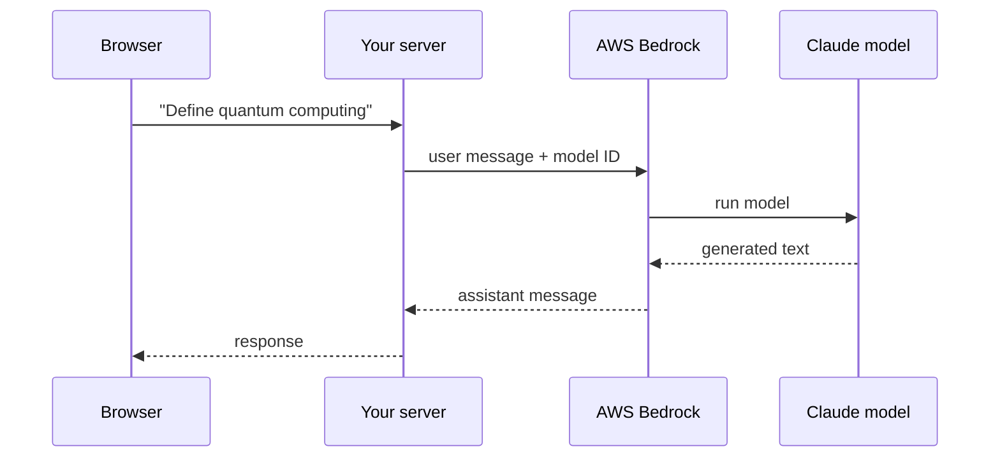
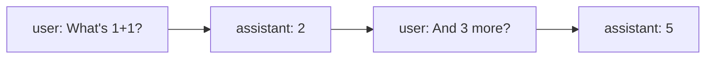
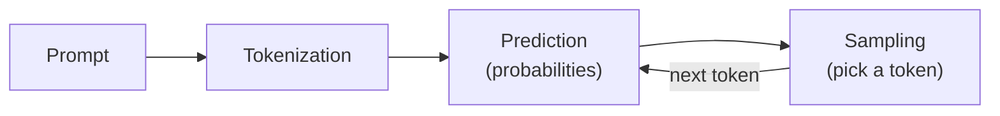
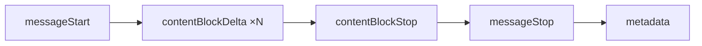

# Module 1 — Working with the API

## Contents

1. [Accessing the API](#1-accessing-the-api)
2. [Making a request](#2-making-a-request)
3. [Multi-turn conversations](#3-multi-turn-conversations)
4. [Chat bot exercise](#4-chat-bot-exercise)
5. [System prompts](#5-system-prompts)
6. [System prompt exercise](#6-system-prompt-exercise)
7. [Temperature](#7-temperature)
8. [Streaming](#8-streaming)
9. [Controlling model output](#9-controlling-model-output)
10. [Structured data](#10-structured-data)
11. [Structured data exercise](#11-structured-data-exercise)
12. [Quiz on working with the API](#12-quiz-on-working-with-the-api)
13. [Common pitfalls](#common-pitfalls)

---

## 1. Accessing the API

### What happens behind a chat app

The user only sees a text box and an answer, but the request goes through your own server.
Example: a user types *"Define quantum computing"* and clicks send.

1. The user submits the message from the web interface.
2. Your **server** receives the request with that text.
3. The server uses the **Bedrock client** to call AWS Bedrock.
4. The request carries the **user message** and a **model ID** (e.g. Claude Haiku or Claude Sonnet).
5. The model processes the request and generates text.
6. Bedrock returns an **assistant message** with the generated response.
7. The server sends that response back to the user's browser.



> The browser never talks to Bedrock directly: credentials and the Bedrock client live on the server.

### Two APIs to call Claude

Both go through the `bedrock-runtime` client:

| | `InvokeModel` | `Converse` |
|---|---|---|
| Body format | Anthropic-native (Messages API + `"anthropic_version": "bedrock-2023-05-31"`) | Unified, same shape for every model |
| Change model without changing code | ❌ | ✅ |
| Streaming | `InvokeModelWithResponseStream` | `ConverseStream` |
| Model-specific features | Full access (raw payload) | Via `additionalModelRequestFields` |

The course uses **`Converse`**.

## 2. Making a request

A first request needs three things:

| Component | What it is |
|---|---|
| Bedrock Runtime client | The boto3 connection to the service |
| Model ID | Which model to run (in practice an inference profile ID) |
| User message | The text you send to the model |

### Client

```python
import boto3

client = boto3.client("bedrock-runtime", region_name="eu-central-1")
```

### Model ID and Regions

Not every model is hosted in every Region. Calling a model from a Region where it isn't available
fails with an error that just says the model doesn't exist, which is confusing.

**Inference profiles** fix this: the profile knows which Regions host the model and AWS routes each
request to one of them, even if your client points to a different Region.

- Find the IDs in the Bedrock console under **Cross-region inference**, not in the model catalog.
- Copy the inference profile ID (e.g. `eu.anthropic.claude-haiku-4-5-20251001-v1:0`) and use it as `modelId`.

### User message

```python
user_message = {
    "role": "user",
    "content": [{"text": "What's 1+1?"}],
}
```

`content` is a **list** because one message can mix several content types (text, images, other
media). That is what makes multimodal requests possible.

### Calling `converse` and reading the answer

```python
response = client.converse(modelId=model_id, messages=[user_message])

text = response["output"]["message"]["content"][0]["text"]
```

The response carries a lot of metadata; the generated text sits at
`output → message → content[0] → text`. Other fields worth checking:

- `response["usage"]` → `inputTokens`, `outputTokens` (cost).
- `response["stopReason"]` → `end_turn` · `max_tokens` (truncated) · `stop_sequence` · `tool_use`.

### Message types

| Role | Content |
|---|---|
| `user` | What you feed into the model |
| `assistant` | What the model produced |

Both have the same shape (`role` + `content` list). The message Bedrock returns is already an
assistant message in that format, so you can append it to the list and keep chaining requests →
see [Multi-turn conversations](#3-multi-turn-conversations).

📓 [001_Api_Requests_complete.ipynb](exercises/001_Api_Requests_complete.ipynb)

## 3. Multi-turn conversations

### Nothing is stored

Neither Bedrock nor Claude keeps any messages: not the ones you send, not the answers you get back.
Every API call is independent. So if you send only *"And 3 more?"*, Claude has no idea it refers to
the earlier *"What's 1+1?"* and gives an answer that doesn't make sense.

To keep context you have to:

1. Keep a **list of every message** (user and assistant) in your own code.
2. Send the **whole list** with each follow-up request.

### Helper functions

```python
def add_user_message(messages, text):
    messages.append({"role": "user", "content": [{"text": text}]})

def add_assistant_message(messages, text):
    messages.append({"role": "assistant", "content": [{"text": text}]})

def chat(messages):
    response = client.converse(modelId=model_id, messages=messages)
    return response["output"]["message"]["content"][0]["text"]
```

### Building the conversation


```python
messages = []

add_user_message(messages, "What's 1+1?")
answer = chat(messages)
add_assistant_message(messages, answer)          # store Claude's reply

add_user_message(messages, "And 3 more added to that?")
answer = chat(messages)                          # full history is sent
print(answer)   # → "...1+1 = 2, adding 3 more: 2 + 3 = 5"
```



### Roles must alternate

The list must follow **user → assistant → user → assistant**. Two `user` or two `assistant`
messages in a row are not allowed by the API.

> Managing the list by hand feels tedious at first, but it's the basis of any app that keeps
> conversational context with Claude.

📓 [001_Api_Requests_complete.ipynb](exercises/001_Api_Requests_complete.ipynb)

## 4. Chat bot exercise

📓 [001_Api_Requests_complete.ipynb](exercises/001_Api_Requests_complete.ipynb)

A `while True` loop that reads user input, adds it to the history, calls `chat()` and appends
the reply as an assistant message. Because the full list is sent every time, the chatbot keeps the
context of the whole conversation.

## 5. System prompts

A system prompt turns a general-purpose assistant into a specialized one that follows your
guidelines and stays on topic.

### Why not put the rules in the user message?

Writing instructions like *"mention AWS services, don't mention competitors"* in every user message
doesn't scale:

- You'd have to foresee every question and edge case.
- The list of rules grows long and repetitive.
- Users see all your internal instructions in the conversation.
- The right rules change depending on the question.

### Give Claude a role instead

Rather than a list of do's and don'ts, tell Claude **who it is**. It then answers the way that
professional would:

- Consistent answers, with the mindset and limits of the role.
- Responses stay focused and on-brand.
- No need to anticipate every scenario.

### Implementation

The system prompt is a separate `system` parameter: a **list of dicts with a `"text"` key**.

```python
system_prompt = """
You are an AWS cloud support specialist. Your job is to answer user queries related
to cloud hosting services on AWS.
"""

response = client.converse(
    modelId=model_id,
    messages=messages,
    system=[{"text": system_prompt}],
)
```

Reusable version with an optional system prompt (no prompt → Claude answers as its default self):

```python
def chat(messages, system=None):
    params = {"modelId": model_id, "messages": messages}
    if system:
        params["system"] = [{"text": system}]
    response = client.converse(**params)
    return response["output"]["message"]["content"][0]["text"]
```

### Effect

| Question | Without system prompt | With *AWS support specialist* |
|---|---|---|
| *"How do I host a Postgres database?"* | Broad answer: several cloud providers and self-hosting | Only AWS options (RDS, Aurora, Postgres on EC2) with AWS setup steps, no competitors |
| *"Give me a bread recipe"* | Gives the recipe | Politely declines and stays in character |

### Technical details

- The system prompt **can't be an empty string**: it needs at least one character (hence the `if system:` check).
- `system` expects a **list** of `{"text": ...}` dicts, not a plain string.
- It is processed **before** any user message.
- Set it per conversation; keep it the same during one conversation.

📓 [002_System_Messages_complete.ipynb](exercises/002_System_Messages_complete.ipynb)

## 6. System prompt exercise

📓 [002_System_Messages_complete.ipynb](exercises/002_System_Messages_complete.ipynb)

Asks for a function that checks a string for duplicate characters, with the system prompt
*"You are a Python engineer who writes very concise code."* The system prompt changes the style of
the answer: short code and little explanation.

## 7. Temperature

Temperature controls how **creative or deterministic** Claude's answers are.

### How Claude generates text

For a prompt like *"What do you think?"*, generation runs in three phases, repeated token by token
until the answer is complete:

1. **Tokenization** — the input is split into small chunks (tokens).
2. **Prediction** — Claude computes a probability for each possible next token (e.g. *"about"* 30%, *"would"* 20%…).
3. **Sampling** — one token is picked according to those probabilities.



### What temperature changes

A value from **0 to 1** that reshapes those probabilities before sampling:

- **Near 0:** the most probable token becomes much more likely → at 0 Claude is deterministic and always picks the top token.
- **Near 1:** probability is spread more evenly → less likely tokens get a real chance → more varied, creative output.

### Which value to use

| Range | Use cases |
|---|---|
| **Low** (0.0 – 0.3) | Factual answers · coding · data extraction · content moderation |
| **Medium** (0.4 – 0.7) | Summarization · educational content · problem-solving · constrained creative writing |
| **High** (0.8 – 1.0) | Brainstorming · creative writing · marketing copy · jokes |

### In code

The **default is 1.0** (maximum creativity). Override it in `inferenceConfig`:

```python
def chat(messages, system=None, temperature=1.0):
    params = {
        "modelId": model_id,
        "messages": messages,
        "inferenceConfig": {"temperature": temperature},
    }
    if system:
        params["system"] = [{"text": system}]
    response = client.converse(**params)
    return response["output"]["message"]["content"][0]["text"]
```

### In practice: movie ideas

Prompt: *"Generate a movie idea in one sentence."*

- **`temperature=1.0`** → a different, more original idea on each run (e.g. an origami master whose paper creations come alive at night).
- **`temperature=0.0`** → nearly the same idea every time, with recurring themes such as a *time-traveling archaeologist*.

> Since the default is 1.0, lower it for tasks that need precision and consistency.

📓 [002_System_Messages_complete.ipynb](exercises/002_System_Messages_complete.ipynb)

## 8. Streaming

Users expect the answer to start appearing right away, not after 10–30 seconds of waiting.
`converse_stream` sends the text **in chunks as soon as they are generated**, so the experience goes
from *"submit and wait"* to *"submit and watch the answer appear"*.

### How it works

`converse_stream` returns immediately with a response containing a `stream`: a **generator** that
yields events while the model writes. Each event carries a small piece of the answer.

```python
messages = []
add_user_message(messages, "Write a 1 sentence description of a fake database")
response = client.converse_stream(messages=messages, modelId=model_id)

for event in response["stream"]:
    print(event)          # see every event as it arrives
```

### Stream events

Always in the same order:

| Event | When | Useful content |
|---|---|---|
| `messageStart` | Start of the answer | `role` (`assistant`) |
| `contentBlockDelta` | Many times | `delta.text` → the next piece of text |
| `contentBlockStop` | End of a content block | — |
| `messageStop` | End of the answer | `stopReason` (`end_turn`, `max_tokens`…) |
| `metadata` | Last event | `usage` (input/output tokens), `metrics.latencyMs` |



For plain text generation, **only `contentBlockDelta` matters**: it holds the text to show.

### Extracting the text

```python
text = ""
for event in response["stream"]:
    if "contentBlockDelta" in event:
        chunk = event["contentBlockDelta"]["delta"]["text"]
        print(chunk, end="")    # end="" → no newline after each chunk
        text += chunk

print("\n\nTotal Message:\n" + text)
```

### In a real app

Instead of printing each chunk you would:

- Send each chunk to the frontend via **WebSockets** or **Server-Sent Events**.
- Update the UI so the answer grows in real time.
- **Store the full message** when the stream ends (and append it to the history if the conversation continues).
- Handle errors that can happen mid-stream.

### Things to remember

- Streaming improves **time-to-first-token** (perceived latency), not total time or cost: same tokens, same price.
- `stopReason` and token usage only arrive at the end, in `messageStop` and `metadata`.
- `InvokeModel` equivalent: `invoke_model_with_response_stream`.

📓 [003_Streaming_complete.ipynb](exercises/003_Streaming_complete.ipynb)

## 9. Controlling model output

Besides writing better prompts, two techniques give precise control over **how Claude starts** and
**where it stops**: prefilled assistant messages and stop sequences.

### Prefilled assistant messages

Add an **assistant message at the end** of the list with the beginning of the answer you want.
Claude sees that it has "already started" answering and **continues from exactly that point**,
without repeating your text.

```python
messages = []
add_user_message(messages, "Is coffee or tea better for breakfast?")
add_assistant_message(messages, "Coffee is better because")

chat(messages)   # → "it has more caffeine."
```

The result is only the continuation, so **join both parts** to get the full answer:
*"Coffee is better because it has more caffeine."*

Change the prefill to steer the answer anywhere:

| Prefill | Effect |
|---|---|
| `"Coffee is better because"` | Argues for coffee |
| `"Tea is better because"` | Argues for tea |
| `"They are the same because"` | Neutral answer |

### Stop sequences

A list of strings: as soon as Claude generates **any** of them, it stops and returns what it has so
far. The stop sequence itself is **not included** in the response (`stopReason = stop_sequence`).

Add them to `inferenceConfig`:

```python
def chat(messages, system=None, temperature=1.0, stop_sequences=[]):
    params = {
        "modelId": model_id,
        "messages": messages,
        "inferenceConfig": {
            "temperature": temperature,
            "stopSequences": stop_sequences,
        },
    }
    if system:
        params["system"] = [{"text": system}]
    response = client.converse(**params)
    return response["output"]["message"]["content"][0]["text"]
```

```python
messages = []
add_user_message(messages, "Count from 1 to 10")

chat(messages, stop_sequences=["5"])           # → "1, 2, 3, 4, "
chat(messages, stop_sequences=["5", "3, 4"])   # stops at whichever appears first
```

Useful for:

- Limiting the length of the answer.
- Stopping at natural breakpoints in structured output.
- Not letting Claude continue past a marker or delimiter.

> Combined, these two techniques shape answers in ways prompting alone can't — see
> [Structured data](#10-structured-data).

📓 [004_Controlling_Output_complete.ipynb](exercises/004_Controlling_Output_complete.ipynb)

## 10. Structured data

To get clean JSON or code with no explanation around it, combine both techniques:
prefill `` ```json `` and stop at `` ``` ``.

```python
messages = [
    {"role": "user", "content": [{"text": "Generate 3 AWS CLI commands as JSON"}]},
    {"role": "assistant", "content": [{"text": "```json"}]},   # prefill
]
response = client.converse(
    modelId=model_id, messages=messages,
    inferenceConfig={"stopSequences": ["```"]},
)
```

## 11. Structured data exercise

_Pending._

## 12. Quiz on working with the API

_Pending._

---

## Common pitfalls

- Forgetting to append the assistant reply to the history → the model "forgets" the conversation.
- `stopReason = max_tokens` → truncated answer. Raise `maxTokens` or shorten the request; temperature has nothing to do with it.
- Streaming improves time-to-first-token, not total cost.
- Prefill is not supported by every model/mode (e.g. not with extended thinking) → check before relying on it.

---

[← Back to README](README.md)
