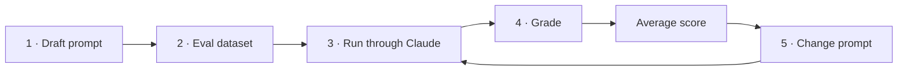

# Module 2 — Prompt evaluations

## Contents

- [Module 2 — Prompt evaluations](#module-2--prompt-evaluations)
  - [Contents](#contents)
  - [1. Prompt evaluation](#1-prompt-evaluation)
    - [Three paths after writing a prompt](#three-paths-after-writing-a-prompt)
    - [The testing trap](#the-testing-trap)
  - [2. A typical eval workflow](#2-a-typical-eval-workflow)
    - [Step 1 · Draft the prompt](#step-1--draft-the-prompt)
    - [Step 2 · Create an evaluation dataset](#step-2--create-an-evaluation-dataset)
    - [Step 3 · Run through Claude](#step-3--run-through-claude)
    - [Step 4 · Grade](#step-4--grade)
    - [Step 5 · Change the prompt and repeat](#step-5--change-the-prompt-and-repeat)
    - [Comparing versions](#comparing-versions)
  - [3. Generating test datasets](#3-generating-test-datasets)
  - [4. Running the eval](#4-running-the-eval)
  - [5. Model based grading](#5-model-based-grading)
  - [6. Code based grading](#6-code-based-grading)
  - [7. Exercise on prompt evals](#7-exercise-on-prompt-evals)
  - [8. Quiz on prompt evaluations](#8-quiz-on-prompt-evaluations)
  - [Common pitfalls](#common-pitfalls)

---

## 1. Prompt evaluation

Writing a prompt is only the start. Reliable apps need two things:

| | Prompt engineering | Prompt evaluation |
|---|---|---|
| What | Techniques to **write and improve** prompts | Automated testing to **measure** how well prompts work |
| Examples | Multishot prompting, XML tags… (Module 3) | Test against expected answers · compare prompt versions · review outputs for errors |
| Answers | *"How do I make it better?"* | *"Is it actually better?"* |

### Three paths after writing a prompt

| Option | What you do | Risk |
|---|---|---|
| 1 | Test it once, call it good | ❌ High: breaks in production with unexpected inputs |
| 2 | Test a few times, patch one or two corner cases | ⚠️ Still high: real users send inputs you never thought of |
| 3 | Run it through an **eval pipeline**, score it, iterate on the data | ✅ More work and cost upfront, but real confidence |

### The testing trap

Options 1 and 2 are traps almost every engineer falls into: we test with inputs that look obvious
to us, but users interact with prompts in ways we don't anticipate.

**Option 3** gives objective scores across many scenarios, so you can iterate with confidence and
catch problems before production.

> Learn evaluation first: once you can measure a prompt, you can try prompt-engineering techniques
> and know which ones actually help. **Measure before improving.**

## 2. A typical eval workflow


There are many ways and tools (open source and paid) to build an eval pipeline, but they all share
the same core loop. Start small and scale up as needed.



### Step 1 · Draft the prompt

A simple baseline. You don't know if it's good until you measure it:

```python
prompt = f"""
Please answer the user's question:

{question}
"""
```

### Step 2 · Create an evaluation dataset

Sample inputs to feed into the prompt. This prompt has one input (`question`), so the dataset is a
list of questions. Write them by hand or **generate them with Claude**; real evals have tens to
thousands of records. Example with three:

- *What's 2+2?*
- *How do I make oatmeal?*
- *How far away is the Moon?*

### Step 3 · Run through Claude

Merge each record into the prompt template and send each complete prompt to Claude. Collect the
responses (*"2 + 2 = 4"*, oatmeal instructions, the Moon's distance…).

### Step 4 · Grade

Feed each **question + answer** pair into a grader that scores the response, typically 1–10:

| Score | Meaning |
|---|---|
| 10 | Perfect, nothing to improve |
| 4 | Clearly room for improvement |
| 1 | Poor or wrong |

Example: scores 10, 4 and 9 → **average ≈ 7.67**. That average is the prompt's overall metric.

### Step 5 · Change the prompt and repeat

Change the prompt and run the **whole pipeline again** with the same dataset:

```python
prompt = f"""
Please answer the user's question:

{question}

Answer the question with ample detail
"""
```

### Comparing versions

| Version | Change | Score |
|---|---|---|
| v1 | Baseline | 7.66 |
| v2 | + *"Answer the question with ample detail"* | **8.7** |

v2 scores higher, so the extra instruction helped across the test cases. Keep the best version or
keep iterating.

> The value of the workflow is an **objective number per prompt version** instead of a gut feeling.
> Start simple and add more sophisticated grading criteria as you need them.

## 3. Generating test datasets

_Pending._

## 4. Running the eval

_Pending._

## 5. Model based grading

_Pending._

## 6. Code based grading

_Pending._

## 7. Exercise on prompt evals

_Pending._

## 8. Quiz on prompt evaluations

_Pending._

---

## Common pitfalls

- Changing the prompt without a baseline → you can't tell if it improved.
- Grader prompts that only return a number → ask for reasoning first, then the score; otherwise scores cluster around the middle.
- Dataset too easy / too homogeneous → include edge cases on purpose.
- Model-based graders have their own bias → combine with code checks and spot-check manually.
- Managed alternative on AWS: **Bedrock Evaluations** (LLM-as-a-judge and human evaluation jobs).

---

[← Back to README](README.md)
