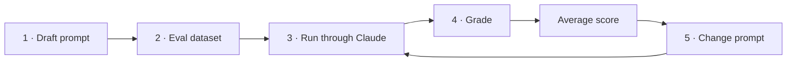
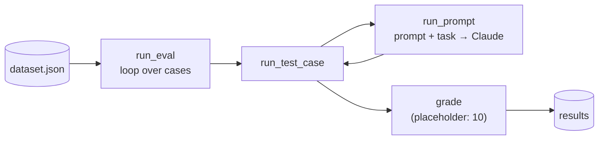

# Module 2 — Prompt evaluations

## Contents

- [Module 2 — Prompt evaluations](#module-2--prompt-evaluations)
  - [Contents](#contents)
  - [1. Prompt evaluation](#1-prompt-evaluation)
    - [Three paths after writing a prompt](#three-paths-after-writing-a-prompt)
    - [The testing trap](#the-testing-trap)
  - [2. A typical eval workflow](#2-a-typical-eval-workflow)
    - [Step 1 · Draft the prompt](#step-1--draft-the-prompt)
    - [Step 2 · Create an evaluation dataset](#step-2--create-an-evaluation-dataset)
    - [Step 3 · Run through Claude](#step-3--run-through-claude)
    - [Step 4 · Grade](#step-4--grade)
    - [Step 5 · Change the prompt and repeat](#step-5--change-the-prompt-and-repeat)
    - [Comparing versions](#comparing-versions)
  - [3. Generating test datasets](#3-generating-test-datasets)
    - [The goal](#the-goal)
    - [Evaluation dataset](#evaluation-dataset)
    - [Generating it with code](#generating-it-with-code)
    - [Saving the dataset](#saving-the-dataset)
  - [4. Running the eval](#4-running-the-eval)
    - [Three functions, one job each](#three-functions-one-job-each)
    - [function: `run_prompt`](#function-run_prompt)
    - [function: `run_test_case`](#function-run_test_case)
    - [function: `run_eval`](#function-run_eval)
    - [Running it](#running-it)
    - [Where we are](#where-we-are)
  - [5. Model based grading](#5-model-based-grading)
    - [Types of graders](#types-of-graders)
    - [Define the criteria first](#define-the-criteria-first)
    - [Implementing a model grader](#implementing-a-model-grader)
    - [Plugging it into the pipeline](#plugging-it-into-the-pipeline)
    - [Average score](#average-score)
  - [6. Code based grading](#6-code-based-grading)
    - [What it checks](#what-it-checks)
    - [Validation functions](#validation-functions)
    - [Add the format to the dataset](#add-the-format-to-the-dataset)
    - [Improve the prompt for the code grader](#improve-the-prompt-for-the-code-grader)
    - [Combining the scores](#combining-the-scores)
    - [Reading the results](#reading-the-results)
  - [Common pitfalls](#common-pitfalls)

---

## 1. Prompt evaluation

Writing a prompt is only the start. Reliable apps need two things:

| | Prompt engineering | Prompt evaluation |
|---|---|---|
| What | Techniques to **write and improve** prompts | Automated testing to **measure** how well prompts work |
| Examples | Multishot prompting, XML tags… (Module 3) | Test against expected answers · compare prompt versions · review outputs for errors |
| Answers | *"How do I make it better?"* | *"Is it actually better?"* |

### Three paths after writing a prompt

| Option | What you do | Risk |
|---|---|---|
| 1 | Test it once, call it good | ❌ High: breaks in production with unexpected inputs |
| 2 | Test a few times, patch one or two corner cases | ⚠️ Still high: real users send inputs you never thought of |
| 3 | Run it through an **eval pipeline**, score it, iterate on the data | ✅ More work and cost upfront, but real confidence |

### The testing trap

Options 1 and 2 are traps almost every engineer falls into: we test with inputs that look obvious
to us, but users interact with prompts in ways we don't anticipate.

**Option 3** gives objective scores across many scenarios, so you can iterate with confidence and
catch problems before production.

> Learn evaluation first: once you can measure a prompt, you can try prompt-engineering techniques
> and know which ones actually help. **Measure before improving.**

## 2. A typical eval workflow


There are many ways and tools (open source and paid) to build an eval pipeline, but they all share
the same core loop. Start small and scale up as needed.



### Step 1 · Draft the prompt

A simple baseline. You don't know if it's good until you measure it:

```python
prompt = f"""
Please answer the user's question:

{question}
"""
```

### Step 2 · Create an evaluation dataset

Sample inputs to feed into the prompt. This prompt has one input (`question`), so the dataset is a
list of questions. Write them by hand or **generate them with Claude**; real evals have tens to
thousands of records. Example with three:

- *What's 2+2?*
- *How do I make oatmeal?*
- *How far away is the Moon?*

### Step 3 · Run through Claude

Merge each record into the prompt template and send each complete prompt to Claude. Collect the
responses (*"2 + 2 = 4"*, oatmeal instructions, the Moon's distance…).

### Step 4 · Grade

Feed each **question + answer** pair into a grader that scores the response, typically 1–10:

| Score | Meaning |
|---|---|
| 10 | Perfect, nothing to improve |
| 4 | Clearly room for improvement |
| 1 | Poor or wrong |

Example: scores 10, 4 and 9 → **average ≈ 7.67**. That average is the prompt's overall metric.

### Step 5 · Change the prompt and repeat

Change the prompt and run the **whole pipeline again** with the same dataset:

```python
prompt = f"""
Please answer the user's question:

{question}

Answer the question with ample detail
"""
```

### Comparing versions

| Version | Change | Score |
|---|---|---|
| v1 | Baseline | 7.66 |
| v2 | + *"Answer the question with ample detail"* | **8.7** |

v2 scores higher, so the extra instruction helped across the test cases. Keep the best version or
keep iterating.

> The value of the workflow is an **objective number per prompt version** instead of a gut feeling.
> Start simple and add more sophisticated grading criteria as you need them.

## 3. Generating test datasets

From here on the module builds a **custom eval pipeline** for one concrete prompt.

### The goal

A prompt that helps users write **AWS-specific code**. Given a task description, it returns one of:

- Python code
- JSON configuration
- A regular expression

**Requirement:** only the code, with no headers, footers or explanations.

First version, kept simple on purpose:

```python
prompt = f"Please provide a solution to the following task: {task}"
```

### Evaluation dataset

Input examples that are merged one by one into the prompt and sent to Claude, to see how the prompt
behaves across different scenarios. Two ways to build it:

- **By hand.**
- **Generated with Claude** → use a fast, cheap model like **Haiku**, since you generate many cases.

### Generating it with code

```python
import json

def generate_dataset():
    prompt = """
    Generate 3 AWS-related tasks that require Python, JSON, or Regex solutions.

    Focus on tasks that can be solved by writing a single Python function,
    a single JSON object, or tasks that do not require writing much code.

    Example output:
    [
        {
            "task": "Description of task"
        },
        ...additional
    ]

    Please generate 3 objects.
    """

    messages = []
    add_user_message(messages, prompt)
    add_assistant_message(messages, "```json")
    text = chat(messages, stop_sequences=["```"])
    return json.loads(text)
```

It reuses the **prefill + stop sequence** technique from
[Module 1 › Structured data](module-1-working-with-the-api.md#10-structured-data) to get clean JSON.

### Saving the dataset

Save it once so you don't regenerate it (and pay for it) on every run:

```python
dataset = generate_dataset()
with open("dataset.json", "w") as f:
    json.dump(dataset, f, indent=2)
```

Example of generated tasks:

- Extract the account ID from an ARN (Python).
- Write a JSON schema for an EC2 configuration (JSON).
- Regex that validates S3 bucket names (Regex).

> Three cases are enough while building the pipeline; a real evaluation needs many more, with more
> variety and edge cases.

📓 [001_Prompt_Evals_complete.ipynb](exercises/module_2/001_Prompt_Evals_complete.ipynb) · 🗂️ [dataset.json](exercises/module_2/dataset.json)

## 4. Running the eval

With the dataset ready, the core pipeline takes each test case, merges it with the prompt, sends it
to Claude and grades the output.



### Three functions, one job each

| Function | Responsibility |
|---|---|
| `run_prompt(test_case)` | Merge the test case into the prompt template, call Claude, return the output |
| `run_test_case(test_case)` | Call `run_prompt`, grade the output, return a result dict |
| `run_eval(dataset)` | Loop over the dataset and collect every result |

### function: `run_prompt`

```python
def run_prompt(test_case):
    """Merges the prompt and test case input, then returns the result"""
    prompt = f"""
Please solve the following task:

{test_case["task"]}
"""
    messages = []
    add_user_message(messages, prompt)
    output = chat(messages)
    return output
```

Deliberately simple: **no formatting instructions**, so Claude's answers will be more verbose than
needed. That gets fixed later by iterating on the prompt.

### function: `run_test_case`

```python
def run_test_case(test_case):
    """Calls run_prompt, then grades the result"""
    output = run_prompt(test_case)

    # TODO - Grading
    score = 10

    return {
        "output": output,
        "test_case": test_case,
        "score": score,
    }
```

The score is **hard-coded to 10** for now, just to test the pipeline end to end. Real grading comes in
the next lessons.

### function: `run_eval`

```python
def run_eval(dataset):
    """Loads the dataset and calls run_test_case with each case"""
    results = []
    for test_case in dataset:
        result = run_test_case(test_case)
        results.append(result)
    return results
```

### Running it

```python
with open("dataset.json", "r") as f:
    dataset = json.load(f)

results = run_eval(dataset)
print(json.dumps(results, indent=2))
```

- It's **slow**: even with Haiku, a full dataset can take 30+ seconds (calls run one after another). Optimization comes later.
- `results` is a list with one object per test case: Claude's `output` (quite verbose at this stage), the original `test_case` and the `score`.

### Where we are

- ✅ Read test cases from the dataset
- ✅ Merge them with the prompt template
- ✅ Get Claude's responses
- ✅ Collect and organize the results
- ❌ **Real grading**: every answer still gets a fixed 10

> This orchestration is the backbone of most eval systems. The hard parts are the **grading logic**
> and **prompt optimization**, not the loop.

📓 [001_Prompt_Evals_complete.ipynb](exercises/module_2/001_Prompt_Evals_complete.ipynb)

## 5. Model based grading

A **grader** takes the model's output and returns a measurable signal, usually a score from 1 (poor)
to 10 (excellent).

### Types of graders

| Grader | How | Good for |
|---|---|---|
| **Code** | Your own programmatic checks | Output length · required/forbidden words · syntax of JSON/Python/regex · readability scores |
| **Model** | An extra API call where a model evaluates the output | Response quality · instruction following · completeness · helpfulness · safety |
| **Human** | People review and score by hand | Overall quality · depth · conciseness · relevance — most flexible, but slow and tedious |

A code grader just has to return some measurable value; a model grader is the most flexible automated option.

### Define the criteria first

Before writing any grader, decide what "good" means. For the AWS code prompt:

| Criterion | Meaning | Best grader |
|---|---|---|
| **Format** | Only Python, JSON or regex, no explanation | Code |
| **Valid syntax** | The code parses | Code |
| **Task following** | Directly solves the task with correct code | Model |

### Implementing a model grader

```python
def grade_by_model(test_case, output):
    eval_prompt = f"""
You are an expert code reviewer. Evaluate this AI-generated solution.

<task>
{test_case["task"]}
</task>

<solution>
{output}
</solution>

Provide your evaluation as a structured JSON object with:
- "strengths": An array of 1-3 key strengths
- "weaknesses": An array of 1-3 key areas for improvement
- "reasoning": A concise explanation of your assessment
- "score": A number between 1-10
"""
    messages = []
    add_user_message(messages, eval_prompt)
    add_assistant_message(messages, "```json")
    eval_text = chat(messages, stop_sequences=["```"])
    return json.loads(eval_text)
```

> **Key idea:** ask for **strengths, weaknesses and reasoning before the score**. With only a number,
> models tend to give middling scores (around 6).

⚠️ The lesson's snippet uses a plain string with `{task}` / `{solution}`, so nothing gets filled in.
It must be an **f-string** (as above and in the notebook).

### Plugging it into the pipeline

```python
def run_test_case(test_case):
    output = run_prompt(test_case)

    model_grade = grade_by_model(test_case, output)

    return {
        "output": output,
        "test_case": test_case,
        "score": model_grade["score"],
        "reasoning": model_grade["reasoning"],
    }
```

### Average score

```python
from statistics import mean

def run_eval(dataset):
    results = [run_test_case(tc) for tc in dataset]
    average_score = mean(r["score"] for r in results)
    print(f"Average score: {average_score}")
    return results
```

The average is the single number you track across prompt versions. Model graders can be a bit
inconsistent, but they're a solid starting point.

📓 [001_Prompt_Evals_complete.ipynb](exercises/module_2/001_Prompt_Evals_complete.ipynb) — the final
version also passes `solution_criteria` to the grader and averages the model score with a syntax score
(see [Code based grading](#6-code-based-grading)).

## 6. Code based grading

Adds a second, deterministic check to the eval: does the output have the **right format** and
**valid syntax**? Very useful when the prompt generates code, JSON or regex.

### What it checks

| Criterion | Question |
|---|---|
| **Format** | Does the output contain only the requested format (Python, JSON or regex), with no explanation? |
| **Valid syntax** | Can it actually be parsed / compiled? |

Scoring is binary: **parses → 10**, **error → 0**.

### Validation functions

One per format, using Python's built-in parsers:

```python
import ast
import json
import re

def validate_json(text):
    try:
        json.loads(text.strip())
        return 10
    except json.JSONDecodeError:
        return 0

def validate_python(text):
    try:
        ast.parse(text.strip())      # builds the syntax tree, doesn't run the code
        return 10
    except SyntaxError:
        return 0

def validate_regex(text):
    try:
        re.compile(text.strip())
        return 10
    except re.error:
        return 0

def grade_syntax(response, test_case):
    fmt = test_case["format"]
    if fmt == "json":
        return validate_json(response)
    elif fmt == "python":
        return validate_python(response)
    else:
        return validate_regex(response)
```

| Format | Parser |
|---|---|
| JSON | `json.loads()` |
| Python | `ast.parse()` |
| Regex | `re.compile()` |

### Add the format to the dataset

The grader must know which validator to use, so each test case gets a `format` field. Update the
dataset generation prompt (section 3) to produce it:

```json
{
  "task": "Description of task",
  "format": "python",
  "solution_criteria": "Key criteria for evaluating the solution"
}
```

`format` is `"json"`, `"python"` or `"regex"`. The notebook also adds `solution_criteria`, which is
passed to the model grader.

### Improve the prompt for the code grader

Tell Claude explicitly to return only code:

```python
prompt = f"""
Please solve the following task:

{test_case["task"]}

* Respond only with Python, JSON, or a plain Regex
* Do not add any comments or commentary or explanation
"""
```

And reuse prefill + stop sequence so no markdown fence or text gets in:

```python
add_assistant_message(messages, "```code")
output = chat(messages, stop_sequences=["```"])
```

### Combining the scores

```python
def run_test_case(test_case):
    output = run_prompt(test_case)

    model_grade = grade_by_model(test_case, output)
    model_score = model_grade["score"]
    syntax_score = grade_syntax(output, test_case)

    score = (model_score + syntax_score) / 2      # equal weight

    return {
        "output": output,
        "test_case": test_case,
        "score": score,
        "reasoning": model_grade["reasoning"],
    }
```

| Score | Measures |
|---|---|
| Model grader | Content quality, task following |
| Code grader | Technical correctness (format + syntax) |

Equal weight is the simple default; change the weights if one matters more for your use case.

### Reading the results

The combined score covers both **semantic quality** and **technical correctness**. A single score on
its own says little: its value is as a **baseline** to compare against as you change the prompt.

📓 [001_Prompt_Evals_complete.ipynb](exercises/module_2/001_Prompt_Evals_complete.ipynb) · 🗂️ [dataset.json](exercises/module_2/dataset.json)

---

## Common pitfalls

- Changing the prompt without a baseline → you can't tell if it improved.
- Grader prompts that only return a number → ask for reasoning first, then the score; otherwise scores cluster around the middle.
- Dataset too easy / too homogeneous → include edge cases on purpose.
- Model-based graders have their own bias → combine with code checks and spot-check manually.
- Managed alternative on AWS: **Bedrock Evaluations** (LLM-as-a-judge and human evaluation jobs).

---

[← Back to README](README.md)
