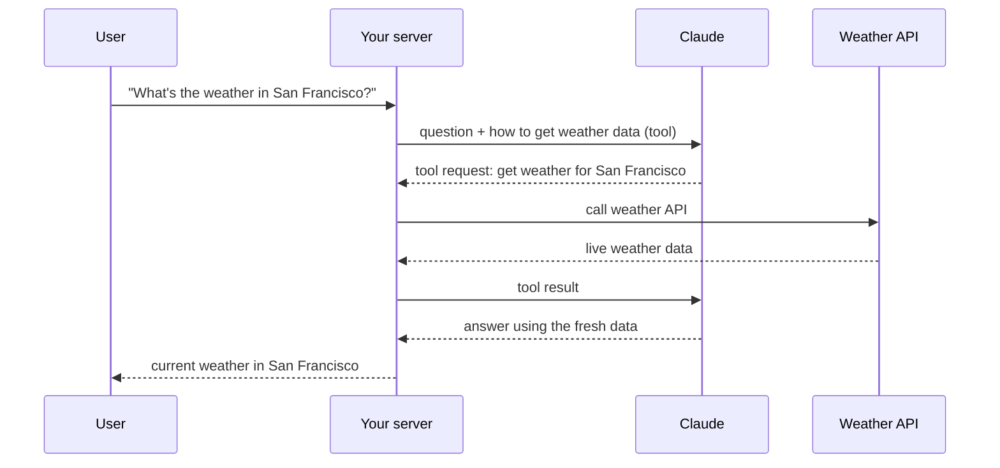

# Module 4 — Tool use

## Contents

- [Module 4 — Tool use](#module-4--tool-use)
  - [Contents](#contents)
  - [1. Introducing tool use](#1-introducing-tool-use)
    - [How tool use works](#how-tool-use-works)
    - [Weather example](#weather-example)
    - [Why it feels confusing at first](#why-it-feels-confusing-at-first)
  - [2. Tool functions](#2-tool-functions)
  - [3. JSON Schema for tools](#3-json-schema-for-tools)
  - [4. Handling tool use responses](#4-handling-tool-use-responses)
  - [5. Running tool functions](#5-running-tool-functions)
  - [6. Sending tool results](#6-sending-tool-results)
  - [7. Multi-Turn conversations with tools](#7-multi-turn-conversations-with-tools)
  - [8. Adding multiple tools](#8-adding-multiple-tools)
  - [9. Batch tool use](#9-batch-tool-use)
  - [10. Structured data with tools](#10-structured-data-with-tools)
  - [11. Flexible tool extraction](#11-flexible-tool-extraction)
  - [12. The text editor tool](#12-the-text-editor-tool)
  - [Common pitfalls](#common-pitfalls)

---

## 1. Introducing tool use

By default Claude only knows what it was trained on, so it can't give current information (today's
weather, recent news…). Ask *"What's the weather in San Francisco, California?"* and it answers that it
has no access to up-to-date weather data.

**Tools** fix this: they're a bridge between Claude and external data sources or actions.
**Claude never runs a tool itself**: it asks for it, your code runs it and sends back the result.

### How tool use works

1. **Initial request** — you send the question plus instructions on how to get extra data (the tool definitions).
2. **Tool request** — Claude decides it needs external data and asks for it (`stopReason = tool_use`).
3. **Data retrieval** — your server runs the code that fetches the data.
4. **Final response** — you send the data back and Claude answers using it.

### Weather example

### Why it feels confusing at first

The code isn't written in the same order the flow runs. Typically you:

1. Write the **tool function** (the code that fetches the data).
2. Write its **JSON Schema** spec (so Claude knows how to call it).
3. Handle the **ToolUse** and **ToolResult** parts of the conversation.
4. **Include the schema** in the request.

> Each step of the flow needs its own piece of code, built in a different order than it runs. The next
> lessons build them one at a time: keep the diagram above in mind to know which piece you're on.

## 2. Tool functions

_Pending._

## 3. JSON Schema for tools

_Pending._

## 4. Handling tool use responses

_Pending._

## 5. Running tool functions

_Pending._

## 6. Sending tool results

_Pending._

## 7. Multi-Turn conversations with tools

_Pending._

## 8. Adding multiple tools

_Pending._

## 9. Batch tool use

_Pending._

## 10. Structured data with tools

_Pending._

## 11. Flexible tool extraction

_Pending._

## 12. The text editor tool

_Pending._

---

## Common pitfalls

- Returning only some of the `toolResult` blocks when the model asked for several → every `toolUseId` needs a result.
- Raising exceptions instead of returning `status: "error"` → the model can't recover or retry.
- Unbounded loop → add a max number of iterations.
- "Batch tool use" (several calls in one turn) ≠ **Bedrock batch inference** (async jobs over S3).
- Managed alternative on AWS: **Bedrock Agents** action groups backed by **Lambda**.

---

[← Back to README](README.md)
