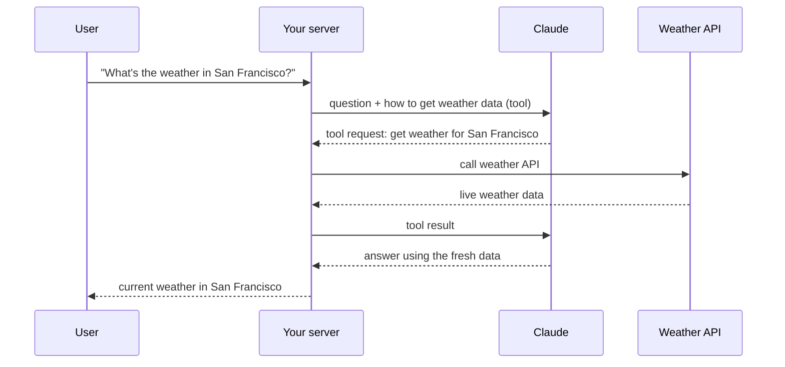
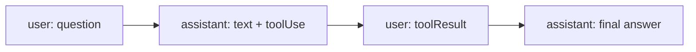
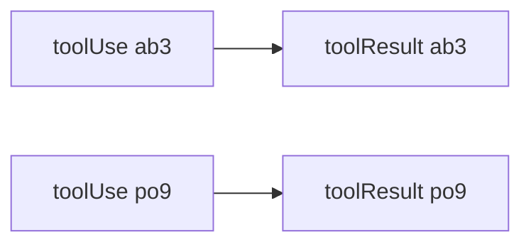
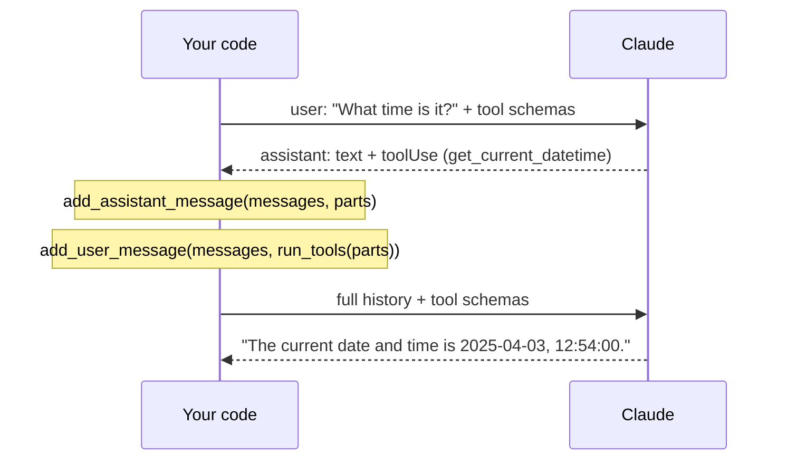
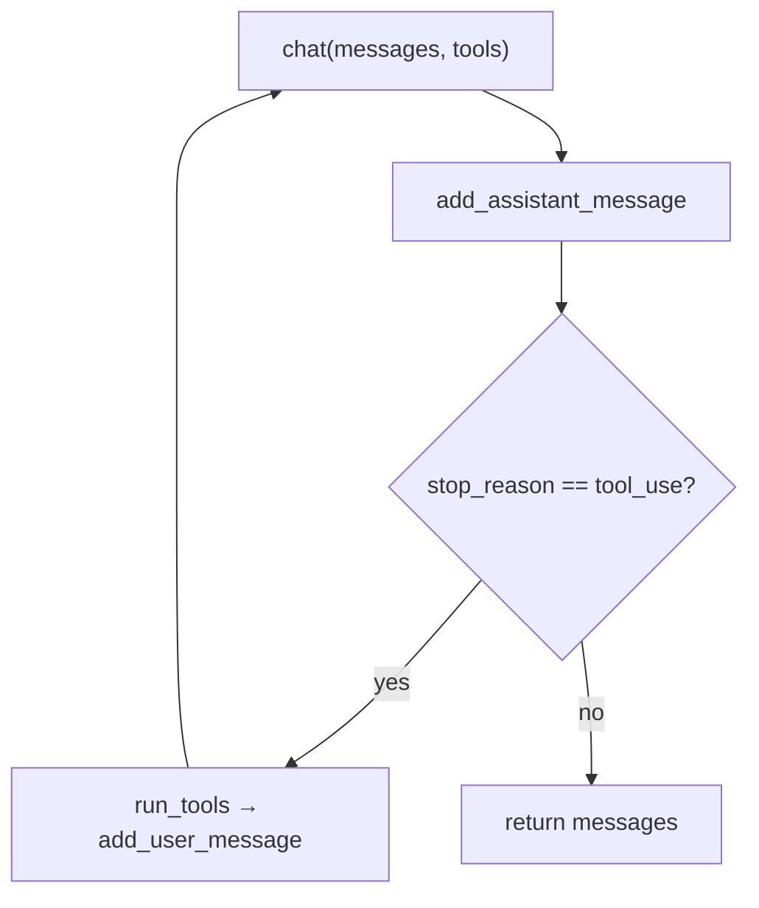
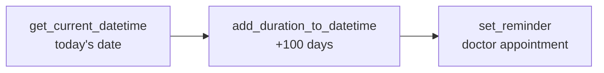
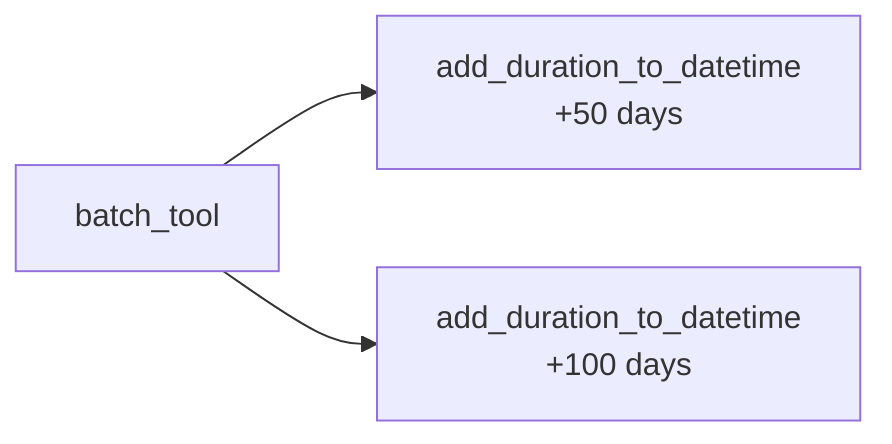
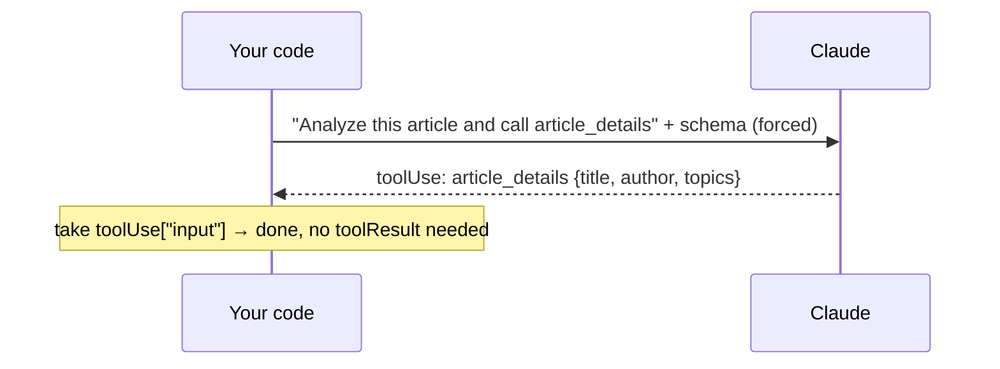

# Module 4 — Tool use

## Contents

- [Module 4 — Tool use](#module-4--tool-use)
  - [Contents](#contents)
  - [1. Introducing tool use](#1-introducing-tool-use)
    - [How tool use works](#how-tool-use-works)
    - [Weather example](#weather-example)
    - [Why it feels confusing at first](#why-it-feels-confusing-at-first)
  - [2. Tool functions](#2-tool-functions)
    - [Why it's hard for Claude alone](#why-its-hard-for-claude-alone)
    - [The three tools](#the-three-tools)
    - [Where tool functions fit](#where-tool-functions-fit)
    - [Writing tool functions](#writing-tool-functions)
    - [First tool: current date and time](#first-tool-current-date-and-time)
    - [JSON Schema spec (preview)](#json-schema-spec-preview)
  - [3. JSON Schema for tools](#3-json-schema-for-tools)
    - [Two parts](#two-parts)
    - [Creating a schema in 4 steps](#creating-a-schema-in-4-steps)
    - [Writing good descriptions](#writing-good-descriptions)
    - [Final shape (Converse `toolSpec`)](#final-shape-converse-toolspec)
  - [4. Handling tool use responses](#4-handling-tool-use-responses)
    - [`toolChoice`: when Claude uses tools](#toolchoice-when-claude-uses-tools)
    - [Multi-part assistant message](#multi-part-assistant-message)
    - [The `toolUse` part](#the-tooluse-part)
    - [Conversation flow with tools](#conversation-flow-with-tools)
    - [Updated helper functions](#updated-helper-functions)
    - [Check the stop reason](#check-the-stop-reason)
  - [5. Running tool functions](#5-running-tool-functions)
    - [Handle several tool requests](#handle-several-tool-requests)
    - [Extracting the `toolUse` parts](#extracting-the-tooluse-parts)
    - [Running the right tool](#running-the-right-tool)
    - [`toolResult` parts](#toolresult-parts)
    - [Why the IDs matter](#why-the-ids-matter)
    - [Error handling](#error-handling)
    - [Complete `run_tools`](#complete-run_tools)
  - [6. Sending tool results](#6-sending-tool-results)
    - [1 · Add Claude's tool request to the history](#1--add-claudes-tool-request-to-the-history)
    - [2 · Run the tools and add the results](#2--run-the-tools-and-add-the-results)
    - [3 · Final call to Claude](#3--final-call-to-claude)
    - [Full sequence](#full-sequence)
    - [Result](#result)
  - [7. Multi-Turn conversations with tools](#7-multi-turn-conversations-with-tools)
    - [The problem](#the-problem)
    - [Stop reasons](#stop-reasons)
    - [`chat` returns a dict](#chat-returns-a-dict)
    - [The conversation loop](#the-conversation-loop)
    - [Testing it](#testing-it)
  - [8. Adding multiple tools](#8-adding-multiple-tools)
    - [The new functions](#the-new-functions)
    - [Step 1 · Add the schemas to the request](#step-1--add-the-schemas-to-the-request)
    - [Step 2 · Route the new names in `run_tool`](#step-2--route-the-new-names-in-run_tool)
    - [Testing a multi-step request](#testing-a-multi-step-request)
  - [9. Batch tool use](#9-batch-tool-use)
    - [The problem](#the-problem-1)
    - [The idea](#the-idea)
    - [Schema (Converse format)](#schema-converse-format)
    - [`run_batch`](#run_batch)
    - [Routing it in `run_tool`](#routing-it-in-run_tool)
    - [Result](#result-1)
  - [10. Structured data with tools](#10-structured-data-with-tools)
    - [How it works](#how-it-works)
    - [Forcing the tool](#forcing-the-tool)
    - [Example: article details](#example-article-details)
    - [Benefits and trade-off](#benefits-and-trade-off)
  - [11. Flexible tool extraction](#11-flexible-tool-extraction)
    - [The flexible schema](#the-flexible-schema)
    - [How it works](#how-it-works-1)
    - [The prompt](#the-prompt)
    - [Changing the structure is trivial](#changing-the-structure-is-trivial)
    - [Dedicated schema vs flexible `to_json`](#dedicated-schema-vs-flexible-to_json)
  - [12. The text editor tool](#12-the-text-editor-tool)
    - [What it can do](#what-it-can-do)
    - [Custom tool vs text editor tool](#custom-tool-vs-text-editor-tool)
    - [Setting it up](#setting-it-up)
    - [Commands](#commands)
    - [Example: analyzing a file](#example-analyzing-a-file)
    - [Practical uses](#practical-uses)
  - [Common pitfalls](#common-pitfalls)

---

## 1. Introducing tool use

By default Claude only knows what it was trained on, so it can't give current information (today's
weather, recent news…). Ask *"What's the weather in San Francisco, California?"* and it answers that it
has no access to up-to-date weather data.

**Tools** fix this: they're a bridge between Claude and external data sources or actions.
**Claude never runs a tool itself**: it asks for it, your code runs it and sends back the result.

### How tool use works

1. **Initial request** — you send the question plus instructions on how to get extra data (the tool definitions).
2. **Tool request** — Claude decides it needs external data and asks for it (`stopReason = tool_use`).
3. **Data retrieval** — your server runs the code that fetches the data.
4. **Final response** — you send the data back and Claude answers using it.

### Weather example



### Why it feels confusing at first

The code isn't written in the same order the flow runs. Typically you:

1. Write the **tool function** (the code that fetches the data).
2. Write its **JSON Schema** spec (so Claude knows how to call it).
3. Handle the **ToolUse** and **ToolResult** parts of the conversation.
4. **Include the schema** in the request.

> Each step of the flow needs its own piece of code, built in a different order than it runs. The next
> lessons build them one at a time: keep the diagram above in mind to know which piece you're on.

## 2. Tool functions

Running example for the module: letting Claude **set reminders for future dates**.

### Why it's hard for Claude alone

- It may know today's date, but **not the exact time**.
- It doesn't always do **date arithmetic** well, especially many days ahead.
- It has **no way to actually set a reminder**.

### The three tools

| Tool | Why |
|---|---|
| `get_current_datetime` | Claude needs the current date and time |
| `add_duration_to_datetime` | Claude isn't reliable at date/time addition |
| `set_reminder` | Claude has no way to set a reminder |

### Where tool functions fit

Write the function → write its JSON Schema → call Claude with the schema → run the tool when Claude
asks for it → send the result back to Claude.

### Writing tool functions

A tool function is a **plain Python function** that runs when Claude decides it needs extra
information. Best practices:

- **Well-named, descriptive arguments** (it matters later, for the schema).
- **Validate the inputs** and raise an error if they're invalid.
- **Return meaningful errors**: if a call fails, Claude will try again, so the error message should help it fix the call.

### First tool: current date and time

```python
from datetime import datetime, timedelta

def get_current_datetime(date_format="%Y-%m-%d %H:%M:%S"):
    return datetime.now().strftime(date_format)
```

Descriptive name, a well-named parameter with a sensible default, and it returns exactly what it promises.

### JSON Schema spec (preview)

Each function also needs a **JSON Schema** describing it to Claude: what arguments it takes, and when and
how to use it. JSON Schema isn't an LLM-only concept (it's widely used for data validation) and there
are online tools to generate schemas.

- Explain **what the tool does, when to use it and what it returns**.
- Aim for **3–4 sentences** in the description.
- Give **detailed descriptions for each parameter**.

More in [JSON Schema for tools](#3-json-schema-for-tools).

📓 [001_tools.ipynb](exercises/module_4/001_tools.ipynb) · 📓 [002_tools_complete.ipynb](exercises/module_4/002_tools_complete.ipynb)

## 3. JSON Schema for tools

Each tool function needs a **JSON Schema** that tells Claude what arguments it expects and how to use
it. It looks intimidating at first, but it's mechanical once you know the steps.

### Two parts

JSON Schema is a long-standing standard for **data validation**, not something made up for AI. A tool
spec has:

| Part | Purpose |
|---|---|
| `name` + `description` (top) | Help Claude decide **when** to use the tool |
| `inputSchema` (bottom) | Describes the function's **arguments** in detail |

### Creating a schema in 4 steps

1. **Dictionary with sample data** — one key per keyword argument of the function, with realistic values.

   ```python
   def process_data(ids, profile, primary_id, value):
       pass

   sample = {
       "ids": [1, 2, 3],
       "profile": {"name": "Ana", "active": True},
       "primary_id": 1,
       "value": 9.5,
   }
   ```

2. **Convert it to JSON** — mainly Python `True`/`False`/`None` → JSON `true`/`false`/`null`.
3. **Online converter** — search *"JSON to JSON Schema converter"*, paste the JSON, get the schema. Remove the `$schema` line, it isn't needed.
4. **Add descriptions** — the most important step: a detailed description for each property.

### Writing good descriptions

- Explain **what the tool does, when to use it and what it returns**.
- Aim for **3–4 sentences** in the tool description.
- Write **very detailed descriptions for each property** (formats, valid values, examples).
- Stuck? Paste the function into Claude and ask it to write the descriptions.

### Final shape (Converse `toolSpec`)

From [002_tools_complete.ipynb](exercises/module_4/002_tools_complete.ipynb):

```python
get_current_datetime_schema = {
    "toolSpec": {
        "name": "get_current_datetime",
        "description": (
            "Retrieves the current date and time formatted according to the specified format string. "
            "This tool returns the system's current local date and time as a formatted string. "
            "It should be used when the user needs to know the current date, time, or both in a specific format. "
            "..."
        ),
        "inputSchema": {
            "json": {
                "type": "object",
                "properties": {
                    "date_format": {
                        "type": "string",
                        "description": (
                            "A string that specifies the format of the returned date and time, using Python's "
                            "strftime format codes. For example, '%Y-%m-%d' returns only the date as '2025-04-02' ..."
                        ),
                    }
                },
            }
        },
    }
}
```

`toolSpec` → `name` · `description` · `inputSchema` → `json` → the actual JSON Schema.

> The schema is a **contract** between your code and Claude: when Claude uses the tool, it knows exactly
> what to send and in what format. That's what makes tool use reliable.

## 4. Handling tool use responses

When Claude decides to use a tool, the response has a special structure you need to handle, and the
conversation history has to be kept complete.

### `toolChoice`: when Claude uses tools

Set in `toolConfig` next to the tools:

| Value | Behavior |
|---|---|
| `{"auto": {}}` | Claude decides whether to use a tool (**default**) |
| `{"any": {}}` | Claude **must** use a tool, but picks which one |
| `{"tool": {"name": "..."}}` | Claude must use **that specific tool** (handy for testing) |

```python
params["toolConfig"] = {"tools": tools, "toolChoice": {"auto": {}}}
```

### Multi-part assistant message

Instead of a single text block, the assistant message comes with **several content parts**:

| Part | Content |
|---|---|
| `text` | A human-readable line, e.g. *"I can help you find out the current time. Let me find that information for you."* |
| `toolUse` | Structured data: which tool to run and with what arguments |

```python
{
    "role": "assistant",
    "content": [
        {"text": "I can help you find out the current time..."},
        {"toolUse": {
            "toolUseId": "tooluse_abc123",
            "name": "get_current_datetime",
            "input": {"date_format": "%H:%M:%S"},
        }},
    ],
}
```

### The `toolUse` part

| Field | Meaning |
|---|---|
| `toolUseId` | Unique ID; you need it when sending back the result |
| `name` | The exact tool name from your schema |
| `input` | Dict of arguments to pass to your function |

### Conversation flow with tools

When a tool use request arrives:

1. Extract the tool info from the `toolUse` part.
2. Run your tool function.
3. Send back a **`toolResult`** message…
4. …together with the **full history**: the original user message **and** the assistant's tool use message.



### Updated helper functions

They now accept either a plain string or a list of parts:

```python
def add_user_message(messages, content):
    if isinstance(content, str):
        user_message = {"role": "user", "content": [{"text": content}]}
    else:
        user_message = {"role": "user", "content": content}
    messages.append(user_message)

def add_assistant_message(messages, content):
    if isinstance(content, str):
        assistant_message = {"role": "assistant", "content": [{"text": content}]}
    else:
        assistant_message = {"role": "assistant", "content": content}
    messages.append(assistant_message)
```

`chat` takes `tools` and returns the parts, not just the text. Version from the notebook:

```python
def chat(messages, system=None, temperature=1.0, stop_sequences=[], tools=None):
    params = {
        "modelId": model_id,
        "messages": messages,
        "inferenceConfig": {"temperature": temperature, "stopSequences": stop_sequences},
    }
    if system:
        params["system"] = [{"text": system}]
    if tools:
        params["toolConfig"] = {"tools": tools, "toolChoice": {"auto": {}}}

    response = client.converse(**params)
    parts = response["output"]["message"]["content"]

    return {
        "parts": parts,
        "stop_reason": response["stopReason"],
        "text": "\n".join(p["text"] for p in parts if "text" in p),
    }
```

> The lesson's version returns `content[0]["text"]`, which breaks if the first part is a `toolUse`
> instead of text. The notebook version joins only the `text` parts, which is safer.

### Check the stop reason

`stopReason == "tool_use"` means Claude wants a tool instead of giving a final answer: extract the
tool info and run the function.

## 5. Running tool functions

When Claude replies with a tool use request, your server has to **extract the `toolUse` parts, run
the matching functions and format the results** as `toolResult` parts.

### Handle several tool requests

One assistant message can contain a text part followed by **one, two or more** `toolUse` parts.
Write the code defensively so it handles all of them.

### Extracting the `toolUse` parts


```python
tool_requests = [part for part in parts if "toolUse" in part]   # ignores text parts
```

Each one gives you `toolUseId`, `name` and `input`.

### Running the right tool

```python
def run_tool(tool_name, tool_input):
    if tool_name == "get_current_datetime":
        return get_current_datetime(**tool_input)
    else:
        raise Exception(f"Unknown tool name: {tool_name}")
```

Claude always sends the arguments as a **dict**, so unpack them with `**tool_input`.

### `toolResult` parts

| Field | Value |
|---|---|
| `toolUseId` | Must **match** the ID of the original `toolUse` part |
| `content` | The tool's output, serialized as a string (`[{"text": json.dumps(output)}]`) |
| `status` | `"success"` or `"error"` |

### Why the IDs matter

If Claude asks for the same tool twice in one message (e.g. a calculator with IDs `ab3` and `po9`),
each result must carry the matching ID so Claude knows which result belongs to which request.



### Error handling

Wrap each call in `try/except`. If you return the error as a result, Claude can **adjust its approach**
(e.g. retry with different arguments) instead of the whole flow crashing.

### Complete `run_tools`

```python
import json

def run_tools(parts):
    tool_requests = [part for part in parts if "toolUse" in part]
    tool_result_parts = []

    for tool_request in tool_requests:
        tool_use_id = tool_request["toolUse"]["toolUseId"]
        tool_name = tool_request["toolUse"]["name"]
        tool_input = tool_request["toolUse"]["input"]

        try:
            tool_output = run_tool(tool_name, tool_input)
            tool_result_part = {
                "toolResult": {
                    "toolUseId": tool_use_id,
                    "content": [{"text": json.dumps(tool_output)}],
                    "status": "success",
                }
            }
        except Exception as e:
            tool_result_part = {
                "toolResult": {
                    "toolUseId": tool_use_id,
                    "content": [{"text": f"Error: {e}"}],
                    "status": "error",
                }
            }

        tool_result_parts.append(tool_result_part)

    return tool_result_parts
```

The returned list is what you send back to Claude in the next request → [Sending tool results](#6-sending-tool-results).

## 6. Sending tool results

The last step of the cycle: package the tool results into a **user message** and send the **whole
conversation** back to Claude, **with the tool schemas**, so it can write the final answer.

### 1 · Add Claude's tool request to the history

Store the assistant message that contains the `toolUse` parts:

```python
add_assistant_message(messages, parts)
```

### 2 · Run the tools and add the results

`run_tools()` ([previous section](#5-running-tool-functions)) returns one `toolResult` per request,
each with the matching `toolUseId`, the output and a `success`/`error` status. They go in a **user**
message:

```python
add_user_message(messages, run_tools(parts))
```

### 3 · Final call to Claude

It needs two things:

- The **complete history**: user → assistant (`toolUse`) → user (`toolResult`).
- The **same tool schemas** as before.

```python
text, parts = chat(messages, tools=[get_current_datetime_schema])
```

> Always send the schemas again: without them Claude doesn't know what `get_current_datetime` is
> when it finds it in the history.

With the notebook version of `chat`, which returns a dict:

```python
result = chat(messages, tools=[get_current_datetime_schema])
print(result["text"])
```

### Full sequence



### Result

Claude answers *"The current date and time is 2025-04-03, 12:54:00."* It may know the date, but not
the exact time: the tool gave it the real-time data it was missing.

The whole cycle now works: Claude asks for a tool → your code runs it → you return the result →
Claude uses it in the final answer.

## 7. Multi-Turn conversations with tools

Claude might ask for a tool **or** answer directly. The code has to handle both.

### The problem

If the code always processes tool results, a simple question like *"What is 1+1?"* (no tool needed)
ends up adding **empty messages** to the history. The fix: check the **`stopReason`** of every response.

### Stop reasons

| `stopReason` | Meaning |
|---|---|
| `tool_use` | Claude wants to call a tool |
| `end_turn` | Claude finished its answer |
| `max_tokens` | Hit the output limit |
| `stop_sequence` | Hit one of your stop sequences |

### `chat` returns a dict

```python
def chat(messages, tools=None, system=None, **kwargs):
    # ... existing code ...
    return {
        "parts": parts,
        "stop_reason": response["stopReason"],
        "text": "\n".join([p["text"] for p in parts if "text" in p]),
    }
```

Joining every text part is more robust than assuming the first part is text.

### The conversation loop

```python
def run_conversation(messages):
    while True:
        result = chat(messages, tools=[get_current_datetime_schema])

        add_assistant_message(messages, result["parts"])
        print(result["text"])

        if result["stop_reason"] != "tool_use":
            break

        tool_result_parts = run_tools(result["parts"])
        add_user_message(messages, tool_result_parts)

    return messages
```

Each iteration:

1. Sends the messages to Claude.
2. Adds Claude's response to the history.
3. Checks whether it wants a tool.
4. Yes → runs the tools and adds the results as a user message, then loops.
5. No → exits.



### Testing it

```python
# Needs a tool
messages = []
add_user_message(messages, "What time is it?")
run_conversation(messages)

# No tool needed
messages = []
add_user_message(messages, "What is 1+1?")
run_conversation(messages)
```

The time question uses the datetime tool; the math question gets a direct answer. The loop adapts on
its own, and the same pattern works unchanged as you add more tools.

> ⚠️ In real code, add a **maximum number of iterations** so a model that keeps asking for tools can't
> loop forever.

## 8. Adding multiple tools

With the base in place, adding the other two tools of the reminder project is quick.

### The new functions

Already provided in the notebook, each with its JSON schema:

| Function | What it does |
|---|---|
| `add_duration_to_datetime` | Date arithmetic in several units (seconds … years) |
| `set_reminder` | Creates the reminder (for now it only prints it; could call a real reminder system) |

### Step 1 · Add the schemas to the request

In `run_conversation`:

```python
tools=[
    get_current_datetime_schema,
    add_duration_to_datetime_schema,
    set_reminder_schema,
]
```

### Step 2 · Route the new names in `run_tool`

```python
def run_tool(tool_name, tool_input):
    if tool_name == "get_current_datetime":
        return get_current_datetime(**tool_input)
    elif tool_name == "set_reminder":
        return set_reminder(**tool_input)
    elif tool_name == "add_duration_to_datetime":
        return add_duration_to_datetime(**tool_input)
    else:
        raise Exception(f"Unknown tool name: {tool_name}")
```

### Testing a multi-step request

*"Set a reminder to go to the doctor. The appointment is in 100 days."*

Claude splits it into steps, explains its plan and calls the tools one after another:



The output shows the whole workflow: the calculated date and the confirmation that the reminder was set.

> Adding a tool = **2 steps**: put its schema in the `tools` list and add a branch in `run_tool`.
> The first setup feels heavy, but scaling to more tools is easy.

## 9. Batch tool use

Claude can return **several `toolUse` parts in one message**, but it doesn't always take advantage of
it. A **batch tool** makes it much more likely that independent calls go together in a single message.

### The problem

*"What is March 12th, 2025 + 50 days? Also, what is March 12th, 2025 + 100 days?"*

The two calculations are independent, so they could go in parallel. But Claude often makes them **one
after another**: two round trips instead of one.

### The idea

The batch tool is a normal tool (schema + function) whose job is to **invoke several other tools at
once**. Its input is a list of `invocations`, each with a tool `name` and its `arguments` as a **JSON string**.

### Schema (Converse format)

```python
batch_tool_schema = {
    "toolSpec": {
        "name": "batch_tool",
        "description": "Invoke multiple other tool calls simultaneously",
        "inputSchema": {
            "json": {
                "type": "object",
                "properties": {
                    "invocations": {
                        "type": "array",
                        "description": "The tool calls to invoke",
                        "items": {
                            "type": "object",
                            "properties": {
                                "name": {
                                    "type": "string",
                                    "description": "The name of the tool to invoke",
                                },
                                "arguments": {
                                    "type": "string",
                                    "description": "The arguments to the tool, encoded as a JSON string",
                                },
                            },
                            "required": ["name", "arguments"],
                        },
                    }
                },
                "required": ["invocations"],
            }
        },
    }
}
```

> The lesson shows it in Anthropic API format (`input_schema`); on Bedrock it goes inside
> `toolSpec` → `inputSchema` → `json`. The notebook has a typo in `items`: `"types"` instead of
> `"type"`, which should be fixed.

### `run_batch`

```python
def run_batch(tool_input):
    batch_output = []
    for invocation in tool_input["invocations"]:
        tool_name = invocation["name"]
        args = json.loads(invocation["arguments"])   # arguments arrive as a JSON string

        tool_output = run_tool(tool_name, args)
        batch_output.append({"tool_name": tool_name, "output": tool_output})

    return batch_output
```

Loops over the invocations, reuses the existing `run_tool` for each one and collects all results.

### Routing it in `run_tool`

```python
elif tool_name == "batch_tool":
    return run_batch(tool_input)     # no ** here: run_batch needs the raw input
```

And add `batch_tool_schema` to the `tools` list.

### Result

Instead of two separate tool calls you get **one `batch_tool` call** with both date calculations as
sub-invocations.



> Useful whenever there are several **independent** operations: fewer round trips with Claude.
> `run_batch` runs them one by one; to truly run them in parallel you could use a thread pool.

## 10. Structured data with tools

[Module 1](module-1-working-with-the-api.md#10-structured-data) got JSON with **prefill + stop
sequences**: quick to set up. Tools give **more reliable** structured output, at the cost of more setup.
Knowing both lets you pick: the quick prompt-based way, or the robust tool-based way.

### How it works

Instead of asking Claude to *write* JSON, you define a tool whose **input schema is exactly the data
structure you want**. Claude "calls" the tool, and the call's arguments are your data.

1. Write a JSON schema for the data you want.
2. Create a tool with that schema as its `inputSchema`.
3. Send the data and the tool schema to Claude.
4. **Force** Claude to use that tool with `toolChoice`.
5. Take the structured data from the `toolUse` → `input`.



Once you have the data, the conversation **ends**: no tool to run, no `toolResult` to send back.

### Forcing the tool

| `toolChoice` | Behavior |
|---|---|
| `{"auto": {}}` | Claude decides whether to use a tool (default) |
| `{"any": {}}` | Must use a tool, picks which |
| `{"tool": {"name": "article_details"}}` | **Must use this tool** → the one to use for structured output |

### Example: article details

Schema:

```python
article_details_schema = {
    "toolSpec": {
        "name": "article_details",
        "description": "Extracts key information from an article",
        "inputSchema": {
            "json": {
                "type": "object",
                "properties": {
                    "title": {"type": "string", "description": "The title of the article"},
                    "author": {"type": "string", "description": "The author's name"},
                    "topics": {
                        "type": "array",
                        "items": {"type": "string"},
                        "description": "List of key topics mentioned",
                    },
                },
                "required": ["title", "author", "topics"],
            }
        },
    }
}
```

`chat` gets a `tool_choice` parameter (from the notebook):

```python
def chat(messages, system=None, temperature=1.0, stop_sequences=[], tools=None, tool_choice="auto"):
    # ... params as before ...
    tool_choices = {"auto": {"auto": {}}, "any": {"any": {}}}
    if tools:
        choice = tool_choices.get(tool_choice, {"tool": {"name": tool_choice}})
        params["toolConfig"] = {"tools": tools, "toolChoice": choice}
    # ... converse + return dict ...
```

Call, forcing the tool:

```python
messages = []
add_user_message(messages, f"""
Analyze the article below and extract key data. Then call the article_details tool.

<article_text>
{article_text}
</article_text>
""")

result = chat(messages, tools=[article_details_schema], tool_choice="article_details")

data = next(p["toolUse"]["input"] for p in result["parts"] if "toolUse" in p)
# → {"title": "...", "author": "...", "topics": [...]}
```

### Benefits and trade-off

| ✅ Benefits | ⚠️ Trade-off |
|---|---|
| More reliable than prompt-based extraction | More complex: detailed schemas, handling `toolUse` parts |
| Output follows your schema | |
| No prefill or stop sequences needed | |
| The schema acts as built-in validation | |

> For quick, simple extraction, prefill + stop sequences is enough. When the output must be
> consistent and reliable, use a tool.

📓 [003_structured_data.ipynb](exercises/module_4/003_structured_data.ipynb) · 📓 [004_structured_data_complete.ipynb](exercises/module_4/004_structured_data_complete.ipynb)

## 11. Flexible tool extraction

Writing a detailed JSON schema for every extraction task is tedious. Workaround: **one generic
`to_json` tool** that accepts any object, and you describe the structure you want **in the prompt**.

### The flexible schema

`additionalProperties: True` lets Claude pass any fields:

```python
to_json_schema = {
    "toolSpec": {
        "name": "to_json",
        "description": (
            "This tool processes any JSON data and can be used for generating structured content, "
            "transforming information, or creating any JSON-based output needed for your task."
        ),
        "inputSchema": {
            "json": {"type": "object", "additionalProperties": True}
        },
    }
}
```

### How it works

1. One flexible schema that accepts any object.
2. In the prompt, describe **exactly** the structure you want.
3. Tell Claude to call `to_json` with that structure.
4. Force the tool with `tool_choice`.

### The prompt

```python
add_user_message(messages, f"""
Analyze the article below and extract key data. Then call the to_json tool.

<article_text>
{result["text"]}
</article_text>

When you call to_json, pass in the following structure:
{{
    "title": str # title of the article,
    "author": str # author of the article,
    "topics": List[str] # List of topics mentioned in the article
}}
""")

flexible_result = chat(messages, tools=[to_json_schema], tool_choice="to_json")
```

> `{{` and `}}` are needed because it's an f-string: they produce literal braces.

### Changing the structure is trivial

Need the number of topics? Add one line to the prompt, no schema changes:

```text
"num_topics": int # Number of topics mentioned
```

### Dedicated schema vs flexible `to_json`

| | Flexible `to_json` | Dedicated schema ([section 10](#10-structured-data-with-tools)) |
|---|---|---|
| Setup | Minimal: structure lives in the prompt | A detailed schema per task |
| Quality | Very good (~90%) | Best |
| Best for | Prototyping · simple extractions · requirements that change often | Critical production extraction · complex nested structures · highest accuracy |

> About **90% of the quality with 10% of the setup**: good enough for most structured extraction.

📓 [004_structured_data_complete.ipynb](exercises/module_4/004_structured_data_complete.ipynb)

## 12. The text editor tool

> ⚠️ Tool IDs change with each model version. Check the current ones in the
> [AWS docs › Anthropic-defined tools](https://docs.aws.amazon.com/bedrock/latest/userguide/model-parameters-anthropic-claude-messages-tool-use.html#model-parameters-anthropic-anthropic-defined-tools).

A **built-in Claude tool** that gives it file system access and text editing. Claude already knows how
to ask for text editor operations: **you only implement the handling**.

### What it can do

Work with files and folders like a software engineer:

- View a file or directory
- View a range of lines in a file
- Replace text in a file
- Create new files
- Insert text at a given line
- Undo recent edits

### Custom tool vs text editor tool

| | Custom tool | Text editor tool |
|---|---|---|
| JSON schema | **You** write it | **Built into Claude** |
| Implementation | You write it | **You still write it** |

### Setting it up

You pass a **versioned tool type** instead of a schema; it depends on the model:

```python
text_editor = "text_editor_20250124"   # Claude 3.7
text_editor = "text_editor_20241022"   # Claude 3.5
```

Newer models use other versions (see the AWS docs above).

#### How it's passed on Bedrock (from the notebook)

Converse has no field for Anthropic-defined tools, so the text editor goes in
**`additionalModelRequestFields`**, with the name `str_replace_editor`:

```python
def chat(messages, ..., tools=None, tool_choice="auto", text_editor=None):
    # ... params as before ...
    if tools or text_editor:
        choice = tool_choices.get(tool_choice, {"tool": {"name": tool_choice}})
        params["toolConfig"] = {"tools": tools, "toolChoice": choice}

    if text_editor:
        params["additionalModelRequestFields"] = {
            "tools": [{"type": text_editor, "name": "str_replace_editor"}]
        }
    # ... converse + return dict ...
```

**AWS workaround:** `toolUse` parts only come back if `toolConfig` has **at least one** tool schema.
The notebook adds a dummy `forbidden_tool` whose description says never to call it:

```python
forbidden_tool_schema = {
    "toolSpec": {
        "name": "forbidden_tool",
        "description": "This tool is deprecated and should not be called under any circumstances. ...",
        "inputSchema": {"json": {"type": "object", "properties": {
            "parameter": {"type": "string", "description": "This parameter is no longer supported. ..."}
        }}},
    }
}

result = chat(messages, text_editor=text_editor, tools=[forbidden_tool_schema])
```

### Commands

Claude sends `toolUse` requests with a `command` field; your code must handle all of them:

| `command` | Action | Main inputs |
|---|---|---|
| `view` | Show a file (or line range) / list a directory | `path` (+ `view_range`) |
| `str_replace` | Replace text in a file | `path`, `old_str`, `new_str` |
| `create` | Create a new file | `path`, `file_text` |
| `insert` | Insert text after a line | `path`, `insert_line`, `new_str` |
| `undo_edit` | Undo the last edit | `path` |

```python
def run_tool(tool_name, tool_input):
    if tool_name == "str_replace_editor":
        command = tool_input.get("command", "")
        if command == "view":
            path = tool_input.get("path", "")
            return text_editor_tool.view(path)
        elif command == "str_replace":
            path = tool_input.get("path", "")
            old_str = tool_input.get("old_str", "")
            new_str = tool_input.get("new_str", "")
            return text_editor_tool.str_replace(path, old_str, new_str)
        # ... create, insert, undo_edit → same pattern
```

The notebook handles all five, plus `view_range` for `view`.

### Example: analyzing a file

*"Write a one sentence description of the code in the ./main.py file"*


1. Claude sends a `toolUse` with `{"command": "view", "path": "./main.py"}`.
2. Your server reads the file with the `TextEditorTool` class and returns the contents.
3. Claude writes its description based on the code it read.

### Practical uses

It turns Claude into a **code assistant** that can:

- Read existing code and analyze it
- Create new files and functions
- Modify existing code
- Set up test files
- Refactor across several files

Example: *"Write a function to calculate pi to the 5th digit in main.py, then create a test.py file to
test it."* Claude reads `main.py`, adds the function, creates `test.py` and writes the tests, all through
text editor commands.

> This is the basis for AI-powered dev tools like modern editors with built-in AI: you ask for a change
> and it's applied directly to the files.

> ⚠️ Your implementation touches the real file system: restrict it to a working folder and validate
> paths.

📓 [005_text_editor_tool.ipynb](exercises/module_4/005_text_editor_tool.ipynb)

---

## Common pitfalls

- Returning only some of the `toolResult` blocks when the model asked for several → every `toolUseId` needs a result.
- Raising exceptions instead of returning `status: "error"` → the model can't recover or retry.
- Unbounded loop → add a max number of iterations.
- "Batch tool use" (several calls in one turn) ≠ **Bedrock batch inference** (async jobs over S3).
- Managed alternative on AWS: **Bedrock Agents** action groups backed by **Lambda**.

---

[← Back to README](README.md)
