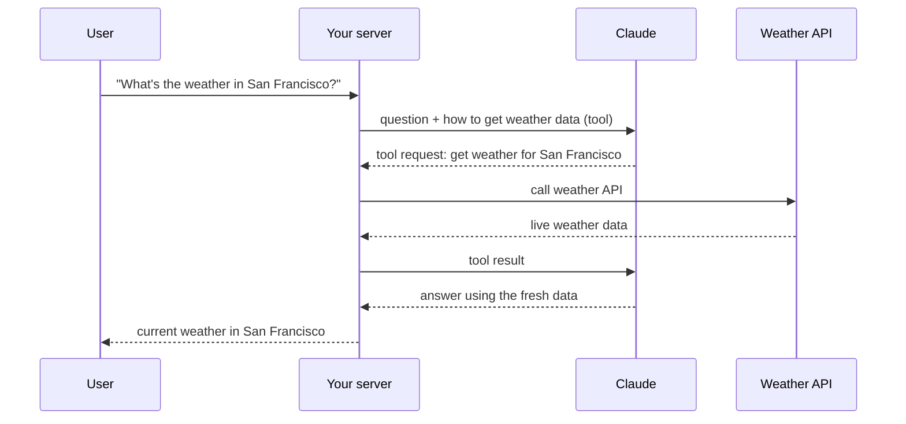

# Module 4 — Tool use

## Contents

- [Module 4 — Tool use](#module-4--tool-use)
  - [Contents](#contents)
  - [1. Introducing tool use](#1-introducing-tool-use)
    - [How tool use works](#how-tool-use-works)
    - [Weather example](#weather-example)
    - [Why it feels confusing at first](#why-it-feels-confusing-at-first)
  - [2. Tool functions](#2-tool-functions)
    - [Why it's hard for Claude alone](#why-its-hard-for-claude-alone)
    - [The three tools](#the-three-tools)
    - [Where tool functions fit](#where-tool-functions-fit)
    - [Writing tool functions](#writing-tool-functions)
    - [First tool: current date and time](#first-tool-current-date-and-time)
    - [JSON Schema spec (preview)](#json-schema-spec-preview)
  - [3. JSON Schema for tools](#3-json-schema-for-tools)
    - [Two parts](#two-parts)
    - [Creating a schema in 4 steps](#creating-a-schema-in-4-steps)
    - [Writing good descriptions](#writing-good-descriptions)
    - [Final shape (Converse `toolSpec`)](#final-shape-converse-toolspec)
  - [4. Handling tool use responses](#4-handling-tool-use-responses)
  - [5. Running tool functions](#5-running-tool-functions)
  - [6. Sending tool results](#6-sending-tool-results)
  - [7. Multi-Turn conversations with tools](#7-multi-turn-conversations-with-tools)
  - [8. Adding multiple tools](#8-adding-multiple-tools)
  - [9. Batch tool use](#9-batch-tool-use)
  - [10. Structured data with tools](#10-structured-data-with-tools)
  - [11. Flexible tool extraction](#11-flexible-tool-extraction)
  - [12. The text editor tool](#12-the-text-editor-tool)
  - [Common pitfalls](#common-pitfalls)

---

## 1. Introducing tool use

By default Claude only knows what it was trained on, so it can't give current information (today's
weather, recent news…). Ask *"What's the weather in San Francisco, California?"* and it answers that it
has no access to up-to-date weather data.

**Tools** fix this: they're a bridge between Claude and external data sources or actions.
**Claude never runs a tool itself**: it asks for it, your code runs it and sends back the result.

### How tool use works

1. **Initial request** — you send the question plus instructions on how to get extra data (the tool definitions).
2. **Tool request** — Claude decides it needs external data and asks for it (`stopReason = tool_use`).
3. **Data retrieval** — your server runs the code that fetches the data.
4. **Final response** — you send the data back and Claude answers using it.

### Weather example



### Why it feels confusing at first

The code isn't written in the same order the flow runs. Typically you:

1. Write the **tool function** (the code that fetches the data).
2. Write its **JSON Schema** spec (so Claude knows how to call it).
3. Handle the **ToolUse** and **ToolResult** parts of the conversation.
4. **Include the schema** in the request.

> Each step of the flow needs its own piece of code, built in a different order than it runs. The next
> lessons build them one at a time: keep the diagram above in mind to know which piece you're on.

## 2. Tool functions

Running example for the module: letting Claude **set reminders for future dates**.

### Why it's hard for Claude alone

- It may know today's date, but **not the exact time**.
- It doesn't always do **date arithmetic** well, especially many days ahead.
- It has **no way to actually set a reminder**.

### The three tools

| Tool | Why |
|---|---|
| `get_current_datetime` | Claude needs the current date and time |
| `add_duration_to_datetime` | Claude isn't reliable at date/time addition |
| `set_reminder` | Claude has no way to set a reminder |

### Where tool functions fit

Write the function → write its JSON Schema → call Claude with the schema → run the tool when Claude
asks for it → send the result back to Claude.

### Writing tool functions

A tool function is a **plain Python function** that runs when Claude decides it needs extra
information. Best practices:

- **Well-named, descriptive arguments** (it matters later, for the schema).
- **Validate the inputs** and raise an error if they're invalid.
- **Return meaningful errors**: if a call fails, Claude will try again, so the error message should help it fix the call.

### First tool: current date and time

```python
from datetime import datetime, timedelta

def get_current_datetime(date_format="%Y-%m-%d %H:%M:%S"):
    return datetime.now().strftime(date_format)
```

Descriptive name, a well-named parameter with a sensible default, and it returns exactly what it promises.

### JSON Schema spec (preview)

Each function also needs a **JSON Schema** describing it to Claude: what arguments it takes, and when and
how to use it. JSON Schema isn't an LLM-only concept (it's widely used for data validation) and there
are online tools to generate schemas.

- Explain **what the tool does, when to use it and what it returns**.
- Aim for **3–4 sentences** in the description.
- Give **detailed descriptions for each parameter**.

More in [JSON Schema for tools](#3-json-schema-for-tools).

📓 [001_tools.ipynb](exercises/module_4/001_tools.ipynb) · 📓 [002_tools_complete.ipynb](exercises/module_4/002_tools_complete.ipynb)

## 3. JSON Schema for tools

Each tool function needs a **JSON Schema** that tells Claude what arguments it expects and how to use
it. It looks intimidating at first, but it's mechanical once you know the steps.

### Two parts

JSON Schema is a long-standing standard for **data validation**, not something made up for AI. A tool
spec has:

| Part | Purpose |
|---|---|
| `name` + `description` (top) | Help Claude decide **when** to use the tool |
| `inputSchema` (bottom) | Describes the function's **arguments** in detail |

### Creating a schema in 4 steps

1. **Dictionary with sample data** — one key per keyword argument of the function, with realistic values.

   ```python
   def process_data(ids, profile, primary_id, value):
       pass

   sample = {
       "ids": [1, 2, 3],
       "profile": {"name": "Ana", "active": True},
       "primary_id": 1,
       "value": 9.5,
   }
   ```

2. **Convert it to JSON** — mainly Python `True`/`False`/`None` → JSON `true`/`false`/`null`.
3. **Online converter** — search *"JSON to JSON Schema converter"*, paste the JSON, get the schema. Remove the `$schema` line, it isn't needed.
4. **Add descriptions** — the most important step: a detailed description for each property.

### Writing good descriptions

- Explain **what the tool does, when to use it and what it returns**.
- Aim for **3–4 sentences** in the tool description.
- Write **very detailed descriptions for each property** (formats, valid values, examples).
- Stuck? Paste the function into Claude and ask it to write the descriptions.

### Final shape (Converse `toolSpec`)

From [002_tools_complete.ipynb](exercises/module_4/002_tools_complete.ipynb):

```python
get_current_datetime_schema = {
    "toolSpec": {
        "name": "get_current_datetime",
        "description": (
            "Retrieves the current date and time formatted according to the specified format string. "
            "This tool returns the system's current local date and time as a formatted string. "
            "It should be used when the user needs to know the current date, time, or both in a specific format. "
            "..."
        ),
        "inputSchema": {
            "json": {
                "type": "object",
                "properties": {
                    "date_format": {
                        "type": "string",
                        "description": (
                            "A string that specifies the format of the returned date and time, using Python's "
                            "strftime format codes. For example, '%Y-%m-%d' returns only the date as '2025-04-02' ..."
                        ),
                    }
                },
            }
        },
    }
}
```

`toolSpec` → `name` · `description` · `inputSchema` → `json` → the actual JSON Schema.

> The schema is a **contract** between your code and Claude: when Claude uses the tool, it knows exactly
> what to send and in what format. That's what makes tool use reliable.

## 4. Handling tool use responses

_Pending._

## 5. Running tool functions

_Pending._

## 6. Sending tool results

_Pending._

## 7. Multi-Turn conversations with tools

_Pending._

## 8. Adding multiple tools

_Pending._

## 9. Batch tool use

_Pending._

## 10. Structured data with tools

_Pending._

## 11. Flexible tool extraction

_Pending._

## 12. The text editor tool

_Pending._

---

## Common pitfalls

- Returning only some of the `toolResult` blocks when the model asked for several → every `toolUseId` needs a result.
- Raising exceptions instead of returning `status: "error"` → the model can't recover or retry.
- Unbounded loop → add a max number of iterations.
- "Batch tool use" (several calls in one turn) ≠ **Bedrock batch inference** (async jobs over S3).
- Managed alternative on AWS: **Bedrock Agents** action groups backed by **Lambda**.

---

[← Back to README](README.md)
