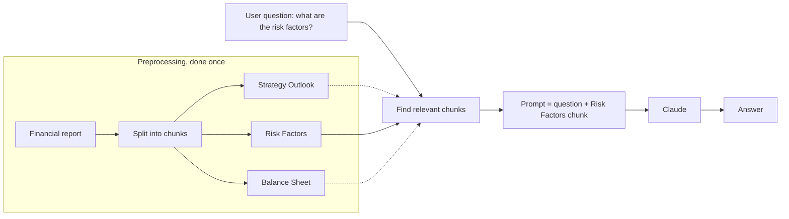
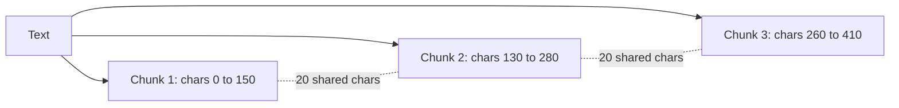
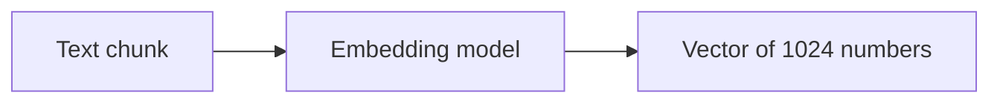
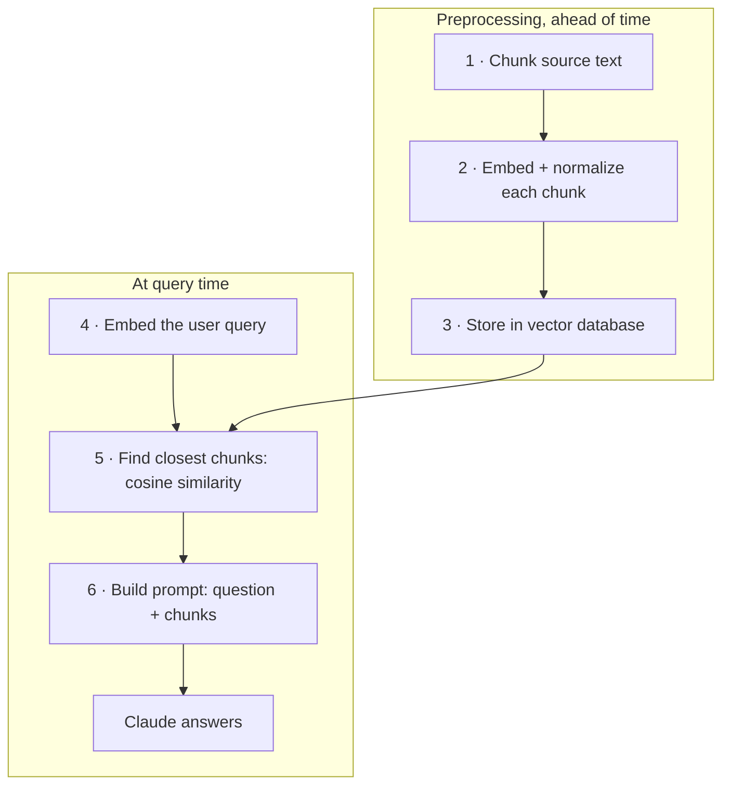

<h1>Module 5 — Retrieval Augmented Generation (RAG)</h1>

<h2>Contents</h2>

- [1. Introducing Retrieval Augmented Generation](#1-introducing-retrieval-augmented-generation)
  - [Two ways to give Claude the document](#two-ways-to-give-claude-the-document)
  - [How RAG works](#how-rag-works)
  - [Challenges](#challenges)
  - [When to use RAG](#when-to-use-rag)
- [2. Text chunking strategies](#2-text-chunking-strategies)
  - [Why it matters](#why-it-matters)
  - [The three strategies](#the-three-strategies)
  - [Size-based chunking and overlap](#size-based-chunking-and-overlap)
  - [Structure-based chunking](#structure-based-chunking)
  - [Implementations](#implementations)
  - [Choosing a strategy](#choosing-a-strategy)
- [3. Text embeddings](#3-text-embeddings)
  - [What an embedding is](#what-an-embedding-is)
  - [Why it matters for RAG](#why-it-matters-for-rag)
  - [Generating embeddings on Bedrock](#generating-embeddings-on-bedrock)
- [4. The full RAG flow](#4-the-full-rag-flow)
  - [Step 1 · Chunk the source text](#step-1--chunk-the-source-text)
  - [Step 2 · Embed and normalize](#step-2--embed-and-normalize)
  - [Step 3 · Store in a vector database](#step-3--store-in-a-vector-database)
  - [Step 4 · Embed the user query](#step-4--embed-the-user-query)
  - [Step 5 · Find the most similar chunks](#step-5--find-the-most-similar-chunks)
  - [Step 6 · Build the final prompt](#step-6--build-the-final-prompt)
  - [The complete flow](#the-complete-flow)
- [5. Implementing the RAG flow](#5-implementing-the-rag-flow)
- [6. BM25 lexical search](#6-bm25-lexical-search)
- [7. A multi-search RAG pipeline](#7-a-multi-search-rag-pipeline)
- [8. Reranking results](#8-reranking-results)
- [9. Contextual retrieval](#9-contextual-retrieval)
- [Common pitfalls](#common-pitfalls)

---

## 1. Introducing Retrieval Augmented Generation

**RAG** is a way of working with documents that are too big to hand to Claude in one go: split the
document into small pieces ahead of time and, for each question, send Claude **only the pieces that
matter**.

Running example: an 800-page financial report and the question *"What risk factors does this company
have?"*. The answer is somewhere in the report; the problem is getting that part in front of Claude.

### Two ways to give Claude the document

| | Option 1 · Everything in the prompt | Option 2 · Chunks + retrieval (RAG) |
|---|---|---|
| **How** | Extract all the text and paste it into one prompt | Pre-split the document, find the relevant chunks, send only those |
| **Size limit** | Hard token limit: a very long document just doesn't fit | Scales to very large documents and whole collections |
| **Answer quality** | Drops as the prompt grows: too much to sift through | Claude concentrates on the relevant content |
| **Cost / latency** | Bigger prompt → more expensive and slower | Smaller prompt → cheaper and faster |
| **Complexity** | None | Preprocessing + a search mechanism |

### How RAG works

1. **Chunk** — split the document into smaller pieces (Strategy Outlook, Risk Factors, Balance Sheet…).
2. **Understand the question** — work out what the user is looking for.
3. **Retrieve** — find the chunks most relevant to that question.
4. **Generate** — put only those chunks in the prompt and let Claude answer.



For the risk question, only the "Risk Factors" chunk reaches Claude: focused context instead of 800
pages.

### Challenges

RAG isn't free; it moves the difficulty somewhere else:

- **Preprocessing step** — documents have to be chunked before any question can be answered.
- **Search mechanism** — you need a way to decide which chunks are relevant.
- **Missing context** — a retrieved chunk may not contain everything needed to answer.
- **Chunking strategy** — equal-sized portions, by headers/sections, by semantic meaning… each has
  trade-offs, and the right one depends on the use case.

### When to use RAG

| Use RAG when… | Stay with "everything in the prompt" when… |
|---|---|
| The document (or collection) doesn't fit, or barely fits, in a prompt | The content fits comfortably |
| Questions are specific and need only a part of the content | Questions need the document as a whole |
| You run many queries and care about cost and response time | Volume is low and simplicity matters more |

> RAG is a trade-off, not a default: chunking, search and retrieval are extra moving parts. Use it when
> that overhead buys you scale, speed or lower cost.

## 2. Text chunking strategies

Chunking is the step that decides the quality of the whole RAG pipeline: whatever lands in a chunk is
what Claude gets to see. Bad chunks put **irrelevant context** in the prompt, and Claude answers
confidently from the wrong material.

### Why it matters

Example: a report with a *medical research* section and a *software engineering* section. The user asks
*"How many bugs did engineers fix this year?"*. If the chunks are poorly cut, retrieval can return a
medical chunk just because it mentions a "bug" (in the biological sense), and the answer is wrong.

> Goal: chunks that are **semantically coherent** (one topic each) and that still make sense when read
> on their own.

### The three strategies

| Strategy | How it splits | Pros | Cons |
|---|---|---|---|
| **Size-based** | Fixed number of characters/words | Simple, works on any text | Cuts words and sentences, separates related content |
| **Structure-based** | Headers, paragraphs, sections | Chunks follow the document's own organization | Needs a guaranteed, consistent format (e.g. Markdown) |
| **Semantic-based** | Groups related sentences using NLP | Most meaningful chunks | Most complex and expensive to build |

### Size-based chunking and overlap

Split the text into pieces of roughly equal length. Reliable, but blind to meaning: a sentence can be
cut in half and its context lost.

**Overlap** mitigates that: each chunk repeats a few characters (or sentences) of its neighbour, so
information at a boundary appears complete in at least one chunk. It costs some duplication, which is
usually worth it.



### Structure-based chunking

If the documents have a reliable structure (Markdown with `##` headers, for example), split on it: each
chunk is a real section. Excellent results on well-formatted documents; unreliable on plain text or
inconsistent formatting.

### Implementations

**By characters**, with overlap:

```python
def chunk_by_char(text, chunk_size=150, chunk_overlap=20):
    chunks = []
    start_idx = 0

    while start_idx < len(text):
        end_idx = min(start_idx + chunk_size, len(text))
        chunks.append(text[start_idx:end_idx])

        # step back `chunk_overlap` chars, unless we already reached the end
        start_idx = end_idx - chunk_overlap if end_idx < len(text) else len(text)

    return chunks
```

**By sentences**, with sentence overlap:

```python
import re

def chunk_by_sentence(text, max_sentences_per_chunk=5, overlap_sentences=1):
    sentences = re.split(r"(?<=[.!?])\s+", text)
    chunks = []
    start_idx = 0

    while start_idx < len(sentences):
        end_idx = min(start_idx + max_sentences_per_chunk, len(sentences))
        chunks.append(" ".join(sentences[start_idx:end_idx]))
        start_idx += max_sentences_per_chunk - overlap_sentences

    return chunks
```

> ⚠️ If `overlap_sentences >= max_sentences_per_chunk`, `start_idx` never advances and the loop is
> infinite. The lesson's `if start_idx < 0` guard doesn't prevent this; validate
> `overlap_sentences < max_sentences_per_chunk` instead. The regex also splits on abbreviations and
> decimals ("e.g. ", "v2. "), so it's a poor fit for code or technical text.

**By sections** (Markdown `##` headers):

```python
import re

def chunk_by_section(document_text):
    return re.split(r"\n## ", document_text)
```

> Note: `re.split` removes the separator, so each chunk loses its `## ` prefix, and the first chunk is
> whatever comes before the first `##` (the document title). Use a lookahead, `re.split(r"\n(?=## )",
> document_text)`, to keep the headers.

### Choosing a strategy

| Strategy | Best for | Watch out for |
|---|---|---|
| Character-based | User-uploaded documents with no format guarantee; the safe fallback | Cut sentences; tune size and overlap |
| Sentence-based | Prose: good balance between context and meaning | Code and technical text with unexpected periods |
| Section-based | Well-structured internal docs (Markdown, consistent headers) | Breaks if the structure isn't there; sections can be too long |

Treat chunking as **iterative**: start simple, test with your real documents and questions, and refine
based on the quality of what retrieval returns.

> On AWS, **Bedrock Knowledge Bases** offers these strategies as managed options when you create a data
> source: fixed-size (with overlap), hierarchical, semantic, or no chunking.

📓 [001_chunking.ipynb](exercises/module_5/001_chunking.ipynb) · data: [report.md](exercises/module_5/report.md)

## 3. Text embeddings

With the document chunked, the next problem is **search**: given the user's question, which chunks are
related to it? Plain keyword matching isn't enough (remember the "bug" example), so the usual answer is
**semantic search**, built on **text embeddings**.

### What an embedding is

An **embedding** is a list of numbers that represents the *meaning* of a piece of text, so that a
computer can compare texts with math instead of words.





- The model returns a fixed-length vector (1024 numbers in this course).
- Each number can be thought of as a **score for some quality** of the text: "how happy is it?", "how
  much does it talk about oceans?"…
- In practice nobody knows what each position means: the model learns those features in training and
  they're **not human-interpretable**. The "score" idea is only a mental model.

> The lesson says the values range from -1 to +1. That holds for **normalized** vectors (length 1, as
> with `normalize=True` below); without normalization the values aren't bounded that way.

### Why it matters for RAG

**Similar meaning → similar vectors.** So you can embed the question, embed every chunk, and compare
them numerically to find the closest chunks, even when they don't share any words with the question.
That's what makes semantic search better than keyword matching for picking RAG context.

| | Keyword matching | Semantic search (embeddings) |
|---|---|---|
| Compares | Exact words | Meaning |
| "bug" in a medical vs software text | Same match | Different vectors |
| Synonyms / paraphrases | Missed | Found |

### Generating embeddings on Bedrock

Embedding models are called with **`InvokeModel`**, not `Converse` (Converse is for chat models). The
request and response body are model-specific; for **Amazon Titan Text Embeddings V2**:

```python
import json
import boto3

client = boto3.client("bedrock-runtime", region_name="us-west-2")

def generate_embedding(
    text,
    embedding_model_id="amazon.titan-embed-text-v2:0",
    dimensions=1024,
    normalize=True,
):
    request_body = {
        "inputText": text,
        "dimensions": dimensions,   # Titan V2: 256, 512 or 1024
        "normalize": normalize,     # unit-length vector, good for cosine similarity
    }

    response = client.invoke_model(
        modelId=embedding_model_id,
        body=json.dumps(request_body),
        accept="application/json",
        contentType="application/json",
    )

    response_body = json.loads(response["body"].read())
    return response_body["embedding"]   # list of `dimensions` floats
```

Running it on the first chunk of `report.md` returns 1024 floats such as
`[-0.0583, 0.0117, 0.0318, ...]`.

> - You may need to enable access to the Titan embeddings model in the Bedrock console first.
> - The lesson says V1 (`amazon.titan-embed-text-v1`) works just as well. It does, but **not with this
>   body**: V1 only accepts `inputText` (no `dimensions` or `normalize`) and always returns 1536 numbers.

📓 [002_embeddings.ipynb](exercises/module_5/002_embeddings.ipynb) · data: [report.md](exercises/module_5/report.md)

## 4. The full RAG flow

This lesson puts chunking and embeddings together and walks through the whole pipeline with a toy
example small enough to check by hand.



### Step 1 · Chunk the source text

Two chunks, both chosen to be ambiguous on purpose:

| Chunk | Text (summary) | Trap |
|---|---|---|
| **Medical research** | Progress understanding XDR-47, a "bug" never seen before | "bug" sounds like software |
| **Software engineering** | Studying "infection vectors" in distributed systems | "infection" sounds medical |

### Step 2 · Embed and normalize

Imagine a perfect embedding model that returns **2 numbers** with known meaning:
`[how medical, how software]`.

| Chunk | Raw embedding | Normalized (length 1) |
|---|---|---|
| Medical research | `[0.97, 0.34]` | `[0.944, 0.331]` |
| Software engineering | `[0.30, 0.97]` | `[0.295, 0.955]` |

**Normalization** scales each vector to magnitude 1.0, so every point lies on the unit circle and only
the *direction* matters. Embedding APIs usually do it for you (Titan's `normalize=True`).

### Step 3 · Store in a vector database

The normalized vectors go into a **vector database**: a store optimized to keep long lists of numbers
and search for the closest ones.

> Up to here everything is **preprocessing**, done once ahead of time. The rest happens per query.

### Step 4 · Embed the user query

Query: *"I'm curious about the company. In particular, what did the software engineering dept do this
year?"*. It goes through **the same embedding model** (vectors from different models can't be
compared): `[0.1, 0.89]` → normalized `[0.112, 0.994]`.

### Step 5 · Find the most similar chunks

The vector database returns the stored vectors closest to the query vector, measured with **cosine
similarity**: the cosine of the angle between two vectors.

$$\cos(\theta) = \frac{A \cdot B}{\|A\| \, \|B\|}$$

| Cosine similarity | Meaning |
|---|---|
| ≈ 1 | Same direction → very similar |
| ≈ 0 | Perpendicular → unrelated |
| ≈ -1 | Opposite |

With normalized vectors both magnitudes are 1, so the cosine is just the **dot product**:

| Query vs… | Cosine similarity | |
|---|---|---|
| Software engineering | **0.982** | ✅ best match |
| Medical research | 0.434 | |

> The lesson gives 0.983 and **0.398**. Recomputing from its own vectors gives ≈ 0.982 and **0.434**
> (and the normalized query is `[0.112, 0.994]`, not `0.993`). The conclusion doesn't change.

```python
import math

def normalize(v):
    norm = math.sqrt(sum(x * x for x in v))
    return [x / norm for x in v]

def cosine_similarity(a, b):
    return sum(x * y for x, y in zip(a, b))   # a and b already normalized

medical  = normalize([0.97, 0.34])
software = normalize([0.30, 0.97])
query    = normalize([0.10, 0.89])

cosine_similarity(query, software)   # 0.982
cosine_similarity(query, medical)    # 0.434
```

**Cosine distance** = `1 - cosine similarity`. Vector databases often use it instead: **0 = identical**,
bigger = less similar (so you sort ascending).

| Measure | Most similar | Sort |
|---|---|---|
| Cosine similarity | Close to 1 | Descending |
| Cosine distance | Close to 0 | Ascending |

### Step 6 · Build the final prompt

Combine the user's question with the retrieved chunk(s) and send it to Claude, which now answers from
the document instead of from its general knowledge. In Converse format:

```python
prompt = f"""
Answer the user's question using the report excerpt below.

<user_question>
{user_question}
</user_question>

<report_excerpt>
{software_engineering_chunk}
</report_excerpt>
"""

messages = [{"role": "user", "content": [{"text": prompt}]}]
response = client.converse(modelId=model_id, messages=messages)
```

### The complete flow

1. Chunk the source documents.
2. Embed each chunk (normalized).
3. Store the embeddings in a vector database.
4. Embed the user's question with the same model.
5. Retrieve the most similar chunks (cosine similarity / distance).
6. Put the chunks and the question in the prompt.
7. Send it to Claude.

> Knowing the math behind steps 4–5 is what lets you debug a RAG system when it retrieves the wrong
> chunks.

## 5. Implementing the RAG flow

_Pending._

## 6. BM25 lexical search

_Pending._

## 7. A multi-search RAG pipeline

_Pending._

## 8. Reranking results

_Pending._

## 9. Contextual retrieval

_Pending._

---

## Common pitfalls

_Pending._

---

[← Back to README](README.md)
