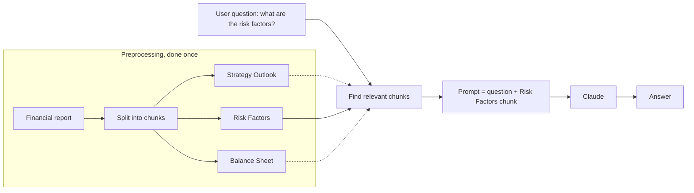
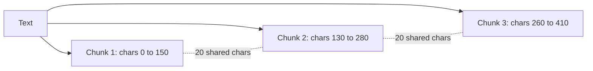

<h1>Module 5 — Retrieval Augmented Generation (RAG)</h1>

<h2>Contents</h2>

- [1. Introducing Retrieval Augmented Generation](#1-introducing-retrieval-augmented-generation)
  - [Two ways to give Claude the document](#two-ways-to-give-claude-the-document)
  - [How RAG works](#how-rag-works)
  - [Challenges](#challenges)
  - [When to use RAG](#when-to-use-rag)
- [2. Text chunking strategies](#2-text-chunking-strategies)
  - [Why it matters](#why-it-matters)
  - [The three strategies](#the-three-strategies)
  - [Size-based chunking and overlap](#size-based-chunking-and-overlap)
  - [Structure-based chunking](#structure-based-chunking)
  - [Implementations](#implementations)
  - [Choosing a strategy](#choosing-a-strategy)
- [3. Text embeddings](#3-text-embeddings)
- [4. The full RAG flow](#4-the-full-rag-flow)
- [5. Implementing the RAG flow](#5-implementing-the-rag-flow)
- [6. BM25 lexical search](#6-bm25-lexical-search)
- [7. A multi-search RAG pipeline](#7-a-multi-search-rag-pipeline)
- [8. Reranking results](#8-reranking-results)
- [9. Contextual retrieval](#9-contextual-retrieval)
- [Common pitfalls](#common-pitfalls)

---

## 1. Introducing Retrieval Augmented Generation

**RAG** is a way of working with documents that are too big to hand to Claude in one go: split the
document into small pieces ahead of time and, for each question, send Claude **only the pieces that
matter**.

Running example: an 800-page financial report and the question *"What risk factors does this company
have?"*. The answer is somewhere in the report; the problem is getting that part in front of Claude.

### Two ways to give Claude the document

| | Option 1 · Everything in the prompt | Option 2 · Chunks + retrieval (RAG) |
|---|---|---|
| **How** | Extract all the text and paste it into one prompt | Pre-split the document, find the relevant chunks, send only those |
| **Size limit** | Hard token limit: a very long document just doesn't fit | Scales to very large documents and whole collections |
| **Answer quality** | Drops as the prompt grows: too much to sift through | Claude concentrates on the relevant content |
| **Cost / latency** | Bigger prompt → more expensive and slower | Smaller prompt → cheaper and faster |
| **Complexity** | None | Preprocessing + a search mechanism |

### How RAG works

1. **Chunk** — split the document into smaller pieces (Strategy Outlook, Risk Factors, Balance Sheet…).
2. **Understand the question** — work out what the user is looking for.
3. **Retrieve** — find the chunks most relevant to that question.
4. **Generate** — put only those chunks in the prompt and let Claude answer.



For the risk question, only the "Risk Factors" chunk reaches Claude: focused context instead of 800
pages.

### Challenges

RAG isn't free; it moves the difficulty somewhere else:

- **Preprocessing step** — documents have to be chunked before any question can be answered.
- **Search mechanism** — you need a way to decide which chunks are relevant.
- **Missing context** — a retrieved chunk may not contain everything needed to answer.
- **Chunking strategy** — equal-sized portions, by headers/sections, by semantic meaning… each has
  trade-offs, and the right one depends on the use case.

### When to use RAG

| Use RAG when… | Stay with "everything in the prompt" when… |
|---|---|
| The document (or collection) doesn't fit, or barely fits, in a prompt | The content fits comfortably |
| Questions are specific and need only a part of the content | Questions need the document as a whole |
| You run many queries and care about cost and response time | Volume is low and simplicity matters more |

> RAG is a trade-off, not a default: chunking, search and retrieval are extra moving parts. Use it when
> that overhead buys you scale, speed or lower cost.

## 2. Text chunking strategies

Chunking is the step that decides the quality of the whole RAG pipeline: whatever lands in a chunk is
what Claude gets to see. Bad chunks put **irrelevant context** in the prompt, and Claude answers
confidently from the wrong material.

### Why it matters

Example: a report with a *medical research* section and a *software engineering* section. The user asks
*"How many bugs did engineers fix this year?"*. If the chunks are poorly cut, retrieval can return a
medical chunk just because it mentions a "bug" (in the biological sense), and the answer is wrong.

> Goal: chunks that are **semantically coherent** (one topic each) and that still make sense when read
> on their own.

### The three strategies

| Strategy | How it splits | Pros | Cons |
|---|---|---|---|
| **Size-based** | Fixed number of characters/words | Simple, works on any text | Cuts words and sentences, separates related content |
| **Structure-based** | Headers, paragraphs, sections | Chunks follow the document's own organization | Needs a guaranteed, consistent format (e.g. Markdown) |
| **Semantic-based** | Groups related sentences using NLP | Most meaningful chunks | Most complex and expensive to build |

### Size-based chunking and overlap

Split the text into pieces of roughly equal length. Reliable, but blind to meaning: a sentence can be
cut in half and its context lost.

**Overlap** mitigates that: each chunk repeats a few characters (or sentences) of its neighbour, so
information at a boundary appears complete in at least one chunk. It costs some duplication, which is
usually worth it.



### Structure-based chunking

If the documents have a reliable structure (Markdown with `##` headers, for example), split on it: each
chunk is a real section. Excellent results on well-formatted documents; unreliable on plain text or
inconsistent formatting.

### Implementations

**By characters**, with overlap:

```python
def chunk_by_char(text, chunk_size=150, chunk_overlap=20):
    chunks = []
    start_idx = 0

    while start_idx < len(text):
        end_idx = min(start_idx + chunk_size, len(text))
        chunks.append(text[start_idx:end_idx])

        # step back `chunk_overlap` chars, unless we already reached the end
        start_idx = end_idx - chunk_overlap if end_idx < len(text) else len(text)

    return chunks
```

**By sentences**, with sentence overlap:

```python
import re

def chunk_by_sentence(text, max_sentences_per_chunk=5, overlap_sentences=1):
    sentences = re.split(r"(?<=[.!?])\s+", text)
    chunks = []
    start_idx = 0

    while start_idx < len(sentences):
        end_idx = min(start_idx + max_sentences_per_chunk, len(sentences))
        chunks.append(" ".join(sentences[start_idx:end_idx]))
        start_idx += max_sentences_per_chunk - overlap_sentences

    return chunks
```

> ⚠️ If `overlap_sentences >= max_sentences_per_chunk`, `start_idx` never advances and the loop is
> infinite. The lesson's `if start_idx < 0` guard doesn't prevent this; validate
> `overlap_sentences < max_sentences_per_chunk` instead. The regex also splits on abbreviations and
> decimals ("e.g. ", "v2. "), so it's a poor fit for code or technical text.

**By sections** (Markdown `##` headers):

```python
import re

def chunk_by_section(document_text):
    return re.split(r"\n## ", document_text)
```

> Note: `re.split` removes the separator, so each chunk loses its `## ` prefix, and the first chunk is
> whatever comes before the first `##` (the document title). Use a lookahead, `re.split(r"\n(?=## )",
> document_text)`, to keep the headers.

### Choosing a strategy

| Strategy | Best for | Watch out for |
|---|---|---|
| Character-based | User-uploaded documents with no format guarantee; the safe fallback | Cut sentences; tune size and overlap |
| Sentence-based | Prose: good balance between context and meaning | Code and technical text with unexpected periods |
| Section-based | Well-structured internal docs (Markdown, consistent headers) | Breaks if the structure isn't there; sections can be too long |

Treat chunking as **iterative**: start simple, test with your real documents and questions, and refine
based on the quality of what retrieval returns.

> On AWS, **Bedrock Knowledge Bases** offers these strategies as managed options when you create a data
> source: fixed-size (with overlap), hierarchical, semantic, or no chunking.

📓 [001_chunking.ipynb](exercises/module_5/001_chunking.ipynb) · data: [report.md](exercises/module_5/report.md)

## 3. Text embeddings

_Pending._

## 4. The full RAG flow

_Pending._

## 5. Implementing the RAG flow

_Pending._

## 6. BM25 lexical search

_Pending._

## 7. A multi-search RAG pipeline

_Pending._

## 8. Reranking results

_Pending._

## 9. Contextual retrieval

_Pending._

---

## Common pitfalls

_Pending._

---

[← Back to README](README.md)
