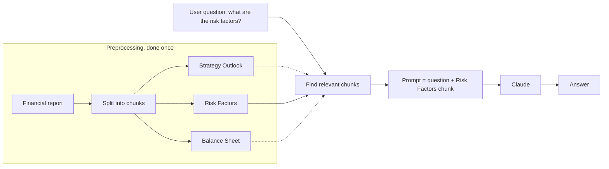

<h1>Module 5 — Retrieval Augmented Generation (RAG)</h1>

<h2>Contents</h2>

- [1. Introducing Retrieval Augmented Generation](#1-introducing-retrieval-augmented-generation)
  - [Two ways to give Claude the document](#two-ways-to-give-claude-the-document)
  - [How RAG works](#how-rag-works)
  - [Challenges](#challenges)
  - [When to use RAG](#when-to-use-rag)
- [2. Text chunking strategies](#2-text-chunking-strategies)
- [3. Text embeddings](#3-text-embeddings)
- [4. The full RAG flow](#4-the-full-rag-flow)
- [5. Implementing the RAG flow](#5-implementing-the-rag-flow)
- [6. BM25 lexical search](#6-bm25-lexical-search)
- [7. A multi-search RAG pipeline](#7-a-multi-search-rag-pipeline)
- [8. Reranking results](#8-reranking-results)
- [9. Contextual retrieval](#9-contextual-retrieval)
- [Common pitfalls](#common-pitfalls)

---

## 1. Introducing Retrieval Augmented Generation

**RAG** is a way of working with documents that are too big to hand to Claude in one go: split the
document into small pieces ahead of time and, for each question, send Claude **only the pieces that
matter**.

Running example: an 800-page financial report and the question *"What risk factors does this company
have?"*. The answer is somewhere in the report; the problem is getting that part in front of Claude.

### Two ways to give Claude the document

| | Option 1 · Everything in the prompt | Option 2 · Chunks + retrieval (RAG) |
|---|---|---|
| **How** | Extract all the text and paste it into one prompt | Pre-split the document, find the relevant chunks, send only those |
| **Size limit** | Hard token limit: a very long document just doesn't fit | Scales to very large documents and whole collections |
| **Answer quality** | Drops as the prompt grows: too much to sift through | Claude concentrates on the relevant content |
| **Cost / latency** | Bigger prompt → more expensive and slower | Smaller prompt → cheaper and faster |
| **Complexity** | None | Preprocessing + a search mechanism |

### How RAG works

1. **Chunk** — split the document into smaller pieces (Strategy Outlook, Risk Factors, Balance Sheet…).
2. **Understand the question** — work out what the user is looking for.
3. **Retrieve** — find the chunks most relevant to that question.
4. **Generate** — put only those chunks in the prompt and let Claude answer.

For the risk question, only the "Risk Factors" chunk reaches Claude: focused context instead of 800
pages.

### Challenges

RAG isn't free; it moves the difficulty somewhere else:

- **Preprocessing step** — documents have to be chunked before any question can be answered.
- **Search mechanism** — you need a way to decide which chunks are relevant.
- **Missing context** — a retrieved chunk may not contain everything needed to answer.
- **Chunking strategy** — equal-sized portions, by headers/sections, by semantic meaning… each has
  trade-offs, and the right one depends on the use case.

### When to use RAG

| Use RAG when… | Stay with "everything in the prompt" when… |
|---|---|
| The document (or collection) doesn't fit, or barely fits, in a prompt | The content fits comfortably |
| Questions are specific and need only a part of the content | Questions need the document as a whole |
| You run many queries and care about cost and response time | Volume is low and simplicity matters more |

> RAG is a trade-off, not a default: chunking, search and retrieval are extra moving parts. Use it when
> that overhead buys you scale, speed or lower cost.

## 2. Text chunking strategies

_Pending._

## 3. Text embeddings

_Pending._

## 4. The full RAG flow

_Pending._

## 5. Implementing the RAG flow

_Pending._

## 6. BM25 lexical search

_Pending._

## 7. A multi-search RAG pipeline

_Pending._

## 8. Reranking results

_Pending._

## 9. Contextual retrieval

_Pending._

---

## Common pitfalls

_Pending._

---

[← Back to README](README.md)
