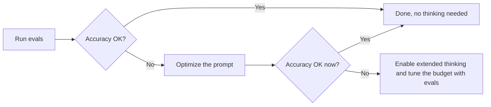

<h1>Module 6 — Features of Claude</h1>

<h2>Contents</h2>

- [1. Extended thinking](#1-extended-thinking)
  - [Response with thinking](#response-with-thinking)
  - [Trade-offs](#trade-offs)
  - [Signature](#signature)
  - [Redacted thinking](#redacted-thinking)
  - [Implementation](#implementation)
- [2. Image support](#2-image-support)
- [3. PDF support](#3-pdf-support)
- [4. Citations](#4-citations)
- [5. Prompt caching](#5-prompt-caching)
- [6. Rules of prompt caching](#6-rules-of-prompt-caching)
- [7. Prompt caching in action](#7-prompt-caching-in-action)
- [Common pitfalls](#common-pitfalls)

---

## 1. Extended thinking

**Extended thinking** gives Claude time to reason through a problem before writing the final answer. It's
like seeing Claude's internal monologue: how it breaks the problem down, what it considers and how it
reaches the answer. Very useful to understand and debug complex tasks.

### Response with thinking

With thinking enabled, the assistant message has **two parts** instead of one:

| Part | Converse block | Contains |
|---|---|---|
| Reasoning | `reasoningContent` | Claude's thinking process (+ signature) |
| Answer | `text` | The final response you actually want |

```python
# reasoningContent with readable thinking
{"reasoningContent": {"reasoningText": {"text": "Let me break this down...",
                                        "signature": "EqoBCkgIARAB..."}}}
{"text": "The answer is..."}
```

### Trade-offs

| ✅ Pros | ❌ Cons |
|---|---|
| Better accuracy on complex tasks | Higher cost: you pay for every thinking token |
| Visible reasoning, easier to debug | More latency: thinking takes time |

**When to use it:** let your **evals** decide. First optimize the prompt; if accuracy is still not
enough, then try extended thinking.



### Signature

Each reasoning block comes with a cryptographic **signature**. It proves the thinking text hasn't been
modified: if you send Claude's previous reasoning back in a follow-up turn, the signature is checked.
This prevents safety issues from tampered reasoning. → Send reasoning blocks back **exactly as received**.

### Redacted thinking

If the safety systems flag part of the thinking, you get `redactedContent` (encrypted bytes) instead of
readable text:

```python
{"reasoningContent": {"redactedContent": b"EqcECkgIAhABGAIqQCWK..."}}
```

It's not readable for you, but it still works: pass it back in later turns and Claude keeps the context.
Your code must handle **both** cases (`reasoningText` and `redactedContent`).

To test it, there's a special string that forces a redacted response:

```python
thinking_test_str = "ANTHROPIC_MAGIC_STRING_TRIGGER_REDACTED_THINKING_46C9A13E193C177646C7398A98432ECCCE4C1253D5E2D82641AC0E52CC2876CB"
```

### Implementation

On Bedrock, thinking is not a Converse native field: it goes in `additionalModelRequestFields`.
`budget_tokens` caps how many tokens Claude can spend thinking (**minimum 1024**); tune it with your evals.

```python
def chat(
    messages,
    system=None,
    temperature=1.0,
    stop_sequences=[],
    tools=None,
    tool_choice="auto",
    text_editor=None,
    thinking=False,
    thinking_budget=1024,
):
    params = {
        "modelId": model_id,
        "messages": messages,
        "inferenceConfig": {"temperature": temperature, "stopSequences": stop_sequences},
    }
    # ... system, toolConfig, text_editor as before ...

    additional_model_fields = {}
    if thinking:
        additional_model_fields["thinking"] = {
            "type": "enabled",
            "budget_tokens": thinking_budget,
        }

    params["additionalModelRequestFields"] = additional_model_fields
    response = client.converse(**params)
    parts = response["output"]["message"]["content"]

    return {
        "parts": parts,  # reasoningContent + text blocks
        "stop_reason": response["stopReason"],
        "text": "\n".join(p["text"] for p in parts if "text" in p),
    }
```

```python
messages = []
add_user_message(messages, thinking_test_str)
result = chat(messages, thinking=True)
result["parts"]
# [{'reasoningContent': {'redactedContent': b'EqcECkgI...'}},
#  {'text': "I notice you've sent what appears to be some kind of command..."}]
```

> Not in the lesson (Claude docs):
> - `budget_tokens` must be **lower than** `maxTokens`.
> - With thinking on, `temperature`, `top_p` / `top_k` can't be changed (keep temperature at 1), and
>   `toolChoice` can only be `auto` (no `any` or forced tool).
> - In a tool use loop, the assistant's reasoning blocks must go back **unchanged** together with the
>   `toolUse` block.
> - Claude 4 models return a **summarized** thinking, but you're billed for the full thinking tokens.
>   Claude 3.7 Sonnet (the notebook's model) returns it in full.

📓 [001_thinking.ipynb](exercises/module_6/001_thinking.ipynb) · [001_thinking_completed.ipynb](exercises/module_6/001_thinking_completed.ipynb)

---

## 2. Image support

_Pending._

---

## 3. PDF support

_Pending._

---

## 4. Citations

_Pending._

---

## 5. Prompt caching

_Pending._

---

## 6. Rules of prompt caching

_Pending._

---

## 7. Prompt caching in action

_Pending._

---

## Common pitfalls

_Pending._

---

[← Back to README](README.md)
