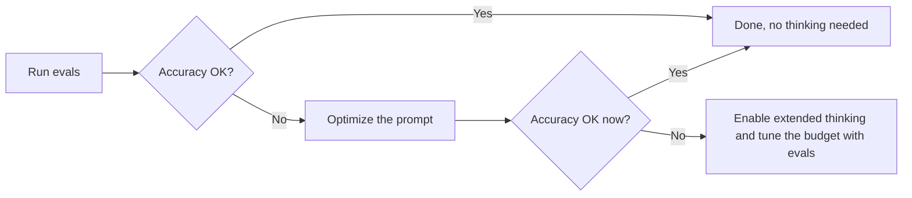
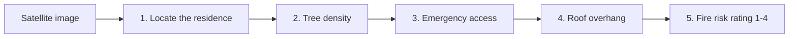
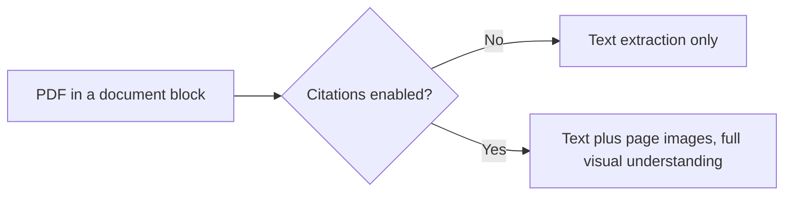
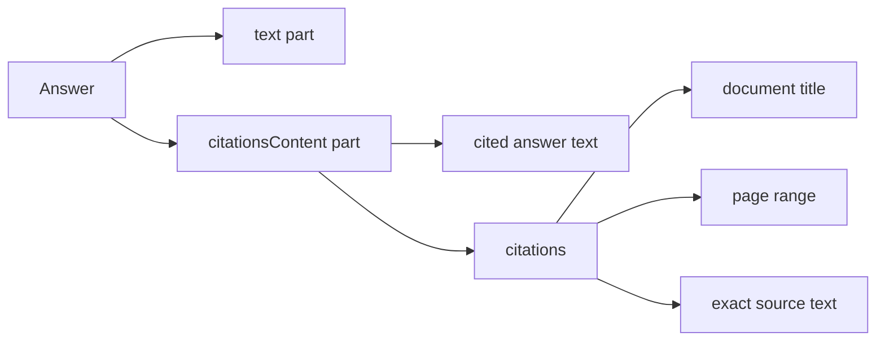
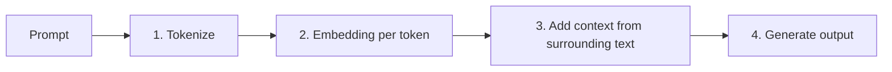
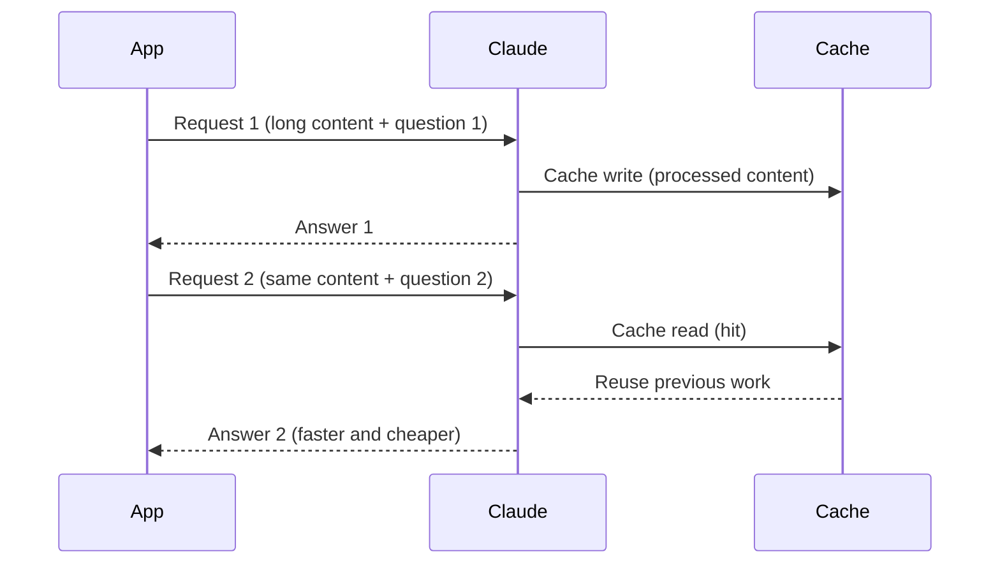
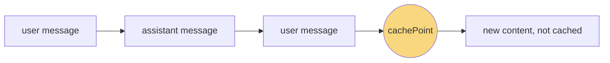
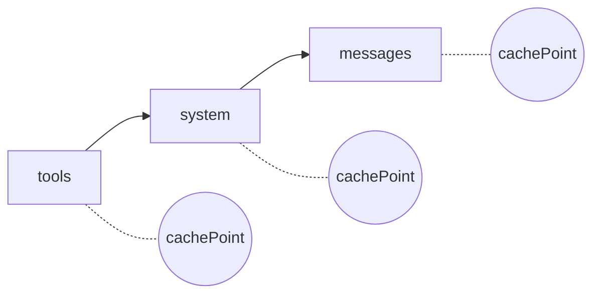

<h1>Module 6 — Features of Claude</h1>

<h2>Contents</h2>

- [1. Extended thinking](#1-extended-thinking)
  - [Response with thinking](#response-with-thinking)
  - [Trade-offs](#trade-offs)
  - [Signature](#signature)
  - [Redacted thinking](#redacted-thinking)
  - [Implementation](#implementation)
- [2. Image support](#2-image-support)
  - [Limits](#limits)
  - [Sending an image](#sending-an-image)
  - [Multiple images](#multiple-images)
  - [Prompting techniques](#prompting-techniques)
  - [Example: fire risk assessment](#example-fire-risk-assessment)
- [3. PDF support](#3-pdf-support)
  - [Sending a PDF](#sending-a-pdf)
  - [What Claude can do with PDFs](#what-claude-can-do-with-pdfs)
  - [Text only vs full visual understanding](#text-only-vs-full-visual-understanding)
- [4. Citations](#4-citations)
  - [Enabling citations](#enabling-citations)
  - [The response with citations](#the-response-with-citations)
  - [Why citations matter](#why-citations-matter)
- [5. Prompt caching](#5-prompt-caching)
  - [How Claude normally processes a request](#how-claude-normally-processes-a-request)
  - [The problem](#the-problem)
  - [The solution](#the-solution)
  - [Benefits and limitations](#benefits-and-limitations)
- [6. Rules of prompt caching](#6-rules-of-prompt-caching)
  - [Cache points](#cache-points)
  - [How cache points work](#how-cache-points-work)
  - [Caching across messages](#caching-across-messages)
  - [Minimum length](#minimum-length)
  - [Where to put cache points](#where-to-put-cache-points)
- [7. Prompt caching in action](#7-prompt-caching-in-action)
- [Common pitfalls](#common-pitfalls)

---

## 1. Extended thinking

**Extended thinking** gives Claude time to reason through a problem before writing the final answer. It's
like seeing Claude's internal monologue: how it breaks the problem down, what it considers and how it
reaches the answer. Very useful to understand and debug complex tasks.

### Response with thinking


With thinking enabled, the assistant message has **two parts** instead of one:

| Part | Converse block | Contains |
|---|---|---|
| Reasoning | `reasoningContent` | Claude's thinking process (+ signature) |
| Answer | `text` | The final response you actually want |

```python
# reasoningContent with readable thinking
{"reasoningContent": {"reasoningText": {"text": "Let me break this down...",
                                        "signature": "EqoBCkgIARAB..."}}}
{"text": "The answer is..."}
```

### Trade-offs

| ✅ Pros | ❌ Cons |
|---|---|
| Better accuracy on complex tasks | Higher cost: you pay for every thinking token |
| Visible reasoning, easier to debug | More latency: thinking takes time |

**When to use it:** let your **evals** decide. First optimize the prompt; if accuracy is still not
enough, then try extended thinking.



### Signature

Each reasoning block comes with a cryptographic **signature**. It proves the thinking text hasn't been
modified: if you send Claude's previous reasoning back in a follow-up turn, the signature is checked.
This prevents safety issues from tampered reasoning. → Send reasoning blocks back **exactly as received**.

### Redacted thinking

If the safety systems flag part of the thinking, you get `redactedContent` (encrypted bytes) instead of
readable text:

```python
{"reasoningContent": {"redactedContent": b"EqcECkgIAhABGAIqQCWK..."}}
```

It's not readable for you, but it still works: pass it back in later turns and Claude keeps the context.
Your code must handle **both** cases (`reasoningText` and `redactedContent`).

To test it, there's a special string that forces a redacted response:

```python
thinking_test_str = "ANTHROPIC_MAGIC_STRING_TRIGGER_REDACTED_THINKING_46C9A13E193C177646C7398A98432ECCCE4C1253D5E2D82641AC0E52CC2876CB"
```

### Implementation

On Bedrock, thinking is not a Converse native field: it goes in `additionalModelRequestFields`.
`budget_tokens` caps how many tokens Claude can spend thinking (**minimum 1024**); tune it with your evals.

```python
def chat(
    messages,
    system=None,
    temperature=1.0,
    stop_sequences=[],
    tools=None,
    tool_choice="auto",
    text_editor=None,
    thinking=False,
    thinking_budget=1024,
):
    params = {
        "modelId": model_id,
        "messages": messages,
        "inferenceConfig": {"temperature": temperature, "stopSequences": stop_sequences},
    }
    # ... system, toolConfig, text_editor as before ...

    additional_model_fields = {}
    if thinking:
        additional_model_fields["thinking"] = {
            "type": "enabled",
            "budget_tokens": thinking_budget,
        }

    params["additionalModelRequestFields"] = additional_model_fields
    response = client.converse(**params)
    parts = response["output"]["message"]["content"]

    return {
        "parts": parts,  # reasoningContent + text blocks
        "stop_reason": response["stopReason"],
        "text": "\n".join(p["text"] for p in parts if "text" in p),
    }
```

```python
messages = []
add_user_message(messages, thinking_test_str)
result = chat(messages, thinking=True)
result["parts"]
# [{'reasoningContent': {'redactedContent': b'EqcECkgI...'}},
#  {'text': "I notice you've sent what appears to be some kind of command..."}]
```

> Not in the lesson (Claude docs):
> - `budget_tokens` must be **lower than** `maxTokens`.
> - With thinking on, `temperature`, `top_p` / `top_k` can't be changed (keep temperature at 1), and
>   `toolChoice` can only be `auto` (no `any` or forced tool).
> - In a tool use loop, the assistant's reasoning blocks must go back **unchanged** together with the
>   `toolUse` block.
> - Claude 4 models return a **summarized** thinking, but you're billed for the full thinking tokens.
>   Claude 3.7 Sonnet (the notebook's model) returns it in full.

📓 [001_thinking.ipynb](exercises/module_6/001_thinking.ipynb) · [001_thinking_completed.ipynb](exercises/module_6/001_thinking_completed.ipynb)

---

## 2. Image support

With **vision**, you can add images to your messages and ask Claude to describe, analyze, compare, count
objects… practically any visual task. Useful for document analysis, automated inspections and so on.

### Limits

| Limit | Value |
|---|---|
| Images per request | Up to **20** (counting all messages) |
| Max size per image | **3.75 MB** |
| Max width / height | **8000 px** |
| Token cost | `tokens ≈ (width px × height px) / 750` |

E.g. a 1000×1000 px image ≈ 1,333 tokens.

> Not in the lesson: the supported formats are `png`, `jpeg`, `gif` and `webp`. Images whose long edge is
> above ~1568 px are downscaled before processing, so sending bigger ones adds latency without improving
> the result.

### Sending an image

An image is just another content block in the user message: one `image` block per image, usually
followed by the `text` block with the question. On Bedrock you send the **raw bytes** (no base64, boto3
encodes them).

```python
with open("image.png", "rb") as f:
    image_bytes = f.read()

add_user_message(messages, [
    {"image": {"format": "png", "source": {"bytes": image_bytes}}},
    {"text": "What do you see in this image?"},
])
```

### Multiple images

Add several `image` blocks to the same message and Claude can compare them, find relationships between
them or answer questions that need all of them.

```python
add_user_message(messages, [
    {"text": "Image 1:"},
    {"image": {"format": "png", "source": {"bytes": img1}}},
    {"text": "Image 2:"},
    {"image": {"format": "png", "source": {"bytes": img2}}},
    {"text": "What are the differences between these two images?"},
])
```

> Not in the lesson: labelling each image with a short text block before it ("Image 1:", "Image 2:")
> makes it easier to refer to them in the question and in the answer.

### Prompting techniques

**Key idea:** all prompt engineering techniques also apply to images. A bare question gives poor results;
guidelines, analysis steps and examples raise the accuracy a lot.

| Technique | Example |
|---|---|
| Simple prompt ❌ | "How many marbles are in this image?" |
| Step-by-step method ✅ | Identify and number each marble one at a time, then verify by counting again with a different method (row by row from the bottom-left) |
| One/multi-shot ✅ | Send an example image with its correct analysis first, then the target image |

```text
Analyze this image of marbles and determine the exact count using this methodology:
1. Begin by identifying each unique marble one at a time. Assign each a number as you identify it.
2. Verify your result by counting with a different method. Start from the bottom-left corner and work
   row by row, from left to right.
What is the exact, verified number of marbles in this image?
```

### Example: fire risk assessment

Use case: an insurance company assesses fire risk from **satellite images** instead of sending an
inspector to each property. The prompt guides Claude through specific steps and a rating scale:



| Rating | Risk | Main signs |
|---|---|---|
| 1 | Low | Well-spaced trees, clear access, no branches over the roof |
| 2 | Moderate | Some clusters with breaks, adequate access, roof overhang < 25% |
| 3 | High | Connected canopies, narrow/limited access, overhang 25–50% |
| 4 | Severe | Continuous canopy, obstructed access, overhang > 50% |

The prompt ends asking for one sentence per step and the final numeric rating with a short justification.

```python
with open("./images/prop3.png", "rb") as f:
    image_bytes = f.read()

messages = []
add_user_message(messages, [
    {"image": {"format": "png", "source": {"bytes": image_bytes}}},
    {"text": prompt},  # the 5-step fire risk prompt
])

response = chat(messages)
response["text"]
```

> The lesson uses `prop7.png`; the notebook uses `prop3.png`. Unzip `images.zip` into `./images/`
> before running it.

📓 [002_images.ipynb](exercises/module_6/002_images.ipynb) · [002_images_completed.ipynb](exercises/module_6/002_images_completed.ipynb) · images: [images.zip](exercises/module_6/images.zip)

---

## 3. PDF support

Claude reads PDFs as easily as images: summaries, Q&A over the content, information extraction… even with
multi-page documents that mix text, images, tables and charts.

### Sending a PDF

Same idea as images, but with a `document` block instead of `image`:

| Field | Value |
|---|---|
| Block type | `document` (instead of `image`) |
| `format` | `"pdf"` |
| `name` | File name **without extension** |
| `source` | `{"bytes": file_bytes}` (raw bytes, as with images) |

```python
with open("./earth.pdf", "rb") as f:
    file_bytes = f.read()

messages = []
add_user_message(messages, [
    {"document": {"format": "pdf", "name": "earth", "source": {"bytes": file_bytes}}},
    {"text": "Summarize this document in one sentence"},
])

response = chat(messages)
response["text"]
```

In the lesson, Claude summarizes the Wikipedia article about Earth (multi-page, with images and complex
layout) in one sentence.

> Not in the lesson (Bedrock): `name` only accepts letters, numbers, spaces, hyphens, parentheses and
> square brackets (no consecutive spaces), because it's inserted into the prompt. Bedrock's Converse
> `document` block also accepts other formats (`csv`, `doc`, `docx`, `xls`, `xlsx`, `html`, `txt`, `md`),
> and has per-request limits on the number and size of documents (check the Bedrock docs for your model).

### What Claude can do with PDFs

- Extract and summarize key information
- Answer specific questions about the content
- Analyze the document's structure and format
- Handle multi-page documents
- Understand PDFs with both text and images

Combined with **citations** (next lesson), Claude can point to the exact parts of the document it used:
very useful for research and document analysis.

### Text only vs full visual understanding

> Not in the lesson: on Bedrock's Converse API a PDF can be processed in two ways.

| Mode | When | What Claude sees |
|---|---|---|
| Converse document chat | Default | Only the **extracted text** |
| Claude PDF chat | **Citations enabled** on the document | Text **and** each page as an image (charts, tables, scanned pages) |



If the PDF has charts or scanned pages that matter, enable citations (or use `InvokeModel`). In visual
mode each page costs text tokens **plus** image tokens.

📓 [003_pdf.ipynb](exercises/module_6/003_pdf.ipynb) · data: [earth.pdf](exercises/module_6/earth.pdf)

---

## 4. Citations

The big problem with answers about a document is **trust**: the user has to believe Claude read it
correctly. **Citations** solve it by showing exactly where in the source each piece of information
comes from.

### Enabling citations

Only one extra field in the `document` block: `"citations": {"enabled": True}`.

```python
with open("./earth.pdf", "rb") as f:
    file_bytes = f.read()

messages = []
add_user_message(messages, [
    {
        "document": {
            "format": "pdf",
            "name": "earth",
            "source": {"bytes": file_bytes},
            "citations": {"enabled": True},
        }
    },
    {"text": "How were Earth's atmosphere and oceans formed?"},
])

response = chat(messages)
```

> Not in the lesson: on Bedrock Converse, enabling citations also switches the PDF to **full visual
> understanding** (text + page images), see [lesson 3](#text-only-vs-full-visual-understanding).

### The response with citations

The answer is no longer a single text block. It comes split into several parts:

| Part | Contains |
|---|---|
| Text parts | Normal text (sentences that don't need a source) |
| Citations content parts | A piece of the answer + the citations that support it: document, pages and the exact source text |

> Not in the lesson: the shape on Bedrock Converse (from the Bedrock docs, there's no notebook for this
> lesson):

```python
{"citationsContent": {
    "content": [{"text": "The atmosphere formed from volcanic outgassing..."}],
    "citations": [{
        "title": "earth",
        "sourceContent": [{"text": "exact sentence from the PDF..."}],
        "location": {"documentPage": {"documentIndex": 0, "start": 5, "end": 6}},
    }],
}}
```

`location` depends on the document type: `documentPage` for PDFs, `documentChar` for plain text,
`documentChunk` for custom content.



> ⚠️ Not in the lesson: our `chat()` builds `"text"` only from parts with a `text` key, so the cited
> sentences (inside `citationsContent`) would be **lost**. To get the full answer, join both:

```python
def response_text(parts):
    out = []
    for p in parts:
        if "text" in p:
            out.append(p["text"])
        elif "citationsContent" in p:
            out += [c["text"] for c in p["citationsContent"]["content"]]
    return "".join(out)
```

### Why citations matter

| Benefit | Why |
|---|---|
| Verification | Users can check the answer against the source |
| Confidence | Knowing where the data comes from builds trust |
| Transparency | Claude's reasoning becomes visible and auditable |
| Accuracy | Citing encourages more careful extraction |

Especially valuable in professional, academic or research contexts: Claude stops being a black box and
becomes a research assistant that **shows its work**.

📓 No notebook for this lesson · data: [earth.pdf](exercises/module_6/earth.pdf)

---

## 5. Prompt caching

**Prompt caching** makes responses faster and cheaper by reusing the work Claude already did on the
same input in previous requests.

### How Claude normally processes a request

Before writing a single output token, Claude does a lot of work on the input:



Once the response is sent, **all that preprocessing is thrown away**.

### The problem

In a conversation, each new request resends everything: the first message, Claude's answer and the new
message. Claude has to redo, from scratch, the work it threw away moments ago for the same text.

| Request | Content sent | Work done |
|---|---|---|
| 1 | Message A | Process A |
| 2 | Message A + answer + message B | Process A **again** + answer + B |

### The solution

Instead of throwing the work away, Claude **stores it in a cache**: a lookup table from input content →
computed result. In the next request, if the same content appears, it reuses the result instead of
starting over.



### Benefits and limitations


| ✅ | ⚠️ |
|---|---|
| Requests that use the cache are **cheaper and faster** | The first request **writes** to the cache, later ones **read** from it |
| Very common pattern: system prompts, history, large documents | The cache lives only **5 minutes** |
| | Only useful if you resend the **same content** |

Typical use cases: chatbots, document analysis tools, any system that keeps conversation context and
makes several requests close together.

> Not in the lesson:
> - Pricing (Claude docs): a cache **write** costs ~25% more than normal input tokens; a cache **read**
>   costs ~10% of the normal price. It pays off from the second request on.
> - The 5-minute TTL is **refreshed on every hit**, so an active conversation keeps the cache alive.
> - What's cached is the model's internal state for the prompt prefix (the attention key/value cache),
>   not the text itself.
> - How to mark what gets cached on Bedrock (`cachePoint`) comes in the next two lessons.

---

## 6. Rules of prompt caching

Quick reminder: the first request **writes** to the cache, later ones **read** from it, and the cache
lives **5 minutes**. Only useful when you resend the same content in a short time.

### Cache points

Caching is **not automatic**: you mark what to cache by adding a `cachePoint` block. Everything
**before** the cache point is cached; anything **after** it is not.

```python
user_message = {
    "role": "user",
    "content": [
        {"text": "<long content>"},
        {"cachePoint": {"type": "default"}},
    ],
}
```

### How cache points work

- **Initial request:** Claude processes everything and stores the work up to the cache point.
- **Follow-up request:** if the content before the cache point is **exactly the same**, it's read from
  the cache instead of processed again.

Any change before the cache point, however small (e.g. adding "Please" at the start of the prompt),
means a cache miss and everything is processed from scratch.

| Request 2 vs request 1 (before the cache point) | Result |
|---|---|
| Identical | ✅ Cache read |
| Same text + "Please" at the start | ❌ Miss, full processing |
| Identical, only content **after** the cache point changes | ✅ Cache read for the prefix |

### Caching across messages

A cache point can cover **several messages**, including assistant ones: you can cache a whole
conversation up to a point.



### Minimum length

The cached content (sum of **all** messages and parts before the cache point) must be at least
**1024 tokens**. `"Hi there!"` is not cached; `"Hi there!"` repeated 500 times is.

> Not in the lesson: the minimum depends on the model (1024 for Sonnet/Opus, 2048 for some Haiku models;
> check your model). Below it there's **no error**: the cache point is just ignored.

### Where to put cache points

Not only in user messages: **system prompts** and **tool definitions** are the most common (and most
valuable) places, because they rarely change between requests.

```python
# Tools: cache point at the end of the tool list
tools = [
    {"toolSpec": add_duration_to_datetime_schema},
    {"toolSpec": get_current_datetime_schema},
    {"cachePoint": {"type": "default"}},
]

# System prompt
system = [
    {"text": "You are a senior software..."},
    {"cachePoint": {"type": "default"}},
]
```

> Not in the lesson (Claude/Bedrock docs):
> - The prefix is built in this order: **tools → system → messages**. A change in tools invalidates the
>   cache for the system prompt and messages too → put stable content first and variable content last.
> - There's a maximum number of cache points per request (4 on most models).
> - The response `usage` shows if it worked: `cacheWriteInputTokens` (written) and
>   `cacheReadInputTokens` (read).



---

## 7. Prompt caching in action

_Pending._

---

## Common pitfalls

_Pending._

---

[← Back to README](README.md)
