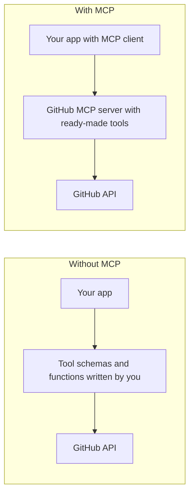
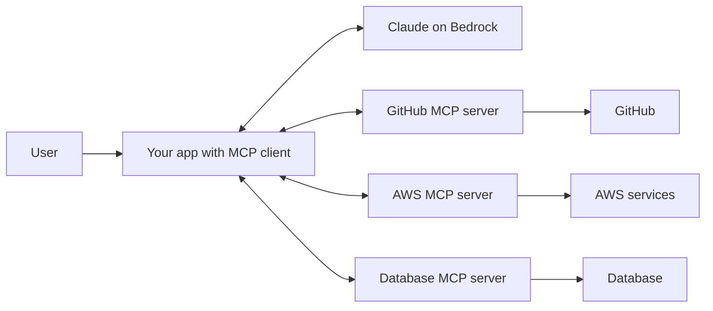

<h1>Module 7 — Model Context Protocol (MCP)</h1>

<h2>Contents</h2>

- [1. Introducing MCP](#1-introducing-mcp)
  - [The problem MCP solves](#the-problem-mcp-solves)
  - [How MCP works](#how-mcp-works)
  - [Common questions](#common-questions)
- [2. MCP clients](#2-mcp-clients)
- [3. Project setup](#3-project-setup)
- [4. Defining tools with MCP](#4-defining-tools-with-mcp)
- [5. The server inspector](#5-the-server-inspector)
- [6. Implementing a client](#6-implementing-a-client)
- [7. Defining resources](#7-defining-resources)
- [8. Accessing resources](#8-accessing-resources)
- [9. Defining prompts](#9-defining-prompts)
- [10. Prompts in the client](#10-prompts-in-the-client)
- [11. MCP review](#11-mcp-review)
- [Common pitfalls](#common-pitfalls)

---

## 1. Introducing MCP

**Model Context Protocol (MCP)** is a communication layer that gives Claude **context and tools** coming
from outside services, so you don't have to write all the integration code yourself. Instead of building every
tool function in your app, you plug in **MCP servers** that already implement them.

### The problem MCP solves

Imagine a chat app where users ask Claude about their GitHub data: *"What open pull requests are there across
all my repositories?"*. With plain tool use, **you** must write a tool schema + function for every GitHub
operation you want to support: repositories, pull requests, issues, projects... GitHub is huge, so this means a
lot of code to write, test and maintain.

### How MCP works

MCP moves the **definition and execution** of tools from your server to dedicated **MCP servers**. Each MCP
server is a wrapper around an outside service (GitHub, AWS, a database...) and exposes:

- **Tools** — functions Claude can call.
- **Prompts** — pre-built instructions.
- **Resources** — data the app can read.

> Note: the lesson calls the MCP client "your server". More precisely, the **MCP client** is the part of your
> application that connects to the MCP servers and passes their tools to Claude.

### Common questions

| Question | Answer |
|---|---|
| Who writes MCP servers? | Anyone. Often the service provider publishes an official one (e.g. AWS with tools for its services). |
| How is it different from calling the API directly? | Calling the API directly, you still write the tool schemas and functions. An MCP server gives them to you already defined. |
| Isn't MCP the same as tool use? | No, they're complementary. **Tool use** = Claude calling functions. **MCP** = *who provides* those functions: someone else already implemented them in a server. |

Key idea: in both cases Claude uses tools, but with MCP you don't author the schemas and functions, which cuts
most of the development work.

---

## 2. MCP clients

_TODO_

---

## 3. Project setup

_TODO_

---

## 4. Defining tools with MCP

_TODO_

---

## 5. The server inspector

_TODO_

---

## 6. Implementing a client

_TODO_

---

## 7. Defining resources

_TODO_

---

## 8. Accessing resources

_TODO_

---

## 9. Defining prompts

_TODO_

---

## 10. Prompts in the client

_TODO_

---

## 11. MCP review

_TODO_

---

## Common pitfalls

_TODO_

---

[← Back to README](README.md)
