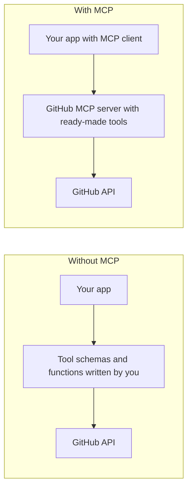
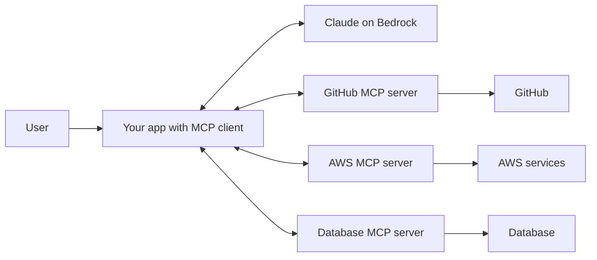
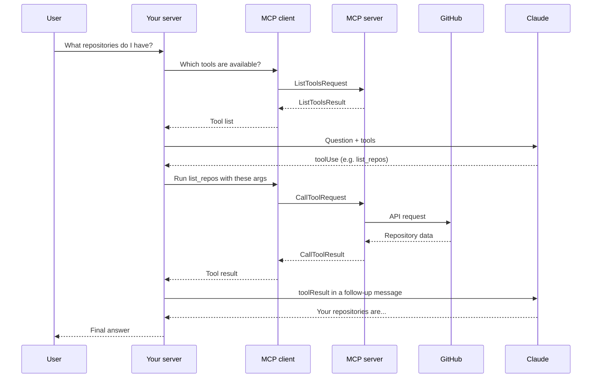
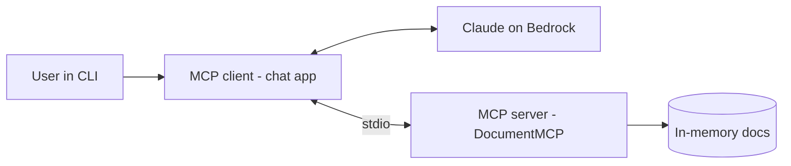
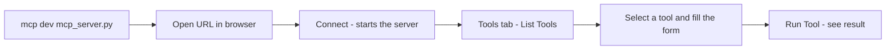
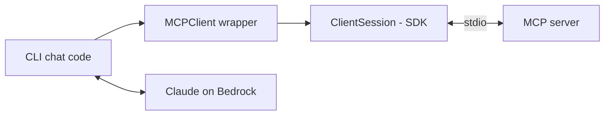
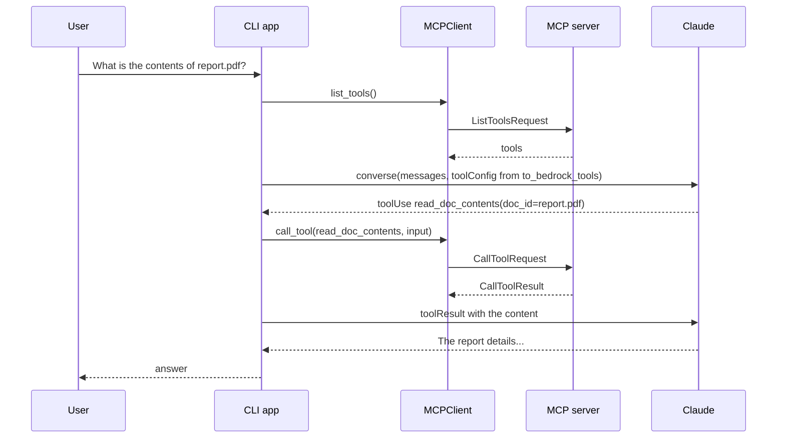
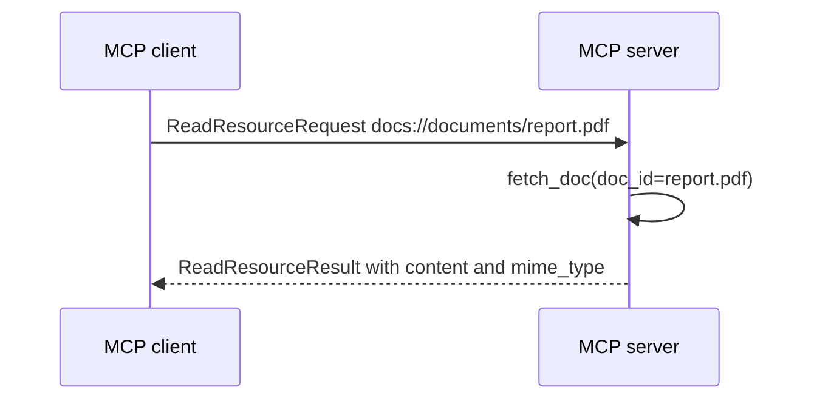
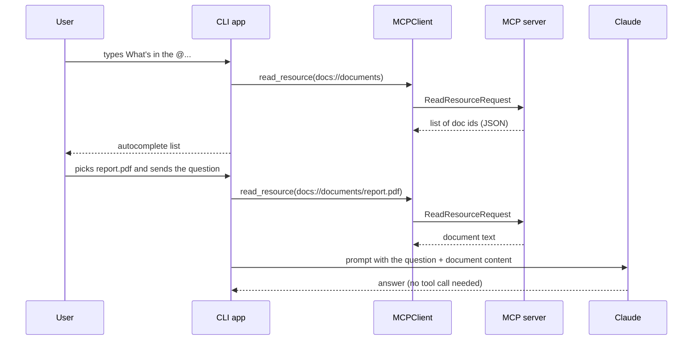

<h1>Module 7 — Model Context Protocol (MCP)</h1>

<h2>Contents</h2>

- [1. Introducing MCP](#1-introducing-mcp)
  - [The problem MCP solves](#the-problem-mcp-solves)
  - [How MCP works](#how-mcp-works)
  - [Common questions](#common-questions)
- [2. MCP clients](#2-mcp-clients)
  - [Transport agnostic](#transport-agnostic)
  - [Message types](#message-types)
  - [Complete flow](#complete-flow)
- [3. Project setup](#3-project-setup)
  - [What we're building](#what-were-building)
  - [Architecture](#architecture)
  - [Client or server, not both](#client-or-server-not-both)
- [4. Defining tools with MCP](#4-defining-tools-with-mcp)
  - [Why the Python SDK](#why-the-python-sdk)
  - [Server setup](#server-setup)
  - [Read tool](#read-tool)
  - [Edit tool](#edit-tool)
  - [Key points](#key-points)
- [5. The server inspector](#5-the-server-inspector)
  - [Starting the inspector](#starting-the-inspector)
  - [Using the interface](#using-the-interface)
  - [Testing the document tools](#testing-the-document-tools)
  - [Development loop](#development-loop)
- [6. Implementing a client](#6-implementing-a-client)
  - [Client architecture](#client-architecture)
  - [The wrapper class](#the-wrapper-class)
  - [`list_tools` and `call_tool`](#list_tools-and-call_tool)
  - [MCP schema vs Bedrock schema](#mcp-schema-vs-bedrock-schema)
  - [Testing with Claude](#testing-with-claude)
- [7. Defining resources](#7-defining-resources)
  - [Understanding resources](#understanding-resources)
  - [Direct vs templated resources](#direct-vs-templated-resources)
  - [Implementing resources](#implementing-resources)
  - [Testing in the inspector](#testing-in-the-inspector)
  - [Use cases](#use-cases)
- [8. Accessing resources](#8-accessing-resources)
  - [Resource flow](#resource-flow)
  - [Implementing `read_resource`](#implementing-read_resource)
  - [Injecting the resource into the prompt](#injecting-the-resource-into-the-prompt)
  - [Testing](#testing)
  - [Resources vs tools to read data](#resources-vs-tools-to-read-data)
- [9. Defining prompts](#9-defining-prompts)
  - [Why prompts](#why-prompts)
  - [Defining a prompt](#defining-a-prompt)
  - [The format prompt](#the-format-prompt)
  - [Testing in the inspector](#testing-in-the-inspector-1)
- [10. Prompts in the client](#10-prompts-in-the-client)
- [11. MCP review](#11-mcp-review)
- [Common pitfalls](#common-pitfalls)

---

## 1. Introducing MCP

**Model Context Protocol (MCP)** is a communication layer that gives Claude **context and tools** coming
from outside services, so you don't have to write all the integration code yourself. Instead of building every
tool function in your app, you plug in **MCP servers** that already implement them.

### The problem MCP solves

Imagine a chat app where users ask Claude about their GitHub data: *"What open pull requests are there across
all my repositories?"*. With plain tool use, **you** must write a tool schema + function for every GitHub
operation you want to support: repositories, pull requests, issues, projects... GitHub is huge, so this means a
lot of code to write, test and maintain.



### How MCP works


MCP moves the **definition and execution** of tools from your server to dedicated **MCP servers**. Each MCP
server is a wrapper around an outside service (GitHub, AWS, a database...) and exposes:

- **Tools** — functions Claude can call.
- **Prompts** — pre-built instructions.
- **Resources** — data the app can read.



> Note: the lesson calls the MCP client "your server". More precisely, the **MCP client** is the part of your
> application that connects to the MCP servers and passes their tools to Claude.

### Common questions

| Question | Answer |
|---|---|
| Who writes MCP servers? | Anyone. Often the service provider publishes an official one (e.g. AWS with tools for its services). |
| How is it different from calling the API directly? | Calling the API directly, you still write the tool schemas and functions. An MCP server gives them to you already defined. |
| Isn't MCP the same as tool use? | No, they're complementary. **Tool use** = Claude calling functions. **MCP** = *who provides* those functions: someone else already implemented them in a server. |

Key idea: in both cases Claude uses tools, but with MCP you don't author the schemas and functions, which cuts
most of the development work.

---

## 2. MCP clients

The **MCP client** is the bridge between your server (your app) and the MCP servers. It's your access point to
everything an MCP server offers: it handles the message passing and the protocol details, so your code just asks
"which tools are there?" and "run this tool".

### Transport agnostic

MCP is **transport agnostic**: client and server can talk over different communication channels.

| Transport | When |
|---|---|
| **stdio** (standard input/output) | Most common setup: client and server on the same machine, the server runs as a local process |
| **HTTP** | Remote servers over the network |
| Others (WebSockets, custom...) | Possible, the protocol doesn't depend on the channel |

> Note: the lesson mentions HTTP and WebSockets as examples. The official MCP spec currently defines two standard
> transports: **stdio** and **Streamable HTTP** (which replaced the older HTTP + SSE). WebSockets would be a custom transport.

### Message types

Once connected, client and server exchange messages defined in the MCP spec. The two main pairs:

| Request | Result | Meaning |
|---|---|---|
| `ListToolsRequest` | `ListToolsResult` | "What tools do you provide?" → full list of tools (name, description, input schema) |
| `CallToolRequest` | `CallToolResult` | "Run this tool with these arguments" → the execution result |

### Complete flow

User asks *"What repositories do I have?"*:



Compared with plain tool use (Module 4), the loop with Claude is **the same** (`toolUse` → `toolResult`). The
only change is **who executes the tool**: your server no longer runs the function, it delegates it to the MCP
server through the client.

| Component | Responsibility |
|---|---|
| Your server | App logic, talks to Claude, decides when to list/call tools |
| MCP client | Protocol and communication with the MCP server |
| MCP server | Defines and executes the tools, talks to the outside service |
| Claude | Decides which tool to call and writes the answer |

---

## 3. Project setup

To see how clients and servers work together, the module builds a **CLI chatbot** that lets the user chat with
a set of documents. The project includes **both sides** of MCP: a client and a server.

### What we're building

| Feature | Description |
|---|---|
| CLI chat | Command-line chat interface with Claude |
| Read / edit documents | Claude can read and update documents through tools |
| Mentions `@doc_name` | The user references a document and its content goes into the prompt |
| Commands `/command_name` | The user runs a pre-built prompt (e.g. `/format`) |
| Fake documents | Stored **in memory** (PDFs, spreadsheets, text, markdown), no files on disk |

### Architecture

| Component | Role |
|---|---|
| **MCP client** | User interaction and chat interface; talks to Claude and to the MCP server |
| **MCP server** | Exposes the document operations |
| **Document storage** | In-memory dict with the documents |

The server implements two core tools:

- **Read** the contents of a document.
- **Update** the contents of a document.



Mapping each feature to the MCP primitive used later in the module:

| Feature | MCP primitive | Section |
|---|---|---|
| Read / edit documents | Tools | [4](#4-defining-tools-with-mcp), [6](#6-implementing-a-client) |
| `@doc_name` mentions | Resources | [7](#7-defining-resources), [8](#8-accessing-resources) |
| `/command_name` commands | Prompts | [9](#9-defining-prompts), [10](#10-prompts-in-the-client) |

### Client or server, not both

In real projects you normally build **one side only**:

- An **MCP server** → to offer your service to other developers / apps.
- An **MCP client** → to connect your app to existing third-party MCP servers.

This project has both in the same codebase **only to learn** how they interact.

Course downloads: `cli_starter.zip` (starting point) and `cli_project_complete.zip` (final solution).

---

## 4. Defining tools with MCP

The official **MCP Python SDK** makes building a server much simpler: instead of writing JSON schemas by hand
(as in Module 4), you define tools as **decorated Python functions** and the SDK generates the schema.

### Why the Python SDK

- Minimal boilerplate to create a server.
- **JSON schema generated automatically** from the function signature (type hints + `Field` descriptions).
- Tools defined with a decorator: `@mcp.tool`.
- Type validation and error handling built in.

| | Plain tool use (Module 4) | MCP Python SDK |
|---|---|---|
| Schema | Written by hand (`toolSpec` → `inputSchema.json`) | Generated from the function signature |
| Parameter descriptions | Inside the JSON schema | `Field(description=...)` |
| Execution | Your app runs the function | The MCP server runs it |

### Server setup

The server is a `FastMCP` instance; the documents live in an in-memory dict (`doc_id` → content).

```python
from mcp.server.fastmcp import FastMCP
from pydantic import Field

mcp = FastMCP("DocumentMCP", log_level="ERROR")

docs = {
    "deposition.md": "This deposition covers the testimony of Angela Smith, P.E.",
    "report.pdf": "The report details the state of a 20m condenser tower.",
    "financials.docx": "These financials outline the project's budget and expenditures",
    "outlook.pdf": "This document presents the projected future performance of the system",
    "plan.md": "The plan outlines the steps for the project's implementation.",
    "spec.txt": "These specifications define the technical requirements for the equipment",
}

if __name__ == "__main__":
    mcp.run(transport="stdio")
```

### Read tool

```python
@mcp.tool(
    name="read_doc_contents",
    description="Read the contents of a document and return it as a string.",
)
def read_document(
    doc_id: str = Field(description="Id of the document to read"),
):
    if doc_id not in docs:
        raise ValueError(f"Doc with id {doc_id} not found")
    return docs[doc_id]
```

What the SDK publishes for it in `ListToolsResult` (roughly):

```json
{
  "name": "read_doc_contents",
  "description": "Read the contents of a document and return it as a string.",
  "inputSchema": {
    "type": "object",
    "properties": {
      "doc_id": {"type": "string", "description": "Id of the document to read"}
    },
    "required": ["doc_id"]
  }
}
```

It's the same shape as a Converse `toolSpec` (`name`, `description`, input schema), which is why the client can
convert MCP tools to `toolConfig` easily (section [6](#6-implementing-a-client)).

### Edit tool

A simple find-and-replace over the document content:

```python
@mcp.tool(
    name="edit_document",
    description="Edit a document by replacing a string in the documents content with a new string.",
)
def edit_document(
    doc_id: str = Field(description="Id of the document that will be edited"),
    old_str: str = Field(description="The text to replace. Must match exactly, including whitespace."),
    new_str: str = Field(description="The new text to insert in place of the old text."),
):
    if doc_id not in docs:
        raise ValueError(f"Doc with id {doc_id} not found")
    docs[doc_id] = docs[doc_id].replace(old_str, new_str)
```

> Note (not in the lesson): `str.replace()` replaces **every** occurrence, and if `old_str` isn't found it
> silently does nothing. The function also returns nothing, so Claude gets an empty result. A sturdier version
> would check that `old_str` exists and return a confirmation (e.g. `"Document updated"`).

### Key points

| Element | Purpose |
|---|---|
| `@mcp.tool(name=..., description=...)` | Registers the tool; clear name and description so Claude knows when to use it |
| Type hints (`doc_id: str`) | Parameter types in the schema |
| `Field(description=...)` (pydantic) | Parameter descriptions in the schema |
| `raise ValueError(...)` | Errors for invalid input; the SDK sends them back to the client as a tool error |

---

## 5. The server inspector

To test an MCP server **without wiring it to a full app**, the Python SDK includes a browser-based
**MCP Inspector** to debug and try the server in real time.

### Starting the inspector

With the project's Python environment activated:

```bash
mcp dev mcp_server.py
```

It starts a development server and prints a local URL to open in the browser.

> Note (not in the lesson): `mcp dev` needs the SDK with the CLI extra (`pip install "mcp[cli]"`) and
> **Node.js**, because the inspector is a Node app launched with `npx`. The lesson says the URL is "typically on
> port 6277"; in current versions **6274** is the web UI and **6277** is the proxy that talks to your server. Use
> the URL printed in the terminal (it may include an auth token).

### Using the interface

The UI changes often, but the flow is the same:



| Step | What to do |
|---|---|
| **Connect** | Button on the left: starts the MCP server and loads its capabilities |
| **Navigation bar** | Tabs **Resources**, **Prompts**, **Tools** (one per primitive) |
| **List Tools** | Shows every tool the server exposes (the `ListToolsRequest`) |
| **Select a tool** | The right panel shows a form generated from its input schema |
| **Run Tool** | Runs it (the `CallToolRequest`) and shows status + returned data |

### Testing the document tools

- **Read**: select `read_doc_contents`, `doc_id` = `deposition.md` → Run Tool → the document content.
- **Edit**: select `edit_document`, fill `doc_id`, `old_str`, `new_str` → Run Tool → then run
  `read_doc_contents` again to check the change was applied.

### Development loop

The left side keeps a **history** of tool calls, so it's easy to see what you tested and repeat calls.

1. Change the server code.
2. Restart the inspector (reconnect).
3. Test the tools right away.
4. Verify the results.

Testing with the inspector **before** building the client separates server bugs from client bugs.

---

## 6. Implementing a client

With the server working, the next step is the **client**: the part of the app that talks to the MCP server and
gives Claude access to its tools.

### Client architecture


The client has two layers:

| Layer | What it is |
|---|---|
| **`MCPClient`** | Our own class that wraps the session to make it easier to use and to **clean up resources** on shutdown |
| **`ClientSession`** | The real connection to the server (from the MCP Python SDK); handles the low-level communication |



The CLI uses the client at **two moments**:

1. **List the tools** to send them to Claude with the request.
2. **Execute a tool** when Claude asks for one (`toolUse`).

### The wrapper class

The starter project already includes the wrapper; roughly it looks like this (my simplified version, the lesson
only shows the two methods below):

```python
from contextlib import AsyncExitStack
from mcp import ClientSession, StdioServerParameters, types
from mcp.client.stdio import stdio_client


class MCPClient:
    def __init__(self, command: str, args: list[str], env: dict | None = None):
        self._command, self._args, self._env = command, args, env
        self._session: ClientSession | None = None
        self._exit_stack = AsyncExitStack()

    async def connect(self):
        params = StdioServerParameters(command=self._command, args=self._args, env=self._env)
        read, write = await self._exit_stack.enter_async_context(stdio_client(params))
        self._session = await self._exit_stack.enter_async_context(ClientSession(read, write))
        await self._session.initialize()

    def session(self) -> ClientSession:
        if self._session is None:
            raise ConnectionError("Client session not initialized. Call connect() first.")
        return self._session

    async def cleanup(self):
        await self._exit_stack.aclose()
        self._session = None

    async def __aenter__(self):
        await self.connect()
        return self

    async def __aexit__(self, *exc):
        await self.cleanup()
```

The `AsyncExitStack` is what gives the "automatic cleanup": it closes the session and stops the server process
when the client exits.

### `list_tools` and `call_tool`

The two methods we implement just delegate to the session:

```python
async def list_tools(self) -> list[types.Tool]:
    result = await self.session().list_tools()        # ListToolsRequest
    return result.tools

async def call_tool(self, tool_name: str, tool_input: dict) -> types.CallToolResult | None:
    return await self.session().call_tool(tool_name, tool_input)   # CallToolRequest
```

Quick test with the harness at the bottom of the file (connects and prints the tools: name, description,
input schema):

```bash
uv run mcp_client.py
```

### MCP schema vs Bedrock schema

MCP tool definitions **don't match exactly** what Bedrock Converse expects, so they must be converted. The
project already does it in `to_bedrock_tools()` (`core/bedrock.py`).

| MCP `types.Tool` | Bedrock Converse `toolConfig.tools[]` |
|---|---|
| `name` | `toolSpec.name` |
| `description` | `toolSpec.description` |
| `inputSchema` (JSON schema) | `toolSpec.inputSchema.json` |

Conversion in both directions (my version; the project's code may differ in details):

```python
def to_bedrock_tools(mcp_tools: list[types.Tool]) -> list[dict]:
    return [
        {
            "toolSpec": {
                "name": t.name,
                "description": t.description or "",
                "inputSchema": {"json": t.inputSchema},
            }
        }
        for t in mcp_tools
    ]


def to_bedrock_tool_result(tool_use_id: str, result: types.CallToolResult) -> dict:
    return {
        "toolResult": {
            "toolUseId": tool_use_id,
            "content": [{"text": c.text} for c in result.content if c.type == "text"],
            "status": "error" if result.isError else "success",
        }
    }
```

### Testing with Claude

```bash
uv run main.py
```

Ask *"What is the contents of the report.pdf document?"*:



---

## 7. Defining resources

**Resources** let an MCP server expose **data** to the client, like **GET handlers** in an HTTP server. They
are for **fetching information**, not for performing actions (that's what tools are for).

### Understanding resources

- **Read-only** endpoints that can return any type of data: strings, JSON, binary files...
- Each resource is identified by a **URI** (its address).
- A **`mime_type`** tells the client what kind of data comes back.
- The client sends a **`ReadResourceRequest`** with the URI → the server answers with a **`ReadResourceResult`**.



| | Tools | Resources |
|---|---|---|
| Purpose | Perform actions (read, edit, call APIs) | Expose data (read-only) |
| Who decides to use it | **Claude** (model-controlled) | **Your app** (application-controlled) |
| Request | `CallToolRequest` | `ReadResourceRequest` |
| HTTP analogy | POST / any action | GET |

### Direct vs templated resources

| Type | URI | Example | Use |
|---|---|---|---|
| **Direct** | Static, no parameters | `docs://documents` | List of all document ids |
| **Templated** | With parameters `{...}` | `docs://documents/{doc_id}` | Content of one document |

In templated resources the SDK **parses the parameters from the URI** and passes them as keyword arguments: the
name in the URI (`{doc_id}`) must match the function argument name (`doc_id`).

### Implementing resources

With the `@mcp.resource()` decorator:

```python
@mcp.resource(
    "docs://documents",
    mime_type="application/json",
)
def list_docs() -> list[str]:
    return list(docs.keys())


@mcp.resource(
    "docs://documents/{doc_id}",
    mime_type="text/plain",
)
def fetch_doc(doc_id: str) -> str:
    if doc_id not in docs:
        raise ValueError(f"Doc with id {doc_id} not found")
    return docs[doc_id]
```

The SDK **serializes** whatever you return: just return the Python structure (`list`, `dict`, `str`...), no need
for `json.dumps()`.

### Testing in the inspector

```bash
uv run mcp dev mcp_server.py
```


The inspector shows the two types separately:

| Inspector section | Contains |
|---|---|
| **Resources** | Direct resources (`docs://documents`) |
| **Resource Templates** | Templated resources (`docs://documents/{doc_id}`); you fill the parameter before reading |

Clicking a resource shows the exact response structure the server returns.

### Use cases

- **Autocomplete** data (e.g. list of documents for `@` mentions).
- File contents or database records.
- Configuration data.
- Any read-only information the client needs.

Key advantage: the client can **fetch data proactively**, without going through Claude and a tool call. That's
what the `@doc_name` mentions use: the app reads the document and **injects it into the prompt** directly.

---

## 8. Accessing resources

Resources let the app put server data **straight into the prompt**, instead of Claude needing a tool call to get
it. A more efficient way to give Claude context.

### Resource flow

When the user types `@` in the CLI, the app needs the list of documents for **autocomplete**, and then the
content of the chosen one:



### Implementing `read_resource`

In the `MCPClient` class. Imports:

```python
import json
from typing import Any
from pydantic import AnyUrl
from mcp import types
```

The method asks the server for the URI and processes the first content according to its MIME type:

```python
async def read_resource(self, uri: str) -> Any:
    result = await self.session().read_resource(AnyUrl(uri))   # ReadResourceRequest
    resource = result.contents[0]

    if isinstance(resource, types.TextResourceContents):
        if resource.mimeType == "application/json":
            return json.loads(resource.text)     # docs://documents -> list[str]
        return resource.text                     # docs://documents/{id} -> str

    return resource.blob                         # BlobResourceContents (binary, base64)
```

| Content type | SDK class | Field | What we return |
|---|---|---|---|
| `application/json` | `TextResourceContents` | `text` | Parsed Python object (`json.loads`) |
| `text/plain` | `TextResourceContents` | `text` | The string as-is |
| Binary (images, PDFs...) | `BlobResourceContents` | `blob` (base64) | The base64 data |

> Note: the lesson's code returns `resource.text` for every case and doesn't import `Any`. A
> `BlobResourceContents` has no `text`, so I added the `blob` branch. Not needed for this project (all docs are
> text), but it avoids an `AttributeError` with binary resources.

### Injecting the resource into the prompt

The lesson doesn't show this part (it's in the starter code). Roughly, the CLI adds the mentioned documents to
the user message in Converse format:

```python
async def build_user_message(client: MCPClient, query: str, mentioned_ids: list[str]) -> dict:
    docs_xml = ""
    for doc_id in mentioned_ids:
        content = await client.read_resource(f"docs://documents/{doc_id}")
        docs_xml += f'<document id="{doc_id}">\n{content}\n</document>\n'

    prompt = f"""The user has mentioned these documents:
<documents>
{docs_xml}</documents>

{query}"""
    return {"role": "user", "content": [{"text": prompt}]}
```

### Testing

Run the CLI and type `@`:

1. The autocomplete list shows the available documents.
2. Select one with the arrow keys and space.
3. Its content goes **directly in the prompt** sent to Claude.

Claude gets the document right away, without extra tool calls.

### Resources vs tools to read data

| | Reading with a tool (`read_doc_contents`) | Reading with a resource (`@report.pdf`) |
|---|---|---|
| Who decides | Claude | User / app |
| Calls to Claude | 2+ (toolUse → toolResult → answer) | 1 |
| Latency and tokens | Higher | Lower |
| UX | Claude must guess which doc | Autocomplete, user picks it |
| Best for | Dynamic operations | Relatively static info: docs, reports, reference material |

---

## 9. Defining prompts

MCP servers can also define **prompts**: pre-written, well-tested instructions that clients can use instead of
writing their own from scratch. Templates crafted by the server author that give better results than what a
user would improvise.

### Why prompts

Asking *"Convert report.pdf to markdown"* works, but a **detailed, tested prompt** that covers edge cases and gives
precise formatting instructions works much better. The server author spends time on prompt engineering (and
evals, Module 2) once, and every user of the server benefits without being an expert.

| Benefit | Meaning |
|---|---|
| **Quality control** | The author tests and refines the prompt before users see it |
| **Consistency** | Everyone gets the same good prompt instead of improvising |
| **Specialization** | Tailored to the server's domain and its tools |
| **Reusability** | Many client apps can use the same prompt |

### Defining a prompt

Same decorator pattern as tools and resources: `@mcp.prompt`. The function returns a **list of messages** ready to
send to Claude, so it can include several user/assistant turns if needed.

```python
from mcp.server.fastmcp.prompts import base
```

### The format prompt

For the document server, a `/format` prompt that rewrites a document in Markdown. It must:

1. Take a document id as input.
2. Use `read_doc_contents` to get the document.
3. Reformat it with Markdown syntax.
4. Save the changes with `edit_document`.

```python
@mcp.prompt(
    name="format",
    description="Rewrites the contents of the document in Markdown format.",
)
def format_document(
    doc_id: str = Field(description="Id of the document to format"),
) -> list[base.Message]:
    prompt = f"""
Your goal is to reformat a document to be written with markdown syntax.

The id of the document you need to reformat is:
<document_id>
{doc_id}
</document_id>

Add in headers, bullet points, tables, etc as necessary. Feel free to add in structure.
Use the 'edit_document' tool to edit the document. After the document has been reformatted,
respond with a short summary of the changes you made.
"""
    return [base.UserMessage(prompt)]
```

> Note: the lesson shows the decorator and the body in two separate snippets and cuts the prompt text
> ("After the document has been reformatted..."). I joined them, finished the last sentence and wrapped the id in
> an XML tag (Module 3).

The prompt **relies on the server's tools**: the prompt is the "what to do", the tools are the "how".

| Primitive | Decorator | Returns |
|---|---|---|
| Tool | `@mcp.tool` | The result of an action |
| Resource | `@mcp.resource` | Data (JSON, text, binary) |
| Prompt | `@mcp.prompt` | A list of messages (`base.UserMessage`, `base.AssistantMessage`) |

### Testing in the inspector

**Prompts** tab → select `format` → fill `doc_id` → the inspector shows the **generated messages** that would be
sent to Claude. Useful to check that the parameters are interpolated correctly and that the prompt contains all
the instructions.


---

## 10. Prompts in the client

_TODO_

---

## 11. MCP review

_TODO_

---

## Common pitfalls

_TODO_

---

[← Back to README](README.md)
