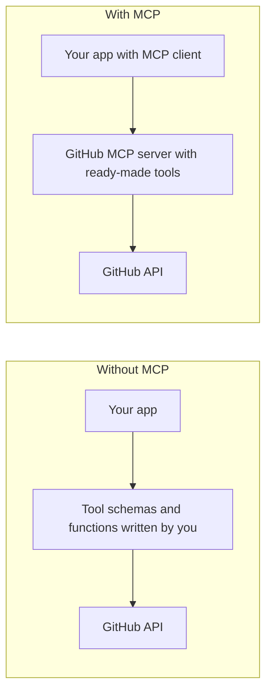
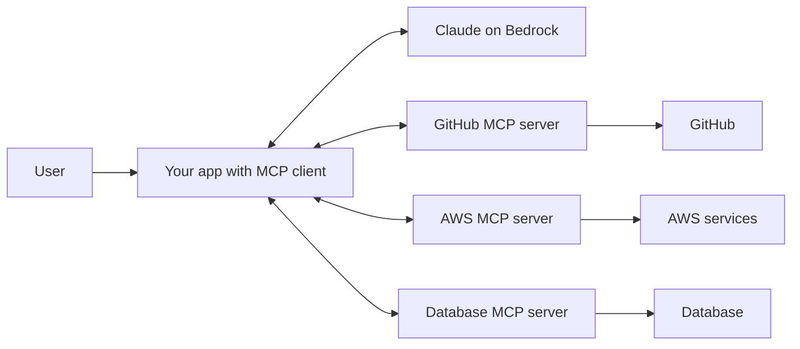
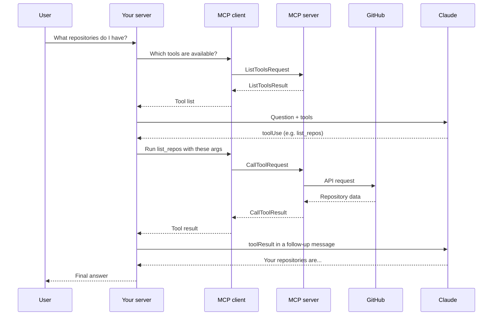
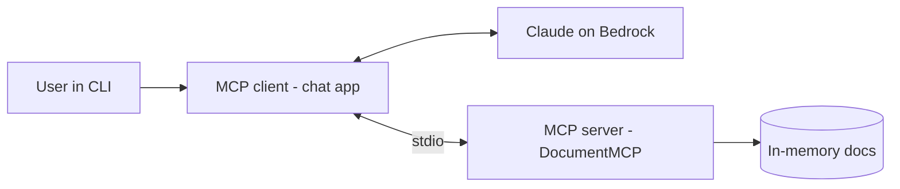

<h1>Module 7 — Model Context Protocol (MCP)</h1>

<h2>Contents</h2>

- [1. Introducing MCP](#1-introducing-mcp)
  - [The problem MCP solves](#the-problem-mcp-solves)
  - [How MCP works](#how-mcp-works)
  - [Common questions](#common-questions)
- [2. MCP clients](#2-mcp-clients)
  - [Transport agnostic](#transport-agnostic)
  - [Message types](#message-types)
  - [Complete flow](#complete-flow)
- [3. Project setup](#3-project-setup)
  - [What we're building](#what-were-building)
  - [Architecture](#architecture)
  - [Client or server, not both](#client-or-server-not-both)
- [4. Defining tools with MCP](#4-defining-tools-with-mcp)
- [5. The server inspector](#5-the-server-inspector)
- [6. Implementing a client](#6-implementing-a-client)
- [7. Defining resources](#7-defining-resources)
- [8. Accessing resources](#8-accessing-resources)
- [9. Defining prompts](#9-defining-prompts)
- [10. Prompts in the client](#10-prompts-in-the-client)
- [11. MCP review](#11-mcp-review)
- [Common pitfalls](#common-pitfalls)

---

## 1. Introducing MCP

**Model Context Protocol (MCP)** is a communication layer that gives Claude **context and tools** coming
from outside services, so you don't have to write all the integration code yourself. Instead of building every
tool function in your app, you plug in **MCP servers** that already implement them.

### The problem MCP solves

Imagine a chat app where users ask Claude about their GitHub data: *"What open pull requests are there across
all my repositories?"*. With plain tool use, **you** must write a tool schema + function for every GitHub
operation you want to support: repositories, pull requests, issues, projects... GitHub is huge, so this means a
lot of code to write, test and maintain.

### How MCP works

MCP moves the **definition and execution** of tools from your server to dedicated **MCP servers**. Each MCP
server is a wrapper around an outside service (GitHub, AWS, a database...) and exposes:

- **Tools** — functions Claude can call.
- **Prompts** — pre-built instructions.
- **Resources** — data the app can read.

> Note: the lesson calls the MCP client "your server". More precisely, the **MCP client** is the part of your
> application that connects to the MCP servers and passes their tools to Claude.

### Common questions

| Question | Answer |
|---|---|
| Who writes MCP servers? | Anyone. Often the service provider publishes an official one (e.g. AWS with tools for its services). |
| How is it different from calling the API directly? | Calling the API directly, you still write the tool schemas and functions. An MCP server gives them to you already defined. |
| Isn't MCP the same as tool use? | No, they're complementary. **Tool use** = Claude calling functions. **MCP** = *who provides* those functions: someone else already implemented them in a server. |

Key idea: in both cases Claude uses tools, but with MCP you don't author the schemas and functions, which cuts
most of the development work.

---

## 2. MCP clients

The **MCP client** is the bridge between your server (your app) and the MCP servers. It's your access point to
everything an MCP server offers: it handles the message passing and the protocol details, so your code just asks
"which tools are there?" and "run this tool".

### Transport agnostic

MCP is **transport agnostic**: client and server can talk over different communication channels.

| Transport | When |
|---|---|
| **stdio** (standard input/output) | Most common setup: client and server on the same machine, the server runs as a local process |
| **HTTP** | Remote servers over the network |
| Others (WebSockets, custom...) | Possible, the protocol doesn't depend on the channel |

> Note: the lesson mentions HTTP and WebSockets as examples. The official MCP spec currently defines two standard
> transports: **stdio** and **Streamable HTTP** (which replaced the older HTTP + SSE). WebSockets would be a custom transport.

### Message types

Once connected, client and server exchange messages defined in the MCP spec. The two main pairs:

| Request | Result | Meaning |
|---|---|---|
| `ListToolsRequest` | `ListToolsResult` | "What tools do you provide?" → full list of tools (name, description, input schema) |
| `CallToolRequest` | `CallToolResult` | "Run this tool with these arguments" → the execution result |

### Complete flow

User asks *"What repositories do I have?"*:

Compared with plain tool use (Module 4), the loop with Claude is **the same** (`toolUse` → `toolResult`). The
only change is **who executes the tool**: your server no longer runs the function, it delegates it to the MCP
server through the client.

| Component | Responsibility |
|---|---|
| Your server | App logic, talks to Claude, decides when to list/call tools |
| MCP client | Protocol and communication with the MCP server |
| MCP server | Defines and executes the tools, talks to the outside service |
| Claude | Decides which tool to call and writes the answer |

---

## 3. Project setup

To see how clients and servers work together, the module builds a **CLI chatbot** that lets the user chat with
a set of documents. The project includes **both sides** of MCP: a client and a server.

### What we're building

| Feature | Description |
|---|---|
| CLI chat | Command-line chat interface with Claude |
| Read / edit documents | Claude can read and update documents through tools |
| Mentions `@doc_name` | The user references a document and its content goes into the prompt |
| Commands `/command_name` | The user runs a pre-built prompt (e.g. `/format`) |
| Fake documents | Stored **in memory** (PDFs, spreadsheets, text, markdown), no files on disk |

### Architecture

| Component | Role |
|---|---|
| **MCP client** | User interaction and chat interface; talks to Claude and to the MCP server |
| **MCP server** | Exposes the document operations |
| **Document storage** | In-memory dict with the documents |

The server implements two core tools:

- **Read** the contents of a document.
- **Update** the contents of a document.

Mapping each feature to the MCP primitive used later in the module:

| Feature | MCP primitive | Section |
|---|---|---|
| Read / edit documents | Tools | [4](#4-defining-tools-with-mcp), [6](#6-implementing-a-client) |
| `@doc_name` mentions | Resources | [7](#7-defining-resources), [8](#8-accessing-resources) |
| `/command_name` commands | Prompts | [9](#9-defining-prompts), [10](#10-prompts-in-the-client) |

### Client or server, not both

In real projects you normally build **one side only**:

- An **MCP server** → to offer your service to other developers / apps.
- An **MCP client** → to connect your app to existing third-party MCP servers.

This project has both in the same codebase **only to learn** how they interact.

Course downloads: `cli_starter.zip` (starting point) and `cli_project_complete.zip` (final solution).

---

## 4. Defining tools with MCP

_TODO_

---

## 5. The server inspector

_TODO_

---

## 6. Implementing a client

_TODO_

---

## 7. Defining resources

_TODO_

---

## 8. Accessing resources

_TODO_

---

## 9. Defining prompts

_TODO_

---

## 10. Prompts in the client

_TODO_

---

## 11. MCP review

_TODO_

---

## Common pitfalls

_TODO_

---

[← Back to README](README.md)
