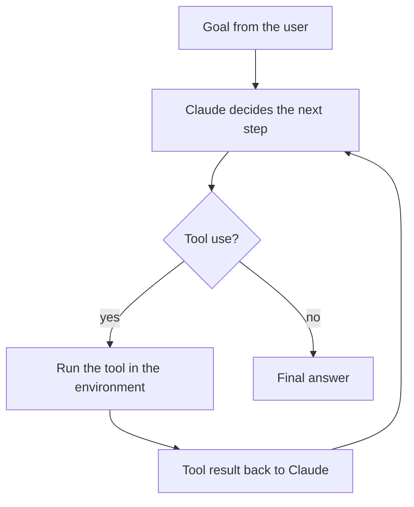
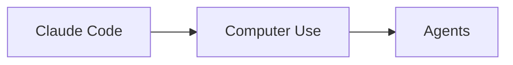

<h1>Module 8 — Agents</h1>

<h2>Contents</h2>

- [1. Agents overview](#1-agents-overview)
  - [Difficulties around agents](#difficulties-around-agents)
  - [Workflow vs agent](#workflow-vs-agent)
  - [The agent loop](#the-agent-loop)
  - [The plan for this module](#the-plan-for-this-module)
  - [When to use an agent](#when-to-use-an-agent)
- [2. Claude Code setup](#2-claude-code-setup)
- [3. Claude Code in action](#3-claude-code-in-action)
- [4. Enhancements with MCP servers](#4-enhancements-with-mcp-servers)
- [5. Parallelizing Claude Code](#5-parallelizing-claude-code)
- [6. Automated debugging](#6-automated-debugging)
- [7. Computer Use](#7-computer-use)
- [8. How Computer Use works](#8-how-computer-use-works)
- [9. Qualities of agents](#9-qualities-of-agents)
- [Common pitfalls](#common-pitfalls)

---

## 1. Agents overview

> Note: in the course this lesson is video only. "Difficulties around agents" and "The plan for this module"
> come from the video slides; the rest (workflow vs agent, the agent loop and when to use an agent) is general
> background I added.

An **agent** is Claude plus a set of **tools**, running in a **loop**. You give it a goal; Claude decides which
tool to use, looks at the result and chooses the next step, until the task is done. In the previous modules
**our code** decided the sequence of calls. In an agent, **the model decides the path**.

### Difficulties around agents

Building agents is hard: design patterns and best practices are **still emerging**. Open questions:

| Topic | Question |
|---|---|
| **What is an agent?** | There's no single, agreed definition |
| **Agents vs workflows** | Is an agent the right solution, or would a workflow be enough? |
| **Development** | Framework or no framework? Imperative or declarative? |
| **Design patterns** | When do you go beyond a single basic agent? |
| **Testing and evaluation** | How do you know the agent works as expected? |
| **Context** | How do you make sure the agent has the right context to solve the problem? |

### Workflow vs agent

| | Workflow | Agent |
|---|---|---|
| Who decides the steps | Our code (predefined) | Claude, at runtime |
| Use when | The steps are known in advance | The steps can't be predicted |
| Cost and latency | Lower and predictable | Higher and variable |
| Testing | Easy: same path every time | Harder: the path changes |
| Example | Prompt chaining, routing, RAG pipeline | Claude Code fixing a failing test |

Rule of thumb: start with the simplest option (a single prompt, then a workflow) and move to an agent only when
the task really needs flexibility.

### The agent loop



It's the same loop as `run_conversation` in Module 4. The difference is in scale: more tools, more
iterations, and real actions on the environment (files, commands, browser, screen). That's why an agent needs
a **stopping condition**:

```python
def run_agent(messages, tools, max_turns=20):
    for _ in range(max_turns):
        result = chat(messages, tools=tools)
        add_assistant_message(messages, result["parts"])

        if result["stop_reason"] != "tool_use":
            return result["text"]          # task done

        tool_result_parts = run_tools(result["parts"])
        add_user_message(messages, tool_result_parts)

    raise RuntimeError("Agent stopped: max_turns reached")
```

> Note: `max_turns` isn't in the lesson. I added it because a `while True` loop with an agent can run (and
> cost) forever.

### The plan for this module

Instead of building an agent from scratch, the module studies two agents made by Anthropic and then extracts
what makes them work:



| Step | What it is | Focus |
|---|---|---|
| **1. Claude Code** | Agentic coding assistant made by Anthropic that runs in the terminal | Edit files, fix bugs, answer questions about the code... |
| **2. Computer Use** | Set of tools that let Claude interact with a desktop computer environment | Access websites, interact with apps... |
| **3. Agents** | Wrap-up of the two examples | What makes Claude Code and Computer Use successful? |

### When to use an agent

- The task is **open-ended** and you can't write the steps in advance.
- Claude can **check its own work** (tests, error messages, screenshots).
- Mistakes are **cheap or reversible**, or a person reviews the sensitive actions.

## 2. Claude Code setup

<!-- pending -->

## 3. Claude Code in action

<!-- pending -->

## 4. Enhancements with MCP servers

<!-- pending -->

## 5. Parallelizing Claude Code

<!-- pending -->

## 6. Automated debugging

<!-- pending -->

## 7. Computer Use

<!-- pending -->

## 8. How Computer Use works

<!-- pending -->

## 9. Qualities of agents

<!-- pending -->

## Common pitfalls

<!-- pending -->

---

[← Back to README](README.md)
