<h1>Module 8 — Agents</h1>

<h2>Contents</h2>

- [1. Agents overview](#1-agents-overview)
  - [Difficulties around agents](#difficulties-around-agents)
  - [Workflow vs agent](#workflow-vs-agent)
  - [The agent loop](#the-agent-loop)
  - [The plan for this module](#the-plan-for-this-module)
  - [When to use an agent](#when-to-use-an-agent)
- [2. Claude Code in action](#2-claude-code-in-action)
  - [The `/init` command and `CLAUDE.md`](#the-init-command-and-claudemd)
  - [Common workflows](#common-workflows)
    - [Plan first](#plan-first)
    - [Test-driven development (TDD)](#test-driven-development-tdd)
  - [Practical tips](#practical-tips)
- [3. Adding MCP servers to Claude Code](#3-adding-mcp-servers-to-claude-code)
  - [How the integration works](#how-the-integration-works)
  - [Adding a server](#adding-a-server)
  - [Testing the integration](#testing-the-integration)
  - [Popular MCP servers for development](#popular-mcp-servers-for-development)
  - [Building your own workflow](#building-your-own-workflow)
- [4. Parallelizing Claude Code](#4-parallelizing-claude-code)
  - [The challenge: file conflicts](#the-challenge-file-conflicts)
  - [Git worktrees](#git-worktrees)
  - [Automating worktree creation](#automating-worktree-creation)
  - [Custom commands](#custom-commands)
  - [Parallel development in action](#parallel-development-in-action)
  - [Merging the changes](#merging-the-changes)
  - [Results](#results)
- [5. Automated debugging](#5-automated-debugging)
  - [The problem: production-only errors](#the-problem-production-only-errors)
  - [Traditional debugging](#traditional-debugging)
  - [Automated error detection and fixing](#automated-error-detection-and-fixing)
  - [Real-world example](#real-world-example)
  - [Benefits](#benefits)
  - [Implementation considerations](#implementation-considerations)
- [6. Computer Use](#6-computer-use)
  - [What Computer Use can do](#what-computer-use-can-do)
  - [Real-world example: automated QA testing](#real-world-example-automated-qa-testing)
  - [How the testing process works](#how-the-testing-process-works)
  - [Setting up Computer Use](#setting-up-computer-use)
  - [Best practices](#best-practices)
- [7. How Computer Use works](#7-how-computer-use-works)
  - [Tool use recap](#tool-use-recap)
  - [Same flow, different tool](#same-flow-different-tool)
  - [The technical implementation](#the-technical-implementation)
  - [Getting started](#getting-started)
- [8. Qualities of agents](#8-qualities-of-agents)
  - [How agents work in practice](#how-agents-work-in-practice)
  - [Comparing the two agents](#comparing-the-two-agents)
  - [Key qualities of effective agents](#key-qualities-of-effective-agents)
- [Common pitfalls](#common-pitfalls)

---

## 1. Agents overview

> Note: in the course this lesson is video only. "Difficulties around agents" and "The plan for this module"
> come from the video slides; the rest (workflow vs agent, the agent loop and when to use an agent) is general
> background I added.

An **agent** is Claude plus a set of **tools**, running in a **loop**. You give it a goal; Claude decides which
tool to use, looks at the result and chooses the next step, until the task is done. In the previous modules
**our code** decided the sequence of calls. In an agent, **the model decides the path**.

### Difficulties around agents

Building agents is hard: design patterns and best practices are **still emerging**. Open questions:

| Topic | Question |
|---|---|
| **What is an agent?** | There's no single, agreed definition |
| **Agents vs workflows** | Is an agent the right solution, or would a workflow be enough? |
| **Development** | Framework or no framework? Imperative or declarative? |
| **Design patterns** | When do you go beyond a single basic agent? |
| **Testing and evaluation** | How do you know the agent works as expected? |
| **Context** | How do you make sure the agent has the right context to solve the problem? |

### Workflow vs agent

| | Workflow | Agent |
|---|---|---|
| Who decides the steps | Our code (predefined) | Claude, at runtime |
| Use when | The steps are known in advance | The steps can't be predicted |
| Cost and latency | Lower and predictable | Higher and variable |
| Testing | Easy: same path every time | Harder: the path changes |
| Example | Prompt chaining, routing, RAG pipeline | Claude Code fixing a failing test |

Rule of thumb: start with the simplest option (a single prompt, then a workflow) and move to an agent only when
the task really needs flexibility.

### The agent loop

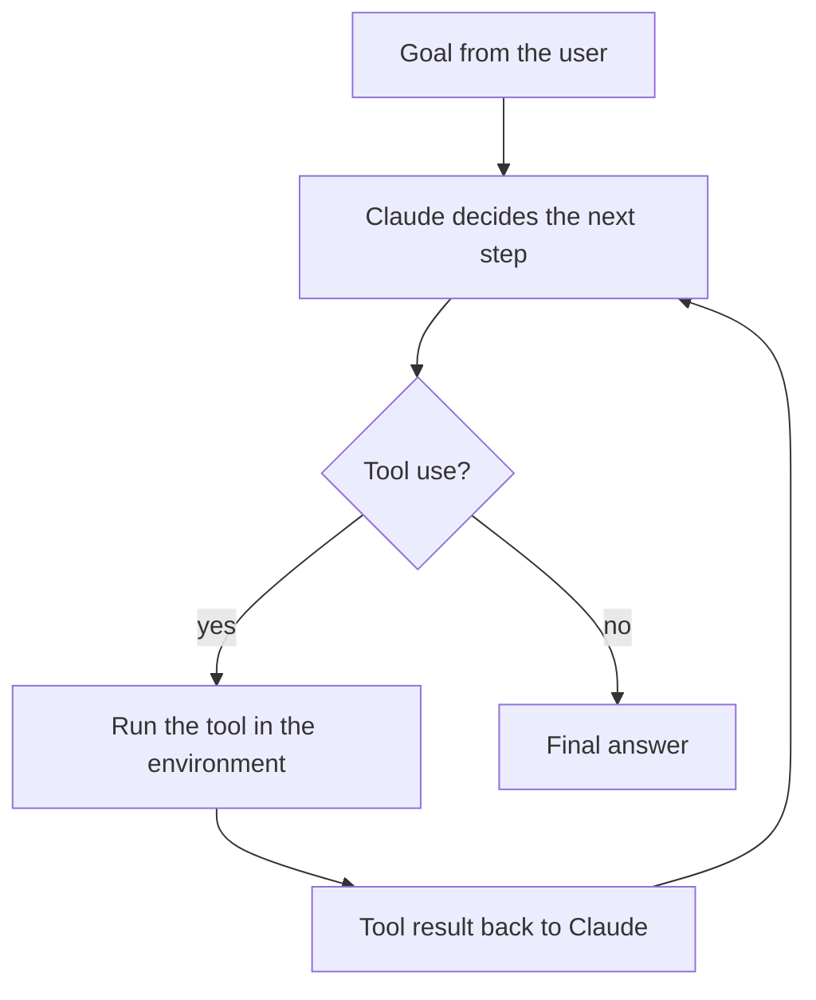

It's the same loop as `run_conversation` in Module 4. The difference is in scale: more tools, more
iterations, and real actions on the environment (files, commands, browser, screen). That's why an agent needs
a **stopping condition**:

```python
def run_agent(messages, tools, max_turns=20):
    for _ in range(max_turns):
        result = chat(messages, tools=tools)
        add_assistant_message(messages, result["parts"])

        if result["stop_reason"] != "tool_use":
            return result["text"]          # task done

        tool_result_parts = run_tools(result["parts"])
        add_user_message(messages, tool_result_parts)

    raise RuntimeError("Agent stopped: max_turns reached")
```

> Note: `max_turns` isn't in the lesson. I added it because a `while True` loop with an agent can run (and
> cost) forever.

### The plan for this module

Instead of building an agent from scratch, the module studies two agents made by Anthropic and then extracts
what makes them work:

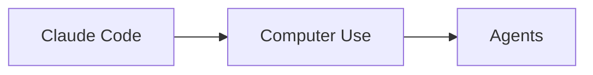

| Step | What it is | Focus |
|---|---|---|
| **1. Claude Code** | Agentic coding assistant made by Anthropic that runs in the terminal | Edit files, fix bugs, answer questions about the code... |
| **2. Computer Use** | Set of tools that let Claude interact with a desktop computer environment | Access websites, interact with apps... |
| **3. Agents** | Wrap-up of the two examples | What makes Claude Code and Computer Use successful? |

### When to use an agent

- The task is **open-ended** and you can't write the steps in advance.
- Claude can **check its own work** (tests, error messages, screenshots).
- Mistakes are **cheap or reversible**, or a person reviews the sensitive actions.

## 2. Claude Code in action

Claude Code is more than a code generator. It's meant to be a **coding partner for the whole project
lifecycle**, from the initial setup to deployment and maintenance:

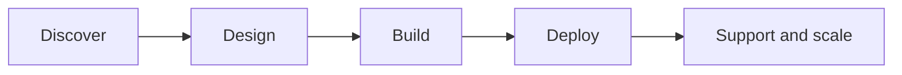

> Note (not in the lesson): to run Claude Code with Claude on **Amazon Bedrock**, set
> `CLAUDE_CODE_USE_BEDROCK=1` and `AWS_REGION`, and have your usual AWS credentials configured.

### The `/init` command and `CLAUDE.md`

`/init` is the first step in a new project. Claude Code scans the codebase (structure, dependencies, commands,
coding patterns) and writes a summary to **`CLAUDE.md`**. Claude reads this file **automatically** at the start
of every future conversation.

You can pass extra instructions to `/init` to point Claude at the areas you care about.

There are three scopes:

| Scope | Committed to git? | Use | File (not in the lesson) |
|---|---|---|---|
| **Project** | Yes, shared with the team | Commands, conventions, architecture | `./CLAUDE.md` |
| **Local** | No | Your personal notes for this project | `./CLAUDE.local.md` |
| **User** | — | Instructions for all your projects | `~/.claude/CLAUDE.md` |

The lesson mentions the `#` shortcut to add a quick note to `CLAUDE.md`.

> Note (not in the lesson): in recent versions of Claude Code you can also edit the memory files with the
> `/memory` command, or just ask Claude to add the note to `CLAUDE.md`.

Anything you write in `CLAUDE.md` (coding standards, project notes, architecture decisions) affects **every
future conversation**, so Claude gets better as the file grows.

### Common workflows


Claude works best as an **effort multiplier**: the more context and structure you give it, the better the result. Two workflows that work well:

#### Plan first

Good for complex features:

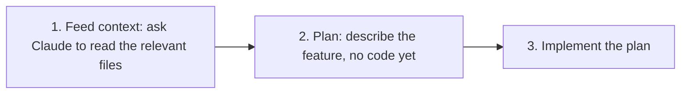

Example: for a document conversion tool, first ask Claude to look at the existing tools and helper functions,
then ask for an implementation plan, and only then for the code.

> Note (not in the lesson): Claude Code also has a **plan mode** (`Shift+Tab`) where Claude can read and
> plan but not edit files.

#### Test-driven development (TDD)

More effort at the start, but much better results:

| Step | What you ask Claude |
|---|---|
| 1. Context | Read the files related to the feature |
| 2. Test cases | Think of test cases, **without writing code yet** |
| 3. Tests | Implement only the tests that are relevant |
| 4. Code | Write code that makes the tests pass; Claude iterates until they're green |

The tests give Claude a clear way to **check its own work**, and they cover edge cases you might not have
thought of.

| | Plan first | TDD |
|---|---|---|
| Best for | Complex features | Code that must be robust |
| Upfront effort | Low | Higher |
| How Claude checks its work | Against the plan | Against the tests |

### Practical tips

Beyond writing code, Claude can handle routine development tasks:

- Set up the project environment and install dependencies.
- Stage and commit changes with descriptive commit messages.
- Run the test suite and interpret the results.
- `/clear` to reset the conversation context (for example, between unrelated tasks).

## 3. Adding MCP servers to Claude Code

Claude Code has a **built-in MCP client**, so you can plug MCP servers into it and give it new capabilities.
Each server can expose **tools, prompts and resources** (the same three primitives from Module 7).

### How the integration works

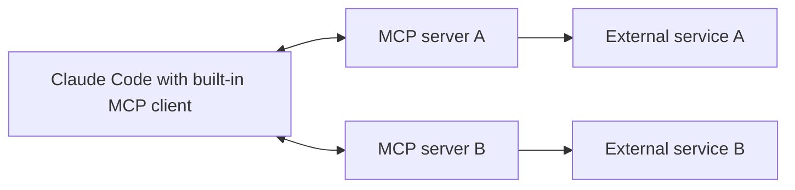

In the lesson's example, Claude Code connects to a **custom MCP server** with a document conversion tool,
`document_path_to_markdown`, that turns PDF and Word files into Markdown.

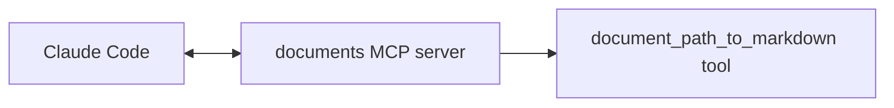

### Adding a server

Stop any running Claude Code session, then run:

```bash
claude mcp add documents uv run main.py
```

| Argument | Meaning |
|---|---|
| `documents` | Server name: any name you want |
| `uv run main.py` | Command that starts the MCP server |

Restart Claude Code and it connects to the server automatically.

> Note (not in the lesson): the docs recommend putting `--` before the server command, so that its options
> aren't read as `claude` options: `claude mcp add documents -- uv run main.py`. Other useful commands:
>
> | Command | What it does |
> |---|---|
> | `claude mcp list` | List the configured servers |
> | `claude mcp remove documents` | Remove a server |
> | `/mcp` (inside Claude Code) | See the connection status and tools of each server |
> | `--scope local / project / user` | Where the config is saved: just you in this project (default), the team via `.mcp.json` in the repo, or all your projects |

### Testing the integration

Once connected, you just ask in plain language, e.g. *"convert `mcp_docs.docx` to markdown"*. Claude picks the
`document_path_to_markdown` tool from the MCP server by itself, and returns the document as Markdown (in the
lesson, a table of the MCP primitives).

This is the key point: an MCP server adds a **completely new capability** to Claude Code without changing
Claude Code itself.

### Popular MCP servers for development

| Server | What it gives Claude |
|---|---|
| `sentry-mcp` | Find and fix errors logged in Sentry |
| `playwright-mcp` | Browser automation for testing and troubleshooting |
| `figma-context-mcp` | Access to Figma designs |
| `mcp-atlassian` | Access to Confluence and Jira |
| `firecrawl-mcp-server` | Web scraping |
| `slack-mcp` | Post messages or reply to specific threads |

### Building your own workflow

The real power comes from **combining several servers** that match how you work:

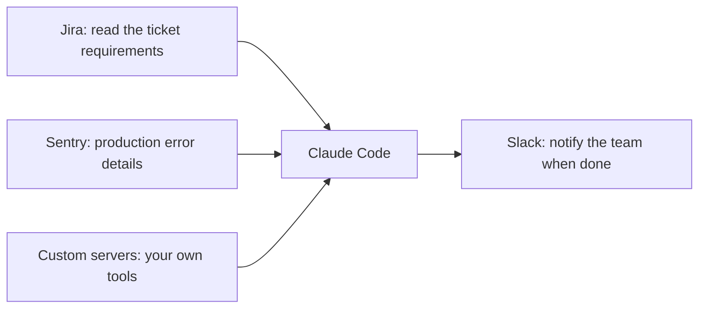

Think about the external services you use every day: there's probably an MCP server that connects them to
Claude Code.

## 4. Parallelizing Claude Code

Running **several Claude Code instances in parallel** is one of the biggest productivity gains. Claude is
lightweight, so you can start several copies, give each one a different task and let them work at the same
time: in practice, a team of virtual software engineers on your project.

### The challenge: file conflicts

If all the instances work on the **same folder**, they can edit the same files at the same time. Each instance
doesn't know what the others are doing, so the result can be conflicting or invalid code.

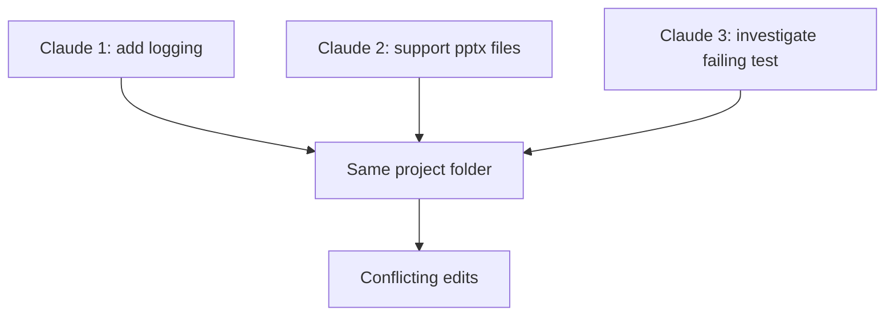

The solution: give each instance its **own workspace**. Each one works on its own copy of the project, in
isolation, and then its changes are merged back into the main project.

### Git worktrees

**Git worktrees** fit this perfectly. If the project already uses Git, you can use them right away. They extend
Git branching: each worktree is a **full copy of the project in a separate folder**, linked to its **own
branch**.

| Folder | Branch | Content |
|---|---|---|
| `.trees/feature_a` | `feature_a` | Full copy of the codebase |
| `.trees/feature_b` | `feature_b` | Full copy of the codebase |

You run an independent Claude Code instance in each worktree. When an instance finishes, you commit its work
and merge the branch into `main`, like any other Git branch.

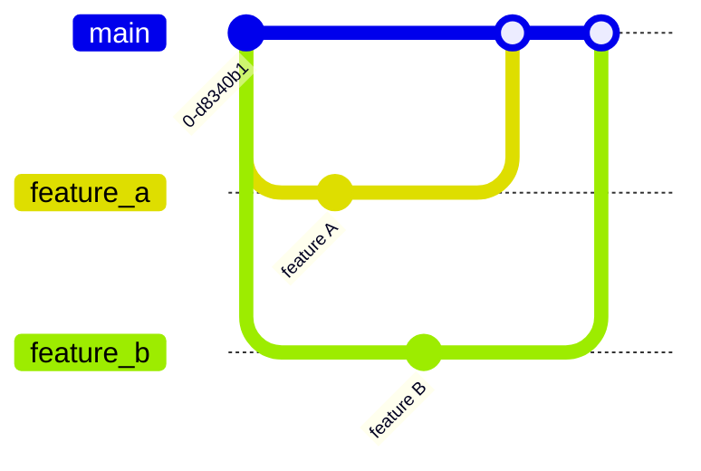

> Note (not in the lesson): the Git commands behind it:
>
> ```bash
> git worktree add .trees/feature_a -b feature_a   # new folder + new branch
> git worktree list                                 # show all worktrees
> git worktree remove .trees/feature_a              # delete it after merging
> ```
>
> Add `.trees/` to `.gitignore` so the worktrees aren't committed into the main project.

### Automating worktree creation

You don't have to manage this by hand: you can ask Claude Code to do it. A prompt that asks Claude to:

1. Create a new git worktree called `feature_a` in the `.trees` folder (and stop if it already exists).
2. Create **symlinks** for the dependencies that Git doesn't track (e.g. `.venv`).
3. Open a new VS Code window in that folder (`code .trees/feature_a`).

### Custom commands

Instead of pasting a long prompt every time, turn it into a **custom slash command**: a `.md` file in
`.claude/commands/`. The file can use **`$ARGUMENTS`**, which is replaced by whatever you pass to the command.

| Command | Result |
|---|---|
| `/project:create_worktree feature_a` | Creates a worktree called `feature_a` |
| `/project:create_worktree develop` | Creates a worktree called `develop` |

My version of `.claude/commands/create_worktree.md` (not the lesson's exact text):

```markdown
Create a git worktree called $ARGUMENTS in the .trees folder, on a new branch $ARGUMENTS.
If .trees/$ARGUMENTS already exists, stop and tell me.
Create a symlink of the .venv folder inside the new worktree.
Open the worktree in a new VS Code window with: code .trees/$ARGUMENTS
```

> Note (not in the lesson): in current versions of Claude Code the `project:` prefix is gone; the command is
> just `/create_worktree feature_a`. Project commands live in `.claude/commands/` (shared through Git) and
> personal ones in `~/.claude/commands/`.

### Parallel development in action

With one worktree per feature, each VS Code window runs its own Claude Code on its own task:

| Worktree | Task |
|---|---|
| 1 | Update the document tests |
| 2 | Add logging |
| 3 | Add note-taking tools |
| 4 | Add a subtraction tool |

### Merging the changes

The merge can be automated too, with a second custom command (`.claude/commands/merge_worktree.md`) that asks
Claude to:

1. Go into the worktree folder `.trees/$ARGUMENTS`.
2. Look at the latest commit to understand the changes.
3. Go back to the root folder.
4. Merge the worktree branch.
5. Resolve any merge conflicts (using commands like `git status` to list them).

Claude can resolve merge conflicts by itself, because it understands what changed in each branch.

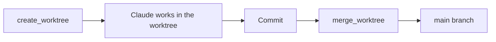

### Results

This scales to as many parallel instances as **you** can manage. Instead of building features one after
another, several Claude instances build different parts of the project at the same time, each in its own
isolated environment, and then their work is merged. Your development capacity is multiplied by the number
of instances you run.

## 5. Automated debugging

Claude isn't only for writing code in your editor: it can also **watch your production app and fix errors
automatically**, often before users notice them.

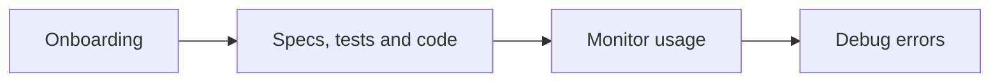

### The problem: production-only errors

The classic case: the app works perfectly in development but fails in production.

Example from the lesson: a simple chatbot works locally (answers questions, generates spreadsheets with fake
data). Deployed on **AWS Amplify**, the same tests run, but spreadsheet generation **fails silently**: the
request completes, but no data shows up.

### Traditional debugging

| Step | Manual work |
|---|---|
| 1 | Search the **CloudWatch** logs for error messages |
| 2 | Read complex errors and stack traces |
| 3 | Work out why the code behaves differently in production |
| 4 | Fix and redeploy |

Slow, especially with cryptic messages like *"The provided model identifier is invalid"* buried in a long log.

### Automated error detection and fixing

Instead, a **GitHub Action** runs every day, checks production and hands the whole debugging process to
Claude:

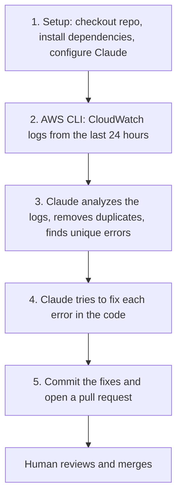

My sketch of the workflow (not from the lesson, untested):

```yaml
name: daily-debug
on:
  schedule:
    - cron: "0 3 * * *"          # every day, low-traffic hours
permissions:
  contents: write                # push the fix branch
  pull-requests: write           # open the PR
  id-token: write                # AWS OIDC login

jobs:
  debug:
    runs-on: ubuntu-latest
    steps:
      - uses: actions/checkout@v4
      - uses: aws-actions/configure-aws-credentials@v4
        with:
          role-to-assume: ${{ secrets.AWS_ROLE_ARN }}
          aws-region: us-east-1
      - run: npm install -g @anthropic-ai/claude-code
      - name: Get the last 24h of errors
        run: |
          aws logs filter-log-events \
            --log-group-name /aws/amplify/my-app \
            --start-time $(date -d '24 hours ago' +%s000) \
            --filter-pattern ERROR \
            --max-items 200 > errors.json
      - name: Let Claude fix them
        env:
          CLAUDE_CODE_USE_BEDROCK: "1"
          AWS_REGION: us-east-1
        run: |
          claude -p "Read errors.json. Remove duplicates, find the unique errors, fix each one in the code \
          and write a summary (error, root cause, fix) in pr_body.md." \
            --allowedTools "Read,Edit,Write"
      - name: Open the pull request
        env:
          GH_TOKEN: ${{ github.token }}
        run: |
          git checkout -b auto-fix/$(date +%F)
          git add -A ':!errors.json' ':!pr_body.md'
          git -c user.name=claude-bot -c user.email=bot@example.com commit -m "Automated fixes from production logs"
          git push origin HEAD
          gh pr create --title "Automated fixes $(date +%F)" --body-file pr_body.md
```

> Anthropic also has an official GitHub Action for this (`anthropics/claude-code-action`), which supports
> Bedrock.

### Real-world example

In the chatbot, Claude found that production used an **invalid model ID**: a typo in the model identifier that
only appeared in the production config. Claude found the correct ID format, updated the config file
(`lib/ai/providers.ts`) and opened a PR with three sections: **Error**, **Root cause** and **Fix
implemented**.

> Note (not in the lesson): on Bedrock this error is common with newer models, which must be called through an
> **inference profile** ID with a region prefix (e.g. `us.anthropic.claude-...` or `global.anthropic.claude-...`)
> instead of the base model ID.

### Benefits

| Benefit | Why |
|---|---|
| Proactive monitoring | Catches errors before you even know they exist |
| Time savings | No more digging through logs by hand |
| Clear documentation | Every fix comes with an explanation |
| Review process | The PR lets you check the fix before merging |
| Continuous improvement | Runs every day and catches new problems |

### Implementation considerations

- **AWS permissions** to read CloudWatch (e.g. `logs:FilterLogEvents`), plus `bedrock:InvokeModel` if Claude
  runs on Bedrock.
- A **limit on the number of errors** processed, to stay within the context window.
- **Deduplication** logic for similar errors.
- **Write permissions** on the repo so the workflow can create pull requests.
- Run it during **low-traffic hours**.

Debugging goes from a reactive, manual process to a proactive, automated one with minimal intervention.

## 6. Computer Use

**Computer Use** lets Claude interact directly with a **desktop environment**, controlling a computer the way a
person would. Claude doesn't just describe what to do or generate code: it **does the task**.

The lesson's roadmap:

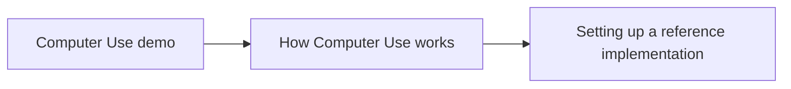

### What Computer Use can do

| Action | Example |
|---|---|
| Take screenshots | See what's on the screen |
| Click | Buttons and links |
| Type | Text in forms and apps |
| Navigate | Between apps and browser tabs |
| Follow multi-step processes | Tasks that need visual feedback at every step |

This makes it especially useful for **QA testing**, where you have to use a UI and check that everything works.

### Real-world example: automated QA testing

A React component with **autocomplete**: typing `@` lets the user mention files or resources (e.g.
`@document.pdf` becomes a mention chip in the textarea). It looks fine at first sight, but you want to test the
edge cases. Instead of testing by hand, you give Claude the test cases:

| # | Test case | Result |
|---|---|---|
| 1 | Typing `Did you read @` shows the autocomplete options | ✅ Pass |
| 2 | Pressing **Enter** adds the mention to the textarea | ✅ Pass |
| 3 | Pressing **Backspace** after adding mentions shows the autocomplete list in the right position | ❌ Fail: the list appears at the top of the page |

To press Enter, for example, Claude calls the computer tool with the action `key` and the text `Return`.
Claude found a real bug that's easy to miss when testing by hand.

### How the testing process works

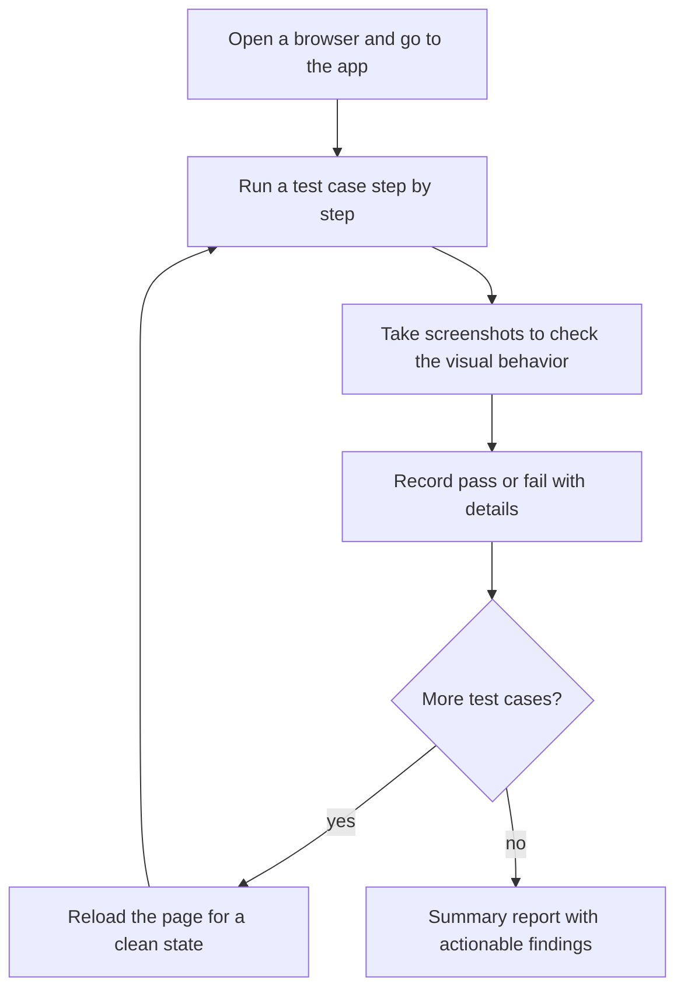

The key advantage: Claude catches problems you might miss, and can run **the same tests consistently** every
time the code changes.

### Setting up Computer Use

Computer Use runs in an **isolated environment** for security:

- A **Docker container** running a desktop environment.
- A **browser** that Claude can control.
- A **chat interface** where you give Claude instructions.
- **Full isolation** from your main system.

The isolation is key: Claude can use apps and websites with no risk to your personal data or your system.

> Note (not in the lesson): Anthropic's reference implementation is the `computer-use-demo` in the
> `anthropic-quickstarts` repo on GitHub. It runs in Docker and can use Claude on Bedrock
> (`API_PROVIDER=bedrock` plus your AWS credentials).

### Best practices

- Be **specific** about what Claude should test or do.
- Give **clear success criteria** for each task.
- Break complex workflows into **smaller steps**.
- Always run Computer Use in **isolated environments**.
- **Review** Claude's findings and check the important results yourself.

Computer Use moves Claude from *generating text about tasks* to *actually doing them*: QA testing, repetitive
workflows, exploring complex apps, with consistent and documented results.

## 7. How Computer Use works

Computer Use is **just tool use** (Module 4). The only difference is what the tool does: instead of calling a
weather API or a database, Claude asks to **control a computer interface**.

### Tool use recap

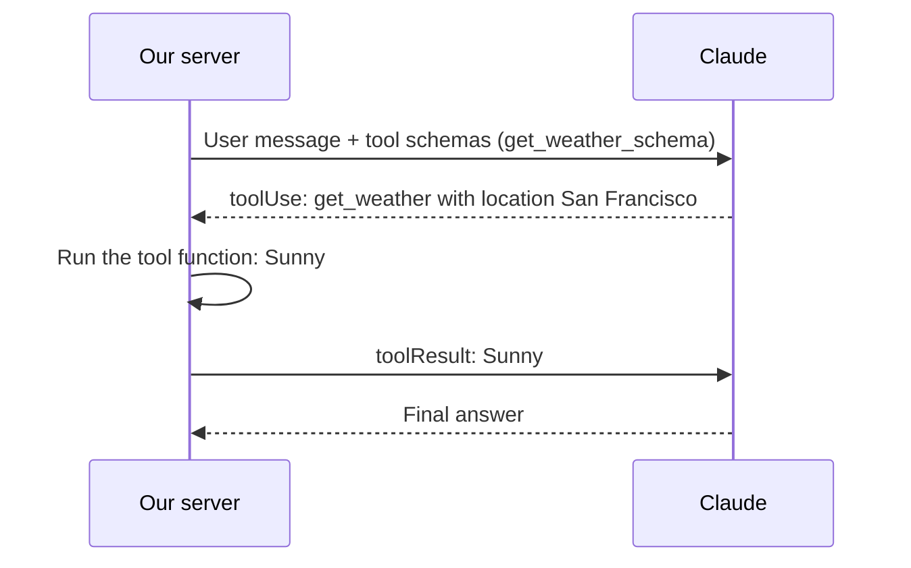

1. Send Claude the question plus the available tool schemas.
2. Claude decides it needs a tool.
3. Claude replies with a tool use request (tool name + inputs).
4. Our server runs the function.
5. We send the result back to Claude.

### Same flow, different tool

With Computer Use the pattern is identical, but the "tool" **simulates computer interactions**: mouse clicks,
keyboard input, screenshots. Our server runs those actions in a **Docker container with Firefox**.

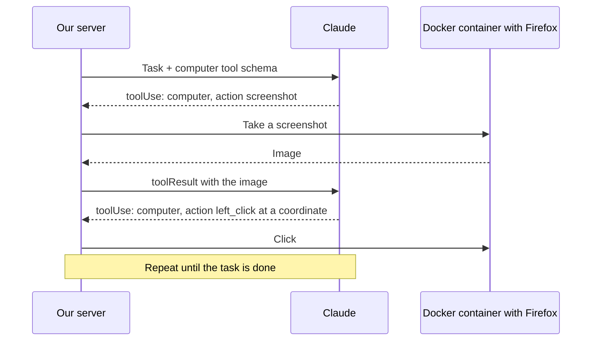

The schema you send is **tiny**: just the tool type and the screen size. Behind the scenes it **expands** into a
full specification that tells Claude everything it can do:

| What you send (`computer_20250124`) | What it expands to (main properties) |
|---|---|
| Tool type, name, screen width and height | `action`: e.g. `screenshot`, `left_click`, `mouse_move`, `type`, `key`, `scroll` |
| | `coordinate`: `[x, y]` on the screen |
| | `text`: text to type or keys to press (e.g. `Return`) |
| | `duration`: e.g. how long to hold a key or wait |

In Bedrock Converse format (my sketch, not from the lesson; check the exact fields and beta flag in the Bedrock
docs for your model):

```python
computer_tool = {
    "type": "computer_20250124",
    "name": "computer",
    "display_width_px": 1024,
    "display_height_px": 768,
}

response = client.converse(
    modelId=model_id,
    messages=messages,
    additionalModelRequestFields={
        "tools": [computer_tool],                    # Anthropic-defined tool, not a toolSpec
        "anthropic_beta": ["computer-use-2025-01-24"],
    },
)
```

Each `toolUse` from Claude then has an `input` like `{"action": "left_click", "coordinate": [512, 300]}` or
`{"action": "key", "text": "Return"}`. For `screenshot`, the `toolResult` carries the image:

```python
tool_result = {
    "toolResult": {
        "toolUseId": tool_use["toolUseId"],
        "content": [{"image": {"format": "png", "source": {"bytes": screenshot_bytes}}}],
    }
}
```

### The technical implementation

You need an environment that can **run Claude's actions programmatically**. The reference implementation uses a
Docker container with Firefox, plus code that simulates key presses and mouse movements.

The key idea: **Claude doesn't control the computer directly**. It only makes tool requests; **your
infrastructure** turns them into real clicks and keystrokes.

| Who | Does what |
|---|---|
| Claude | Looks at screenshots and decides the next action (tool request) |
| Your server | Receives the request and runs it in the container |
| Container | Real desktop and browser where the actions happen |

### Getting started

You don't have to build this from scratch: Anthropic's **reference implementation** handles the hard parts.

Prerequisites:

- A **Docker runtime** (e.g. OrbStack).
- An **AWS profile** configured locally (usually `default`) — get the name from your credentials file.
- The reference implementation from the **anthropic-quickstarts** repo.

One `docker run` starts it. You get a **chat on the left** to talk to Claude and a **browser on the right**
where Claude works. The demo warns you never to give it access to sensitive accounts or data.

> Note (not in the lesson): the command, roughly as in the quickstart's README (check it there before running):
>
> ```bash
> docker run \
>   -e API_PROVIDER=bedrock \
>   -e AWS_PROFILE=default \
>   -e AWS_REGION=us-west-2 \
>   -v $HOME/.aws:/home/computeruse/.aws \
>   -v $HOME/.anthropic:/home/computeruse/.anthropic \
>   -p 5900:5900 -p 8501:8501 -p 6080:6080 -p 8080:8080 \
>   -it ghcr.io/anthropics/anthropic-quickstarts:computer-use-demo-latest
> ```
>
> Then open `http://localhost:8080`.

## 8. Qualities of agents

After looking at Claude Code and Computer Use, some clear patterns show **what makes an agent work**: focused
tool use, awareness of the environment, and iterative execution.

### How agents work in practice

Example: Claude Code is asked to **add a test** for `document_path_to_markdown`. It makes four tool calls:

| # | Tool call | Type |
|---|---|---|
| 1 | Read an existing file | 👀 Observe |
| 2 | Read another existing file | 👀 Observe |
| 3 | Update the test file | ✏️ Act |
| 4 | Run the tests (success criteria) | 👀 Observe |

Three of the four calls only **gather information** from the environment; just one changes it. This
**"observe first, then act"** pattern shows up in both agents.

Computer Use does the same: every tool call (`screenshot`, `left_click`, `type`...) **returns a screenshot**,
so Claude always sees the current state of the UI and adjusts its next action.

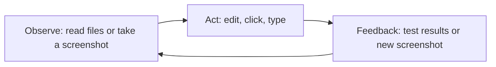

### Comparing the two agents


&nbsp;

| | Claude Code | Computer Use |
|---|---|---|
| Uses tools in a loop until success or error? | Yes | Yes |
| Where does the context come from? | Tool calls (reading files, running commands), not a long prompt or RAG | Tool calls (screenshots) |
| Toolset | Small and well defined | Small and well defined |
| Type of task | High value, complex | High value, complex |
| Cost of an error | Low, but not negligible | Very low |

### Key qualities of effective agents


&nbsp;

| Quality | What it means |
|---|---|
| **1. Focused toolset, run in a loop** | A few simple, well-defined tools, run again and again until the success criteria, an error or an **iteration limit**. The loop lets the agent correct its course |
| **2. Context is everything** | Claude knows nothing about your environment. It needs tools to read the current state; the quality of that context drives the agent's performance |
| **3. High-value tasks with low cost of error** | Complex, knowledge-heavy work where mistakes can be caught and fixed (e.g. writing code). Avoid agents for high-risk decisions with serious economic or safety impact |
| **4. Continuous evaluation** | The only reliable way to build good agents: evaluation criteria and constant testing against real scenarios, **including your prompts and tool descriptions** (Module 2) |

Claude Code and Computer Use work well because they're built around these principles. Keep them in mind when
building your own agents.

## Common pitfalls

<!-- pending -->

---

[← Back to README](README.md)
