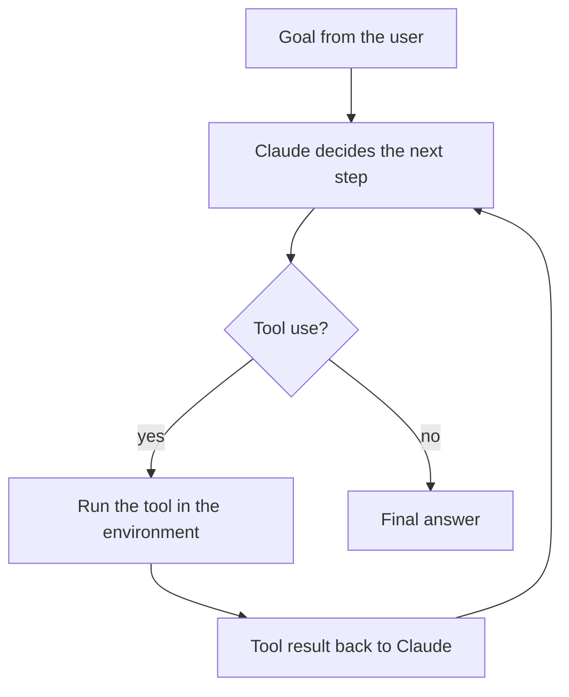
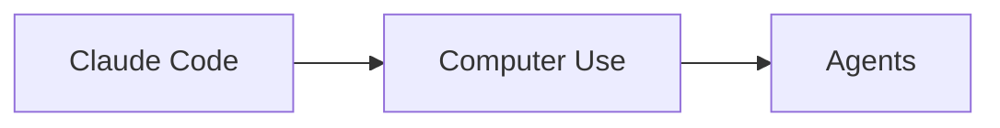
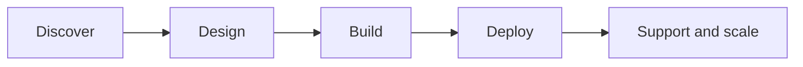
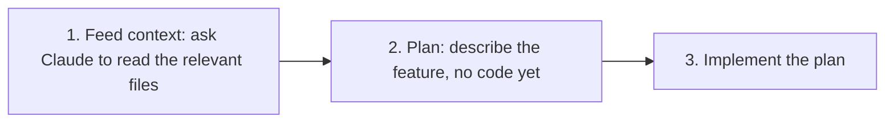

<h1>Module 8 — Agents</h1>

<h2>Contents</h2>

- [1. Agents overview](#1-agents-overview)
  - [Difficulties around agents](#difficulties-around-agents)
  - [Workflow vs agent](#workflow-vs-agent)
  - [The agent loop](#the-agent-loop)
  - [The plan for this module](#the-plan-for-this-module)
  - [When to use an agent](#when-to-use-an-agent)
- [2. Claude Code in action](#2-claude-code-in-action)
  - [The `/init` command and `CLAUDE.md`](#the-init-command-and-claudemd)
  - [Common workflows](#common-workflows)
    - [Plan first](#plan-first)
    - [Test-driven development (TDD)](#test-driven-development-tdd)
  - [Practical tips](#practical-tips)
- [3. Adding MCP servers to Claude Code](#3-adding-mcp-servers-to-claude-code)
- [4. Parallelizing Claude Code](#4-parallelizing-claude-code)
- [5. Automated debugging](#5-automated-debugging)
- [6. Computer Use](#6-computer-use)
- [7. How Computer Use works](#7-how-computer-use-works)
- [8. Qualities of agents](#8-qualities-of-agents)
- [Common pitfalls](#common-pitfalls)

---

## 1. Agents overview

> Note: in the course this lesson is video only. "Difficulties around agents" and "The plan for this module"
> come from the video slides; the rest (workflow vs agent, the agent loop and when to use an agent) is general
> background I added.

An **agent** is Claude plus a set of **tools**, running in a **loop**. You give it a goal; Claude decides which
tool to use, looks at the result and chooses the next step, until the task is done. In the previous modules
**our code** decided the sequence of calls. In an agent, **the model decides the path**.

### Difficulties around agents

Building agents is hard: design patterns and best practices are **still emerging**. Open questions:

| Topic | Question |
|---|---|
| **What is an agent?** | There's no single, agreed definition |
| **Agents vs workflows** | Is an agent the right solution, or would a workflow be enough? |
| **Development** | Framework or no framework? Imperative or declarative? |
| **Design patterns** | When do you go beyond a single basic agent? |
| **Testing and evaluation** | How do you know the agent works as expected? |
| **Context** | How do you make sure the agent has the right context to solve the problem? |

### Workflow vs agent

| | Workflow | Agent |
|---|---|---|
| Who decides the steps | Our code (predefined) | Claude, at runtime |
| Use when | The steps are known in advance | The steps can't be predicted |
| Cost and latency | Lower and predictable | Higher and variable |
| Testing | Easy: same path every time | Harder: the path changes |
| Example | Prompt chaining, routing, RAG pipeline | Claude Code fixing a failing test |

Rule of thumb: start with the simplest option (a single prompt, then a workflow) and move to an agent only when
the task really needs flexibility.

### The agent loop



It's the same loop as `run_conversation` in Module 4. The difference is in scale: more tools, more
iterations, and real actions on the environment (files, commands, browser, screen). That's why an agent needs
a **stopping condition**:

```python
def run_agent(messages, tools, max_turns=20):
    for _ in range(max_turns):
        result = chat(messages, tools=tools)
        add_assistant_message(messages, result["parts"])

        if result["stop_reason"] != "tool_use":
            return result["text"]          # task done

        tool_result_parts = run_tools(result["parts"])
        add_user_message(messages, tool_result_parts)

    raise RuntimeError("Agent stopped: max_turns reached")
```

> Note: `max_turns` isn't in the lesson. I added it because a `while True` loop with an agent can run (and
> cost) forever.

### The plan for this module

Instead of building an agent from scratch, the module studies two agents made by Anthropic and then extracts
what makes them work:



| Step | What it is | Focus |
|---|---|---|
| **1. Claude Code** | Agentic coding assistant made by Anthropic that runs in the terminal | Edit files, fix bugs, answer questions about the code... |
| **2. Computer Use** | Set of tools that let Claude interact with a desktop computer environment | Access websites, interact with apps... |
| **3. Agents** | Wrap-up of the two examples | What makes Claude Code and Computer Use successful? |

### When to use an agent

- The task is **open-ended** and you can't write the steps in advance.
- Claude can **check its own work** (tests, error messages, screenshots).
- Mistakes are **cheap or reversible**, or a person reviews the sensitive actions.

## 2. Claude Code in action

Claude Code is more than a code generator. It's meant to be a **coding partner for the whole project
lifecycle**, from the initial setup to deployment and maintenance:



> Note (not in the lesson): to run Claude Code with Claude on **Amazon Bedrock**, set
> `CLAUDE_CODE_USE_BEDROCK=1` and `AWS_REGION`, and have your usual AWS credentials configured.

### The `/init` command and `CLAUDE.md`

`/init` is the first step in a new project. Claude Code scans the codebase (structure, dependencies, commands,
coding patterns) and writes a summary to **`CLAUDE.md`**. Claude reads this file **automatically** at the start
of every future conversation.

You can pass extra instructions to `/init` to point Claude at the areas you care about.

There are three scopes:

| Scope | Committed to git? | Use | File (not in the lesson) |
|---|---|---|---|
| **Project** | Yes, shared with the team | Commands, conventions, architecture | `./CLAUDE.md` |
| **Local** | No | Your personal notes for this project | `./CLAUDE.local.md` |
| **User** | — | Instructions for all your projects | `~/.claude/CLAUDE.md` |

The lesson mentions the `#` shortcut to add a quick note to `CLAUDE.md`.

> Note (not in the lesson): in recent versions of Claude Code you can also edit the memory files with the
> `/memory` command, or just ask Claude to add the note to `CLAUDE.md`.

Anything you write in `CLAUDE.md` (coding standards, project notes, architecture decisions) affects **every
future conversation**, so Claude gets better as the file grows.

### Common workflows


Claude works best as an **effort multiplier**: the more context and structure you give it, the better the result. Two workflows that work well:

#### Plan first

Good for complex features:



Example: for a document conversion tool, first ask Claude to look at the existing tools and helper functions,
then ask for an implementation plan, and only then for the code.

> Note (not in the lesson): Claude Code also has a **plan mode** (`Shift+Tab`) where Claude can read and
> plan but not edit files.

#### Test-driven development (TDD)

More effort at the start, but much better results:

| Step | What you ask Claude |
|---|---|
| 1. Context | Read the files related to the feature |
| 2. Test cases | Think of test cases, **without writing code yet** |
| 3. Tests | Implement only the tests that are relevant |
| 4. Code | Write code that makes the tests pass; Claude iterates until they're green |

The tests give Claude a clear way to **check its own work**, and they cover edge cases you might not have
thought of.

| | Plan first | TDD |
|---|---|---|
| Best for | Complex features | Code that must be robust |
| Upfront effort | Low | Higher |
| How Claude checks its work | Against the plan | Against the tests |

### Practical tips

Beyond writing code, Claude can handle routine development tasks:

- Set up the project environment and install dependencies.
- Stage and commit changes with descriptive commit messages.
- Run the test suite and interpret the results.
- `/clear` to reset the conversation context (for example, between unrelated tasks).

## 3. Adding MCP servers to Claude Code

<!-- pending -->

## 4. Parallelizing Claude Code

<!-- pending -->

## 5. Automated debugging

<!-- pending -->

## 6. Computer Use

<!-- pending -->

## 7. How Computer Use works

<!-- pending -->

## 8. Qualities of agents

<!-- pending -->

## Common pitfalls

<!-- pending -->

---

[← Back to README](README.md)
